# GitHub 项目研究索引

记录最近遇到的优秀 GitHub 项目：为什么值得研究、如何运行、实现原理，以及基于研究制作的 Web 演示。

这是多个子项目的总入口。每个子项目拥有固定编号、独立研究文档与图片资源；需要展示时，可在同一个 GitHub Pages 站点下发布独立路径。

[收录与研究指南](docs/project-guide.md) · [Web 发布指南](docs/deployment.md) · [子项目目录](projects/) · [项目模板](templates/project/)

## 有序索引

编号按收录先后分配，从 `001` 开始，目录采用 `001-project-name`。已有编号保持不变，归档后保留索引，新增项目使用下一个编号。

<!-- PROJECT_INDEX:START -->
共收录 **19** 个项目 · 待研究 0 · 研究中 1 · 复现中 0 · 已完成 17 · 已归档 1

### 19个项目研究概览

每项按“能力 → 我们的研究 → 借鉴意义”阅读，点击名称继续了解项目；具体实验与未验证范围见各项目记录。

- **001 · [Motion Video Kit](projects/001-motion-video-kit/)**：**能力：** 提供商业短片策划、代码动画与独立评审工作流；**研究：** 制作24秒本地代码短片，验证时间定位、渲染与画面评审；**意义：** 借鉴业务先行、可控修改和制作质检闭环。
- **002 · [Dioramas](projects/002-dioramas/)**：**能力：** 编排外部生成素材、共享三维引擎与网页交互；**研究：** 整理20个案例，以简化离心泵验证旋转、展开和流向；**意义：** 指导素材与体验解耦、状态控制和设备讲解页面开发。
- **003 · [Oil UI](projects/003-oil-ui/)**：**能力：** 组织前端设计方向探索、方案比较、取证与评审；**研究：** 制作风格卡与版式小样，实现可保存笔记的研究工作台；**意义：** 借鉴设计约定与决策记录，让探索和修改有依据。
- **004 · [Dvor](projects/004-dvor/)**：**能力：** 以程序建模与风格化渲染构成可漫游的三维庭院；**研究：** 完成四站社区导览，验证风格调参、保存与提示词工具；**意义：** 指导视觉规则复用及地点、镜头和内容的关联。
- **005 · [Awesome GPT-6 Astra](projects/005-awesome-gpt-6-astra/)**：**能力：** 收集模型参与制作的游戏与互动作品，提供试玩和部分源码入口；**研究：** 整理175项目录，本地运行轨道花园并适配交互背景；**意义：** 发现创意和可研究案例，复用前逐项核对源码与许可。
- **006 · [BeefTV](projects/006-beeftv/)**：**能力：** 把画布、模型任务、助手操作与剪辑连接为视频工作台；**研究：** 拆解本地架构与受控操作，验证交互说明页（未运行桌面生成）；**意义：** 指导异步生成、资产追踪与统一剪辑流程设计。
- **007 · [Seiso 文档检查](projects/007-seiso/)**：**能力：** 检查Markdown结构、引用和重复维护问题；**研究：** 拆解27条规则与配置边界，完成研究网页（未实跑CLI）；**意义：** 为总库文档内容检查、事实归属和复现记录提供参考。
- **008 · [Realtime 语音与3D联动](projects/008-openai-realtime-solar-system/)**：**能力：** 让实时语音通过工具调用联动对象、镜头、动画与图表；**研究：** 制作关键词驱动的Three.js交互示意（未接通真实语音）；**意义：** 指导语音会话、动作映射与可见反馈的联动设计。
- **009 · [Functional Emotions 油画MV](projects/009-functional-emotions-video/)**：**能力：** 逐帧程序绘画，以音乐时间同步油画笔触、镜头和动作；**研究：** 验证原版八章，制作并导出32秒原创有声短片；**意义：** 复用油画渲染、确定性时间轴与可修改的代码动画。
- **010 · [Lemo-Opuscar 风格与制片](projects/010-lemo-opuscar/)**：**能力：** 提供43种风格规范、导演编排与代码短片制片工具；**研究：** 整理样片索引并运行蓝图画面（完整Agent制片未复跑）；**意义：** 沉淀审美与叙事规范，建立可修改、可重渲染的短片流程。
- **011 · [ShipVideo 网页信息转短片](projects/011-shipvideo/)**：**能力：** 从网页或简报组织叙事，生成代码绘制的静音解释片；**研究：** 拆解任务链与虚拟时钟，完成研究网页（上游生成未运行）；**意义：** 借鉴资料读取、内容编排、动画代码与稳定渲染的流程。
- **012 · [Motion Graphics 音乐MV](projects/012-motion-graphics-music-video/)**：**能力：** 以已有歌曲为时间轴，组织模型素材、代码编排与合成；**研究：** 拆解制作协议与素材任务管理，展示作者样片（未运行制作）；**意义：** 借鉴模型与代码分工、音乐同步、局部修订和问题追踪。
- **013 · [新疆互动知识沙盘](projects/013-xinjiang-knowledge-sandbox/)**：**能力：** 参考视频从全球定位、自然条件和人文联系逐层认识地方；**研究：** 独立实现地球与DEM原型、四主题52幕及自由接管（源库未确认）；**意义：** 先设计认识问题、证据和地图层级，再制作模型与表现。
- **014 · [中文Token叙事短片](projects/014-chinese-token-cinema/)**：**能力：** 参考音乐短片以人物演唱与词块编号组织技术叙事；**研究：** 制作中文演唱与分词字幕初版，保留未达标的口型同步测试；**意义：** 指导声画同步、技术叙事与素材质量验收。
- **015 · [Three ILDA 激光与舞台](projects/015-three-ilda/)**：**能力：** 将激光点序列转为三维场景中的扫描、余辉与光束；**研究：** 完成激光节目实验、五套舞台模板及三类内容共享配置；**意义：** 指导激光组件、舞台资产与业务内容的分工复用。
- **016 · [Agenvo 远程Agent连接](projects/016-agenvo/)**：**能力：** 通过自托管MCP中继远程接入多种原生Agent会话；**研究：** 核查连接、适配与权限机制，完成研究网页（未实跑Agent）；**意义：** 指导统一接入、自托管部署与上层任务编排的边界。
- **017 · [Alook 群聊共享Agent](projects/017-alook/)**：**能力：** 让获准群聊成员共同调用本地Agent并共享上下文；**研究：** 梳理消息唤醒、驱动与记忆恢复，完成网页（未实跑Agent）；**意义：** 指导共享研究助手的消息流、持续协作与业务验收。
- **018 · [抖音内容工作流](projects/018-ah-douyin-clean-downloader/)**：**能力：** 串联视频采集、本地识别、资料归档与口播改写；**研究：** 核查采集分工、环境和续跑流程，完成网页（未实跑下载识别）；**意义：** 指导素材来源记录、恢复检查点与跨平台选型。
- **019 · [LibTV Skills 创作服务接入](projects/019-libtv-skills/)**：**能力：** 提供专用云端创作服务的上传、会话查询与结果下载入口；**研究：** 拆解客户端与云端分工、接口耦合，完成网页（未实测生成）；**意义：** 参考素材与会话交付，对自建创作系统的直接复用价值有限。

### 详细索引

| 编号 | 子项目 | 研究摘要 | 状态 | 标签 | 来源 | Web |
| --- | --- | --- | --- | --- | --- | --- |
| 001 | [Motion Video Kit 研究与演示](projects/001-motion-video-kit/) | **定位：** 让AI助手制作15–40秒商业说明片的Skill、参考资料、工具与模板；核心是制作方法和质量闭环。<br>**能力：** 业务目标与分镜、HTML/SVG清晰文字、GSAP动效、Three.js结构与投影标注、真实或AI素材组织、独立评审、音效处理与客观测量。<br>**模块：** 1个Skill组织9步流程；11份参考文档覆盖业务、动效、三维、质量、音频与案例；7个脚本辅助测量和混音；2个模板提供组件实验与三维锚点投影。<br>**原理：** 统一时间t计算场景姿态与标签，HyperFrames定位时间，Chrome逐帧捕获，FFmpeg编码；模板不依赖Remotion，方法可迁移，接口需适配。<br>**演示与证据：** 全景图引导中文网页；本地24秒1280×720/30fps静音演示，从GitHub链接到编号研究页，46项DOM状态路径一致、3轮画面评审；ALDER与手机案例仅引用作者复盘。<br>**场景：** SaaS与开发工具发布、硬件与电商结构展示、家居服务过程说明、广告变体与视频改进；适合卖点明确、文字需要准确修改的短片。<br>**价值：** 业务先行、确定性画面控制、制作与评审分离、素材与版本可追溯；可借鉴制作方法与质量闭环，已有测量不能证明广告转化。<br>**扩展：** 参数化行业模板、统一制作与质检入口、Remotion与多画幅适配、真实GLB与证据管理、时间点人工评审、实际投放实验；均为未来设想。<br>**边界：** 不是开箱即用的一键成片服务；场景与评审要配置，模型按需接入，部分脚本带案例固定参数。上游三维、AI素材与混音未在本地完整复现，依赖许可分别适用。 | 已完成 | AI视频 / HyperFrames / GSAP / 研究工作流 | [原仓库](https://github.com/echris6/motion-video-kit) | [演示](https://yydshly.github.io/1009_codex_project/001-motion-video-kit/) |
| 002 | [Dioramas：3D 网页编排与场景实验](projects/002-dioramas/) | **定位：** AI 素材流水线、共享 3D 网页引擎与 20 个完整交互案例；通过设计和代码把形状、材质、镜头、行为及内容组织成作品。<br>**能力：** 调度外部生图和图转 3D、记录任务与结果、优化模型和贴图、资源加载、PBR 与后期、输入和滚动、状态动画、HTML 内容协同与截图检查。<br>**模块：** 生成与优化脚本；engine/assets/input/scroll/ui/reflector/volumetric/textures/worlds 共 9 个共享核心模块；各案例代码与内容；7 项生产、截图和评审工具。<br>**原理：** 制作时经 fal 调用 Nano Banana 2 和 Meshy 7.1，生成并压缩资产；访问时加载素材，输入更新状态，代码逐帧改变镜头、物体和效果，WebGL/GPU 与 HTML 同步呈现。<br>**效果与证据：** 沿用完整中文引导图，展示 20 张约 1.8 MB 的署名上游截图；本地离心泵支持旋转、拾取、展开、透视、流向与重置，上游交互和 AI 生成未完整复跑。<br>**场景：** 品牌和产品发布、在线展览、艺术与自然主题、设备售前和部件认知；适合体验与内容共同表达的页面，需权衡性能、易用性和制作成本。<br>**价值：** 素材与体验解耦、通用运行机制复用、设计参数可修改、输入到内容的反馈可控制、生成任务与画面检查可追踪；没有据此验证商业转化或效率提升。<br>**扩展：** 授权分件资产与语义标注、SceneConfig 配置化、特效和交互模块化、专业审核的教学任务、画质分级与替代视图、生成和评审台账；均需逐项适配与验证。<br>**边界：** 生成算法来自外部服务，成熟图形库提供底层能力；专属效果和网页设计仍需开发，整体网格不自动分件；无上游模型下载、工业仿真或全部案例运行保证。 | 已完成 | Three.js / 共享引擎 / AI素材调度 / 交互网页 / 视觉编排 | [原仓库](https://github.com/blendi-remade/dioramas) | [演示](https://yydshly.github.io/1009_codex_project/002-dioramas/) |
| 003 | [Oil UI：AI 前端设计方法、约束与复用研究](projects/003-oil-ui/) | **定位：** AI 前端设计 Skill、参考方法与辅助工具，用可比较的产物和当前画面证据组织设计决策；具体实现由宿主模型与项目技术栈承担。<br>**能力：** 新界面探索、风格/版式比较、视觉语言、素材与动效设计指导、规范润色、截图还原、只读评审和实际视口取证。<br>**模块：** SKILL.md 路由，方向/视觉/布局/媒体/动效/评审参考，Python 风格卡与对比页生成器，Node/CDP 截图录屏工具，以及用户选择和修改记录。<br>**原理：** 任务与边界驱动方向探索，小样暴露差异，选择写入约定，模型实现，浏览器取证后评审修正。部分结构和资源由代码校验，阶段顺序主要靠文本协议。<br>**模型对照：** 直接模型同样可做优秀作品；Oil UI 显式组织候选、取舍、约定、证据和评审，没有训练新模型，也不自动增加资产或渲染能力。<br>**创意与质量：** 区分任务正确性与审美判断；先要求候选差异，再逐步收敛，精修保留记忆点。模板、动效与评分包含作者偏好，应按目标取舍。<br>**效果与实验：** 原始中文引导图和署名上游样例引导阅读；本地保留 4 张风格卡、3 个版式小样、设计约定、决策记录及可搜索筛选、保存读回和导出笔记的真实研究工作台。<br>**个人与团队价值：** 把模糊感觉变成具体决定，提前暴露方向分歧，减少修改漂移，让判断和交付有依据；适合作为自建 UI、3D 与创意编程 Skill 的研究样本。<br>**使用场景：** 视觉方向未定的新产品、已有页面改善、截图还原、品牌官网与关键组件、只读评审；参考与目标明确的小改动可简化流程。<br>**扩展方向：** 设计约定 schema、阶段状态与门禁、团队参考和偏好库、多维评审、跨设备与业务/可访问性联合验收、图像及 3D 工具接入、规则版本与对照实验。<br>**依据与边界：** 固定 v0.18.0 / 7987bb38，保留 MIT/OFL 与原图。已有本地功能和工具验证，未独立审美评分、未量化质量提升；动效证据仍有缺口，上游作品未完整走查。 | 已完成 | Agent Skill / UI设计 / 设计约束 / 视觉评审 | [原仓库](https://github.com/oil-oil/oil-ui) | [演示](https://yydshly.github.io/1009_codex_project/003-oil-ui/) |
| 004 | [Dvor：风格化世界、程序化建模与社区导览研究](projects/004-dvor/) | **定位：** 可运行和改造的浏览器 3D 漫游作品源码；以作者编排的想象庭院承载生活记忆，没有通用场景编辑器。<br>**能力：** 键鼠行走、跑步、碰撞与台阶，预设翻译和文化注释、设施动画、杨絮、环行电车、球面远景及风格渲染。<br>**模块：** core 的配色/材质/后期/轮廓/纹理/玩家；world 的建模积木/建筑/自然/设施/街道/车库/球面/布局；content 的注释，本地社区与实验工具另行增加。<br>**原理：** 代码生成几何与 Canvas2D 纹理，色带光照和阴影偏色，颜色/深度纹理，深度二阶差分轮廓、调色与 FXAA；人工布局经球面投影显示，行走查询保留平面 XZ。<br>**效果与实验：** 原始全景图引导阅读、保留六类署名原作截图；社区四站路线、热点、相机、中英说明与动画可操作，也可切换真实构建的上游世界。<br>**控制与提示词：** 三套风格预设与实际参数调节、浏览器保存和 JSON 导出；编程/图像模型完整模板支持编辑复制与 TXT 下载，读取当前实验参数，用七项规格和同镜头截图校准独立创作。<br>**价值与场景：** 学习风格的因果关系、复用渲染与积木、把地点与内容关联；适合文化展览、城市记忆、社区校园导览、语言叙事和风格原型，尚无量化效率或转化证明。<br>**扩展：** 真实场地与内容更新、布局配置和编辑、glTF 材质/尺度/碰撞适配、多语言语音与进度、触屏无障碍、LOD、分区加载和设备质量分档；均需额外实现与验收。<br>**边界与依据：** 固定 30d6f68，保留 Dvor/Sakura Crossing/Three.js MIT；核心世界由代码生成，但布局和审美由作者设计。轻量控制，无完整物理/多人/任务系统；响应式模拟不代表真实手机性能，提示词工具不直接调用生成模型。 | 已完成 | Three.js / 风格化渲染 / 程序化建模 / 空间导览 / 模块复用 / 提示词控制 | [原仓库](https://github.com/amirmushichge/dvor) | [演示](https://yydshly.github.io/1009_codex_project/004-dvor/) |
| 005 | [Awesome GPT-6 Astra：作品合集、原理与复用研究](projects/005-awesome-gpt-6-astra/) | **定位：** 社区收集 Astra 参与制作的游戏与互动作品，提供导航与研究入口；非官方性能基准，模型参与按作者资料说明。<br>**能力：** 发现试玩、观察视觉与玩法、追溯部分 Prompt 和开发过程、选择公开源码做小范围复现与改造。<br>**模块：** 固定快照 175 项、六类玩法、五个 works 目录、25 项标注源码入口；另有 README、React 目录站、投稿规则与开发资料。<br>**原理：** 上游 Node 服务解析 Markdown、归类去重、稳定标识、300 秒请求驱动缓存与快照回退；作品经需求、模型辅助、运行反馈和迭代形成。本站构建固定数据，不实时同步。<br>**案例：** 轨道花园用 WebGL 绘制 48,000 颗粒子；雷霆战机用 Canvas / Web Audio；三分天下用 React / TypeScript 规则界面与另行生成素材。<br>**价值与场景：** 减少寻找创意与资料的成本；用于 AI 编程学习、小游戏与交互原型、互动艺术、个人理解与教学演示、团队案例库。<br>**成熟度与限制：** 成熟度不一、整体偏实验；能试玩不等于可稳定复用，25 项源码入口不等于统一开源许可；未逐一实测 175 项，第三方作品各自许可。<br>**扩展方向：** 建议补入口可用性与证据档案、统一实测与兼容性记录、成熟度分层、技术栈与许可检索、验证过的组件模板、版本追踪和参数实验。<br>**网页交付：** 既有中文引导图、完整研究章节、175 项筛选与详情、交互原理；本地轨道花园三形态、暂停、扰动和纯背景效果，运行不调用模型。 | 已完成 | AI编程 / 浏览器游戏 / 案例库 / 创意编程 | [原仓库](https://github.com/MartinDelophy/awesome-gpt-6-astra) | [演示](https://yydshly.github.io/1009_codex_project/005-awesome-gpt-6-astra/) |
| 006 | [BeefTV：从创意到成片的 AI 视频工作台](projects/006-beeftv/) | **定位：** 连接创意、参考媒体、生成任务、助手操作与剪辑成片的本地 AI 视频工作台；无限画布承载创作上下文。<br>**入口与出口：** 手动桌面界面、内置 Pi 与外部 MCP/CLI；输入文案/提示词、图片/视频/音频参考、模型渠道与参数，输出生成素材、可播放下载的视频、可编辑工作区和操作/任务记录。<br>**能力：** 多模态生成、画布与资产组织、分镜及批量任务、Pi 业务工具、媒体工具/时间线/字幕/FFmpeg 导出、渠道和自动化接入；生成画质由具体模型决定。<br>**模块：** 按职责归纳画布、项目与资产、模型目录与协议、异步任务、Pi 与 Skills、受控操作层、媒体工具与剪辑、插件接缝八类；该分类为研究归纳。<br>**原理：** React/Wails → Go 本地 API → SQLite/资源目录；模型合同校验 → 创建/轮询/下载；Pi 工具由 Go 做权限、版本、幂等与撤销；统一剪辑计划分别交给 native/wasm FFmpeg 执行。<br>**效果与证据：** 完整原全景图引导；本页验证三场景、五步骤、15 秒分镜示意与三入口切换，流程卡为说明文件。维护者记录候选版 4 图/8 视频与 15 秒阅读成片两版；本研究未复跑桌面或付费生成。<br>**场景：** 品牌广告与产品展示、短剧和视觉分镜预演、知识/阅读倡议、多模型与 Agent 实验、素材复用和迭代交付。<br>**价值：** 上下文与结果关系可见、生成到剪辑连续、人工与助手协作、模型可替换、资产状态可追踪、职责分工可研究；未量化效率、ROI 或商业转化。<br>**扩展：** 行业模板与品牌约束、新模型合同和适配器、精细声音/剪辑、质量评测与素材选择、可恢复自动化、团队同步与共享资产；列明现有接入点、开发内容和验收目标。<br>**边界：** 默认单用户本地工作区，生成可能向供应商发送参考且收费；工具非任意 shell，模型发现不等于生成验证；VERSION v1.7.14 的发行状态在固定验收中未完成；高级合成、团队协作与端到端性能需另验。 | 已完成 | AI视频工作台 / 多模型生成 / Pi Agent / FFmpeg / 本地优先 / MCP/CLI | [原仓库](https://github.com/glanderness/BeefTV) | [演示](https://yydshly.github.io/1009_codex_project/006-beeftv/) |
| 007 | [Seiso：Markdown 文档检查、规则算法与扩展研究](projects/007-seiso/) | **定位：** Markdown 文档约定及本地静态检查器，把能明确表述的文档维护要求转成可重复执行的检查；元数据决定策略，正文和结构提供检查内容。<br>**能力：** 类型与本地文件目标、例外声明、易变值、对话残留、章节组织、含糊指向、标题锚点、重复定义、相似段落、权威归属和邻近证据；区分默认稳定与预览。<br>**模块：** main/commands、workspace、analysis、config、md、paths、index、sections、rules、diagnostics、cache，分别承担命令、加载、策略、解析、关系检查、输出和缓存。<br>**原理：** Markdown 解析成带原文位置的文档模型，结合类型、语言、领域与路径政策执行词表/正则、结构启发式和集合相似度，形成可追踪诊断；检查过程不调用模型。<br>**处理与集成：** 文本、JSON、SARIF、GitHub 注解及 parse/policy/index 工具；--fix 主要清理确认失效的例外。Claude Code hook、pre-commit、CI 及外部 Agent 可调用 CLI。<br>**使用场景：** AI 经常写改文档、多人协作、多页共享定义、操作手册、文档站点与提交检查；重复的是检查流程，文档内容本身无需重复，少量笔记收益有限。<br>**个人与总库价值：** 补充 README/research/AGENTS 的引用与内容检查，按项目划分比较领域，让定义集中且研究结论有可核查来源；固定 commit 是复现依据，已有元数据和索引校验仍保留。<br>**扩展方向：** 现有配置可扩词表、类型、阈值、领域和站点路由；外部接编辑器与 Agent；业务字段、实验/图片/元数据一致性需新规则，模型语义审阅、检索与存储另建。<br>**边界与交付：** 不是数据库、知识检索或任意 schema 验证器，不抓取外部 URL，不保证事实与证据质量；固定 7e5b3b1 / 0.3.0 / MIT，原始引导图保留，网页与发布可验证，上游 CLI 未独立实跑。 | 已完成 | Markdown / 文档检查 / 静态分析 / AI文档 / 研究规范 | [原仓库](https://github.com/scarletkc/seiso) | [演示](https://yydshly.github.io/1009_codex_project/007-seiso/) |
| 008 | [Realtime Solar System：实时语音、工具调用与 3D 场景联动研究](projects/008-openai-realtime-solar-system/) | **定位：** 现成 Realtime 语音模型与 Spline 预制场景的工程集成样例；太阳系是演示题材，核心增量是会话、工具协议和动作映射。<br>**能力：** 实时语音输入输出；focus\_planet、display\_data、show\_moons、show\_orbit、get\_iss\_position、reset\_camera 六个工具，联动对象、镜头、动画、图表与外部查询。<br>**模块：** 7 组职责：短期凭据接口、实时会话、工具与提示词、场景适配、图表组件、ISS 数据接口、控制与日志；底层语音来自 OpenAI，渲染与动画来自 Spline。<br>**原理：** 服务器签发短期凭据，浏览器以 WebRTC 音频轨道与 oai-events 传输；注册工具，读取 response.done 调用参数，触发 Spline 事件或图表，按 call\_id 回传工具结果。<br>**效果与证据：** 沿用原始中文理解汇总图，保留上游署名截图与独立 Three.js 六类动作、两种图表、自动演示和系统朗读；本地关键词替代模型，真实语音效果未实测。<br>**使用场景：** 对象清晰、动作有限的课堂演示、设备培训、社区 / 展馆导览、产品结构讲解和研究内容检索；关联已有 002、004 及总库，迁移需要对象与资料配置。<br>**对你的价值：** 学习语音 Agent 控制界面的连接方式，为已有 3D 页面补语音入口；若研究新算法、建模或仿真，优先级较低。语音便利性、教学收益与商业价值需真实任务对比。<br>**投入条件：** 需要场景与动画资产、领域对象 ID、可信内容、短期凭据服务器、API 与数据维护，并处理参数、失败与状态；静态研究页可由 Pages 发布。<br>**可扩展方向：** 三动作真实语音实验、参数验证与执行反馈、多调用顺序与取消、可信资料和引用、Spline / Three.js / 普通网页适配、坐标驱动画面、延迟 / 成本 / 成功率评测；均待实现。<br>**技术边界：** 没有新语音算法、通用场景理解、3D 生成或物理模拟；模型图表值未核验，ISS 只触发预设动画，默认成功未验收画面，响应只取首个调用。<br>**依据：** 结论固定到 18025b6（2026-03-04），研究于 2026-10-09、整理于 2026-10-12；保留 MIT 许可，区分源码核查、本地交互验证和未接通的上游语音。 | 已完成 | Realtime API / WebRTC / 工具调用 / Spline / 语音交互 | [原仓库](https://github.com/openai/openai-realtime-solar-system) | [演示](https://yydshly.github.io/1009_codex_project/008-openai-realtime-solar-system/) |
| 009 | [Functional Emotions：油画动画与音乐同步](projects/009-functional-emotions-video/) | **定位与核心：** 音乐驱动创作的代码动画工程。模型在制作阶段设计故事并写动画代码，播放阶段由程序逐帧绘画；原库不是上传音乐自动生成视频的在线服务。<br>**已有效果：** 原版八章、168 镜头、372.7 秒油画叙事可联网播放原曲；新增《光种的旅行》32 秒、90 BPM、六镜头原创有声演示，支持底画／油画与暖金／青绿切换。<br>**能力：** 场景与角色绘制、镜头和动作编排、音乐时间同步、油画笔触与发光处理、参数调整、章节定位、逐帧导出与画面评审。<br>**模块：** 音乐特征与歌词时间、分镜与创作指南、角色及章节场景、确定性时间轴、Canvas2D／WebGL2 画风引擎、播放器、离线输出与质量评审七部分。<br>**原理：** 底画和光层先由 Canvas2D 绘制，WebGL2 用约六万个多尺度笔触按边缘或流场重绘；节拍、强弱和词时间辅助动作与切镜，画面按歌曲时间计算。<br>**创作与约束：** 用户只给画风和大方向，故事、意象、分镜和实现细节由模型发挥；Skill 可沉淀创作流程与检查方法，原库实际使用分镜和动画指南。提供独立于原库的可复制、可下载提示词。<br>**价值：** 成品保留为可修改、可重渲染的代码工程，复用角色、画风、音乐适配方法和评审规则，便于版本迭代、统一系列及与其他视频工作流衔接。<br>**场景与扩展：** 直接方向是音乐定制 MV，可延伸歌词／诗歌影像、科普、文旅、品牌短片与舞台视觉；进一步接入音乐分析、模型分镜写码、批量渲染、版本管理和系列模板。<br>**验证与边界：** 原镜头 504 次采样及原创镜头、音频和交互已验证，原创 MP4 在本机完成导出；公开站默认实时演示。通用自动成片和业务扩展待建设，替换伴奏不会自动改编画面；上游音乐不随 MIT 代码分发。 | 已完成 | 程序动画 / WebGL2 / 油画渲染 / 音乐同步 / AI创作 | [原仓库](https://github.com/ledbetterljoshua/functional-emotions-video) | [演示](https://yydshly.github.io/1009_codex_project/009-functional-emotions-video/) |
| 010 | [Lemo-Opuscar：风格、导演方法与代码制片](projects/010-lemo-opuscar/) | **定位：** 给编程Agent制作风格化新短片的Skill/插件、43种风格规范和共享制片工具；风格决定视觉语言，导演决定叙事与节奏，工具完成画面和音轨输出。<br>**能力：** 题材与观众目标整理、风格选择、创作方案和真实代码风格证明、角色/动作/镜头/转场、配音与配乐、程序拟音、字幕、逐帧渲染、混音、阅读时长与ASR核对、成片和源码交付。<br>**模块：** 按职责分成8类：Skill入口；styles下的STYLE/DEMO/样片；DIRECTOR与TREATMENT；各影片时间线与画面代码及core/lib/post/three；core/render；core/tts与core/audio；readcheck/ASR/SRT/mux；styleboard官方展台。<br>**原理与约束：** Agent按材质、配色、文字、角色表和导演规范编写代码；render\(t\)、DUR、READY与带种子的随机数支持独立帧重现。五轨共享秒数/节拍/事件，浏览器捕获画面，FFmpeg编码和混音。视觉与叙事规则依赖执行和观看评审，工具检查不能保证吸引力。<br>**产品思路：** OPUSCAR98选取98部奥斯卡最佳影片的可识别元素，以同一Clawd角色出演，重新设计画风、动作与镜头，代码重绘成约6分31秒的合集。它展示题材迁移与统一主体的表达方法，区别于43种完整风格工作流。<br>**效果与证据：** 沿用完整中文引导图，原PNG与SVG字节保留；展示43种上游样片和98个致敬片段索引。真实蓝图源码可本地静音运行、暂停和跳转，水墨已实际解码播放；全量视频与Agent制片、TTS、音轨合成尚未完整复跑。<br>**使用场景：** 设备与科学原理、产品功能/发布、数据与研究汇报、文化品牌/文旅、角色IP系列故事、网页效果与程序动画研究；需提供核对过的步骤、功能、数据或原创角色与情节。<br>**个人价值：** 把研究总库和产品内容讲清楚；把审美与导演方法沉淀为自己的表达系统；制作后保留可修改源码、时间线、字幕与素材归属；用同题材比较理解度、声画同步、耗时和修订成本。<br>**扩展方向：** 自有风格包、参数化场景、角色资产管理、真实模型/数据接入、多画幅多语言、互动预览与成片共用、统一制作质检台、版本与观看效果评估。均为建议，需额外实现接口、资产许可、任务调度、性能和内容验证。<br>**环境与边界：** 上游完整制片需要Node20+、Python3.11+/uv、FFmpeg和相应浏览器/GPU环境，Windows建议WSL；本研究网页只需Node22+。它制作新画面，既有视频编辑转换不在Skill范围；中文TTS、模型迁移、作者耗时估计和传播效果未实测。<br>**依据与引导图：** 固定研究a75e2b3384cded87955c8743b5a59db06ea491a8；保留MIT、CREDITS和字体OFL，第三方素材沿用各自归属。沿用2026-10-10生成的1600×4219中文全景图，2026-10-12补齐全面说明与Pages发布。 | 已完成 | Agent Skill / 程序动画 / 导演方法 / 视频制作 / 风格库 | [原仓库](https://github.com/lemomo-ai/lemo-opuscar) | [演示](https://yydshly.github.io/1009_codex_project/010-lemo-opuscar/) |
| 011 | [ShipVideo：从网页信息到代码短片](projects/011-shipvideo/) | **定位：** 由 Agent 编排、用代码绘图的解释短片制作组件。网址提供信息，模型生成动画程序，浏览器与编码器生成视频；固定实现未使用 Remotion 或 HeyGen。<br>**能力：** 读取网页文字与元数据、组织 6–10 个叙事节奏段、绘制动态文字/流程/图表/界面示意、检查技术问题并修改、编码 MP4 与签名下载。创作约束不等于事实核验。<br>**模块：** Next.js 输入和展示、POST 任务创建与 GET 状态 API、OpenComputer 会话客户端和运行环境、导演 Agent、web\_fetch、check\_scene/render\_video 场景工具、自写 renderer 及会话工作区交付。<br>**原理：** 创建会话并发送 JOB，Agent 读取资料、写单份 HTML、检查修改；虚拟时钟按帧推进 rAF、定时器和动画，Playwright/Chromium 截图流交给 FFmpeg。控制的是同一份代码的时间状态，模型重新创作仍有变化。<br>**输入：** 公开 HTTP\(S\) URL 或不超过 2000 字符的文字简报。抓取不执行页面 JS、不登录、不录制真实操作；当前表单不上传图片、视频或文档。已核实的受众、能力、流程与限制更适合作为简报。<br>**输出与效果：** 单份 HTML 是中间产物，最终为 1920×1080、H.264、默认 30 fps 的静音 MP4；导演目标 20–40 秒，工具支持 3–90 秒及 24/30 fps。适合文字和图形驱动的解释片，绘制界面不等于真实产品录屏。<br>**业务价值：** 可能减少重复制作和销售解释成本，服务产品发布、新功能通知等特定内容任务。需要受众、分发渠道和行动入口，以可用成片总成本、有效试用/预约/功能使用验证；未确认获客或收入提升。<br>**对我们的意义：** 当前直接商业价值有限，仅借鉴“读取信息 → 编排内容 → 写动画代码 → 稳定渲染”的流程，研究已核实资料、结构化叙事、可控画面与逐帧交付，暂未接入上游或总库批量制片。<br>**可扩展方向：** 结构化简报与中文模板、关键帧视觉评审、用量与返工记录、竖屏、配音音乐与字幕、真实截图/录屏素材、多模型和本地适配、持久队列及预算管理；均需另行开发和验证。<br>**依据与交付：** 沿用 2026-10-10 的完整原创引导图，PNG/SVG 字节保留；2026-10-12 复核 main 仍为 53d7c6f。记录 Linux arm64/Node.js 22 运行基线及未发现 LICENSE 的事实，交付静态研究网页，未运行付费生成或验证质量、费用、速度与业务收益。 | 已完成 | 代码视频 / Agent / Chromium / FFmpeg / 产品介绍 | [原仓库](https://github.com/diggerhq/shipvideo) | [演示](https://yydshly.github.io/1009_codex_project/011-shipvideo/) |
| 012 | [Motion Graphics MV：音乐驱动的 AI 视频工作流](projects/012-motion-graphics-music-video/) | **定位与目标：** 已有音乐和创意进入制作链，产出完整音乐 MV；Claude Code 插件与制作工具箱，Opus 兼任导演与工程师。流程不训练新生成模型，也不是网页播放器直接生成视频。<br>**能力：** 音乐节拍/起音/能量分析、视觉研究与分镜、角色参考和关键帧、绿幕表演、透明角色处理、歌词/图形/镜头逐帧编排、音效与 VFX、整曲编码、版本审查与请求恢复。 多角色可分别生成并在 p5 中合成。<br>**模块：** Skill/Opus 制作合同、Ruby CLI/MCP、Python 分析与音频适配、Fal 图像/视频生成、Python 抠图、p5.js/Chromium 渲染、Python/Swift/FFmpeg 后期，以及任务依赖/批次/素材版本管理。<br>**原理：** 音乐提供时间轴，模型生成角色与表演素材，代码直接绘制文字/图形并合成背景与角色，连续主音轨统一成片。Ruby 执行任务并留记录，实际子 Agent 由宿主启动；Opus 写计划、提示词与代码并审查。<br>**输入与输出：** 核心输入是 MP3/WAV/M4A 与创意，可补歌词、参考、角色、受众和预算。默认输出 16:9/24fps/1080p MP4，清洁版及计划中的音效/特效版，附素材、代码、计划、配置、请求 ID 和审查记录。<br>**口型与质量：** 分离人声、对齐并截取片段、以目标音频约束演唱，再看/听与嘴部裁切检查。音频绑定不证明精准口型；专用口型模型需新增适配。素材质量依赖模型，整体效果同时依赖代码编排、创作与审查。<br>**引导图与样片：** 原样保留 2026-10-10 中文理解图 PNG/SVG；首页导览与放大下载。两支作者作品展示纸感插画/数学隐喻与漫画/开发者笑点，四张实际播放截图可离线看风格，点击后页内播放；未取得完整制作日志。<br>**场景与价值：** 适合已有歌曲 MV、歌词动画、角色演唱；知识歌曲、研究导览和品牌音乐短片为应用建议。对总库可借鉴制作协议、动态传播、角色/动效模板、局部修订与问题定位，效果与省时收益需实际试做。<br>**扩展方向：** 复用角色与动效库；适配竖屏/帧率、Windows、替换模型、专用口型/复杂互动；新增可视化工作台、实际预算硬限制、资料到知识短片、自动检查与模型用量比较。均说明起点和验收，未描述为现成功能。<br>**环境与费用：** 上游主要面向 Claude Code，需 Ruby/Bundler、Node.js 22+、Python、Chrome、FFmpeg、ImageMagick；Swift VFX 依赖 macOS。作者约 3 分钟作品的 30 美元 Fal 与 300 万 Opus token 是经验，须另核 Agent 用量与重试。<br>**验证边界：** 默认模型名称来自固定提交，未核验服务当前可用性。80–180 BPM 与四拍分组假设需试听校准，角色一致性、透明边缘、口型和全片播放需审查；回执恢复减少重复提交机会，不等于实际费用硬控制。<br>**依据与交付：** 固定研究 759ba6a，2026-10-12 复核上游 main 仍为同一提交，MIT © 2026 makevoid。交付中文研究文档、静态网页、原图与样片截图；网页与 Pages 发布独立验证，上游生产和付费生成未运行。 | 已完成 | AI视频 / 音乐同步 / Agent Skill / p5.js / 生产工作流 | [原仓库](https://github.com/makevoid/motion-graphics-music-video-skill) | [演示](https://yydshly.github.io/1009_codex_project/012-motion-graphics-music-video/) |
| 013 | [新疆互动沙盘：地理、历史与多尺度知识展示](projects/013-xinjiang-knowledge-sandbox/) | **核心价值：** 全球认识（地球、五带、国界）建立位置与尺度；自然条件（西风、温度、降水、地形）解释地区差异；人文联系（丝路、历史、宗教、地域特色与景点）认识地方。从整体到细节，宏观介绍为每次进入下一层提供理由，用条件、过程与结果组织认知。<br>**已经实现：** R90可控探索原型：地球与新疆定位、真实DEM和部分局部影像、15个场景，张骞／都护／西迁／冰川四主题52幕，讲解字幕、选择回应、自由操作、暂停接管、返回地图与观察恢复。<br>**参考内容：** 参考原视频的整体定位、地理专题、历史与地点案例、多种3D解释形式及逐层引导。研究的是可见呈现与组织方法；原产品GitHub源码、完整内部架构与精度未确认。<br>**研究意义：** 留下可控制的探索基础，更明确后续应先设计认识问题、证据和地图层级，再制作模型与表现。验收应看用户能否说明位置、差异、联系与前后变化。<br>**扩展方向：** 先补区域／河谷、县域／历史聚落细图及有出处的事件过程，再补五带、气候与人文专题。其他地域复用操作和节点规则，换当地资料与关键问题，不照搬新疆故事。<br>**开发指导：** 认识问题 → 资料与尺度 → 每屏对象与可见变化 → 用户操作、进入理由及返回状态 → 一条完整样板 → 静音与理解验收 → 表现精修与增量归档。自动导演与自由探索共用同一内容状态。<br>**当前边界：** 完整五带、气候专题、区域与聚落细图及通用地域框架仍待建设；真实地表与解释模型分开。自然条件提供背景，历史与文化还需制度、交流、技术和人的行动等独立证据。 | 已归档 | Three.js / 真实DEM / 地理可视化 / 历史路线 / 教学模型 | [原始演示](https://x.com/readyfor2025/status/2108409664018977249) | [演示](https://yydshly.github.io/1009_codex_project/013-xinjiang-knowledge-sandbox/) |
| 014 | [我还在这里：中文 Token 叙事短片](projects/014-chinese-token-cinema/) | **定位：** 以参考音乐短片为起点的中文声画创作与可复核研究工程。014 自己组织线上素材、推理缓存、时间线和播放合成；原片未公开源码，不把参考作品当成可直接复用的开源视频模型库。<br>**能力与结果：** 62 秒中文旁白、四段情绪配乐、135.59 秒 MiniMax 中文演唱、27 行实际唱词和 19 个镜头；HeyGen 三条视频映射为八段 114.70 秒表演，全部唱词有对应视频，但以同一雨夜场景为主。另有 21 镜头多场景分镜与三轮拒绝接入的真实测试。<br>**模块：** 歌词／音乐生成、人物与场景素材、歌唱口型／表演、ASR 与节奏分析、GPT-2 分词／预测缓存、字幕与连线编排、唯一音轨时钟与视频映射、Canvas／FFmpeg 合成、来源与质量复核、静态研究网页。云端生成与本地组织分工清楚。<br>**原理与依赖：** 音乐模型将歌词和风格转成旋律、人声、伴奏与段落；视频／表演模型以身份、场景及音频为条件生成连续画面。既有 GPT-2 ONNX 输出字节级 ID 和下一片段概率，ASR／拍点／起音／混音 RMS 提供近似时间控制，浏览器与 FFmpeg 读取缓存合成。网页运行无需下载音乐或视频生成模型。<br>**真实数据边界：** 词块可对应多个 Token ID；预测为连续中文上下文的实际前向推理，数值没有随机填充。ID、权重、激活与注意力不同；箭头、点阵位置、色彩和镜头是创作编排。字幕为近似识别与插值，词长／混音能量不是独立人声重音，音轨相关性也不是口型准确率。<br>**字幕价值：** 少量大词块建立阅读层级；随唱词入口、长音、停顿、节拍改变亮度、尺寸和关系弧线。链式、回指、分叉、断续、桥接、问句、回应使推进、回忆、犹豫与确认可见，并以可追溯编号形成技术叙事。箭头形态服务作品表达。<br>**情绪与价值：** 冷色机房的秩序和距离、预副歌的悬置、雨夜近景的倾诉、暖色海岸的回应构成情绪方向。歌词围绕等待被听见与我还在这里展开，音乐、景别、光线和文字共同表达存在感；虚构人物自我表达不构成模型意识证据。价值在原创音乐表达、技术艺术、教学与可复用制作工程。<br>**尝试与结论：** Art MV 8 首轮突切和身份／服装变化；Seedance 2.0 连续性改善但原唱相关性仅 0.10525；Art MV 8 修复保留原唱并稳定单镜头，无人声段仍开口。三轮共 320 钻石、0 条获准接入；整体偏移可校正，逐字嘴形错误不能靠平移修好。当前瓶颈是生成表演素材。<br>**扩展方向：** 歌曲与歌词替换、可配置字幕／镜头模板、多语言分词和角色、真实模型行为的数据教学、素材管理与复核工作台。人物方向可先在线分离同一原歌的人声、独立口型处理、回接原完整歌曲，再验收 10 秒；这些新路线尚未实施，也没有成功保证。<br>**交付与依据：** 沿用 2026-10-10 的完整 PNG／SVG 引导图，保留原片和中文真实帧、作者署名与平台水印。原片工具与真实权重为作者说明，具体口型流程未公开；机制引用官方资料，结果依据缓存、媒体哈希和逐帧复核。研究网页可部署静态 Pages；完整多场景人物演唱仍处于研究中。 | 研究中 | 中文演唱 / Token 数据 / 音乐同步 / 字幕叙事 / 口型研究 / 可复核工程 | [原始演示](https://x.com/DJ_SHO974/status/2108569544151146742) | [演示](https://yydshly.github.io/1009_codex_project/014-chinese-token-cinema/) |
| 015 | [Three ILDA：激光效果、可复用舞台与内容接入研究](projects/015-three-ilda/) | **定位：** 可嵌入 Three.js 的激光显示组件；我们的扩展是舞台搭建与资产复用，内容和演出由独立业务提供。<br>**能力：** ILDA 0/1/2/4/5 解析、投影机分轨、固定点率扫描、关光、余辉、光束与后处理；24 项原样上游测试保留。<br>**上游模块：** ILDALoader / ILDAAsset、LaserScanner、LaserShowBase，以及匹配 WebGL 或 WebGPU 的 LaserShow 材质与 Pipeline。<br>**工作原理：** CPU 解析目标点，逐点递推 X/Y 位置和速度，维护历史衰减并整理线段与光束三角面；GPU 用噪声、相机深度、Bloom 和模糊合成画面。<br>**本地模块：** 22 节目实验台与轮播、舞台协议和五模板、独立项目与版本、编辑历史、效果筛选与缓存、共用 StageLayout、业务时钟与内容适配。<br>**效果与复用：** 18 上游加 4 原创节目，三阶段调参；90 秒音乐、60 秒发布会、108 秒六部件泵讲解共享舞台 JSON、设备参数、屏幕、内容插槽和激光效果。<br>**素材来源：** 上游节目、原创 format-5 样例与程序配乐、概念产品模型、002 共享简化泵；ILDA 不是视频，角色、音乐、模型与故事需另外准备。<br>**产品价值：** 减少激光显示与舞台布置的重复开发，保留空间投入后替换内容；可用于视觉预览、方案沟通与交互教学，商业与效率收益尚未量化。<br>**扩展方向：** 16 类 / 64 项：舞台工具、节目创作、音乐、传统表演、品牌、产品电商、教育、工业、文化、游戏、直播、创意数据、AI、XR、硬件和资产服务。<br>**使用与交付：** 明确内容 → 选模板搭建 → 另存独立项目与导出 JSON → 业务接入素材 → 目标设备验收；云端、协作、AI、XR 与硬件按具体需求适配。<br>**依据与边界：** 固定 6044b91、MIT 与 CREDITS；104 项 Node 及既有 WebGL/浏览器证据。扫描 Z=0，相机深度非物理光路，本地存储无云端；WebGPU GPU、全部组合、移动性能及商业产品仍待验证。 | 已完成 | Three.js / ILDA 激光 / 舞台配置复用 / 三维讲解 / 产品探索 | [原仓库](https://github.com/artcodev/three-ilda) | [演示](https://yydshly.github.io/1009_codex_project/015-three-ilda/product.html) |
| 016 | [Agenvo：远程 Agent 连接与调度研究](projects/016-agenvo/) | **定位：** 自托管 MCP 中继，让通用助手远程接入 Codex、Herdr 中的 Claude Code，以及 Paseo、Amp、Lody、OpenCode。<br>**能力：** 发现实例与方法、创建或恢复会话、发任务、读进度与结果、追加指令、响应交互、中断与订阅变化；具体动作取决于运行时。<br>**模块：** 客户端负责决策；Relay 管连接、授权与路由；Connector 内置 Adapter 转接原生接口；真实 Agent 负责执行与会话历史。<br>**原理：** Connector 主动 WSS 连接 Relay，按设备与实例 ID 找 Adapter，再用原生会话 ID 定位任务。Codex 附着独立 app-server；Claude Code 经 Herdr CLI / Socket 接入。<br>**部署：** 通常一个 Relay，目标侧按运行时安装 Connector；Adapter 随包提供，一个实例可管理多个会话，每个任务无须重复部署。Agent 与模型认证另行准备。<br>**价值：** 跨 Agent 统一入口，复用自建助手与自动化系统的接入能力，支持自托管与二次开发；只为手机继续使用 Codex，新增价值有限。<br>**边界：** 单所有者，无统一业务调度器或成功判定；原生权限各自管理，脚本隔离不等于执行沙箱，Relay 可见流量。<br>**扩展：** 连接与证据面板、客户端验收、更多运行时适配、上层任务编排、故障恢复、细粒度授权；均为建议或待验证方向。<br>**交付与依据：** 保留完整中文引导图，补充 v0.2.0 与固定源码快照；研究文档、网页及部署已完成，真实 Agent 未独立实测。 | 已完成 | Agent / MCP / 远程控制 / 原生接口 / 自托管 | [原仓库](https://github.com/Xuanwo/agenvo) | [演示](https://yydshly.github.io/1009_codex_project/016-agenvo/) |
| 017 | [Alook：群聊共享 Agent 与持续协作研究](projects/017-alook/) | **定位：** 群聊中共享的 AI 工作入口，面向已有本地 Agent 的开发者与可信小团队；多人调用一个 Agent 也成立，多 Agent 为可选。<br>**能力：** 频道、私聊和讨论串、持久身份与成员关系、收件箱、消息和附件、本地执行连接、会话延续及未完成工作标记。实际任务能力来自接入的 Agent、模型与工具。<br>**模块：** Web/API 与桌面入口、app 自托管 CLI、Daemon、agent-driver、WebSocket Durable Objects、唤醒队列、shared 数据与权限逻辑，以及 D1/SQLite 和文件存储。<br>**原理：** 人发消息后，服务端存储并重查访问和通知策略，经队列与 WebSocket 发出无正文唤醒通知；Daemon 启动或通知已有会话，Agent 拉取收件箱、执行工具并把结果送回群聊。<br>**记忆与跟进：** memory.md、experiences/、事件时间线和消息工作标记恢复上下文；无新消息跟进提醒为 Daemon 内存计时器，重启不保留，不能据此推断可靠长期定时调度。<br>**部署：** 可使用托管房间连接本机 Daemon，或用 @alook/app 自托管四类本地服务；Agent、模型认证及执行机器另行准备。本站只部署研究网页。<br>**价值与场景：** 减少人工代输、结果转发与上下文交接，统一多运行时接入；适合共享开发和研究助手、多人反馈与在线工作机远程执行。群聊接入本身差异化有限，价值需以交付验证。<br>**边界与扩展：** 自动分工、业务验收和治理仍需设计；本地执行不等于全部数据本地，Claude/Codex 适配器默认跳过审批。扩展可围绕业务工具、任务编排、隔离审计、持久调度、现有聊天入口及结果验收。<br>**个人意义与依据：** 优先研究驱动、消息调度和上下文恢复，可试做 GitHub 项目研究助手；保留 2026-10-09 原图，正文依据 f4265de 固定快照，区分源码事实、分析判断、示例和待验证建议。 | 已完成 | Agent / 群聊协作 / 本地执行 / 多运行时 / 自托管 | [原仓库](https://github.com/alookai/alook) | [演示](https://yydshly.github.io/1009_codex_project/017-alook/) |
| 018 | [抖音内容工作流：下载、资料库与口播加工研究](projects/018-ah-douyin-clean-downloader/) | **定位：** 面向自有或已获授权公开内容的 Codex Skill，把链接、视频和博主目录整理成可追溯的本地素材库，再按需校对或改写文字。<br>**能力：** 单条与整号批量下载、本地逐字稿与 SRT、单条语义校对、发布文案与标签、选定封面 OCR、公开互动指标、资料索引与合集、续跑刷新、按点赞排序的口播改写。<br>**模块：** Skill 路由与环境检查、作者身份解析、专用 Edge 启动与浏览器采集、HTTP 下载器与批量队列、MLX ASR、Apple Vision OCR、指标命名、导出验收和改写准备/渲染/检查。<br>**原理：** 单条从官方链接解析作品 ID，查询元数据并用 curl 保存播放源；整号由正常登录的 Edge 和官方网页 SDK 发出分页，Playwright/CDP 捕获目录，之后复用同一下载器。识别在本机，理解和创作由 Codex 完成。<br>**效果与验收：** 形成 MP4、JPEG、Markdown、SRT、CSV、JSONL、索引和来源证据。全量需分页闭合、逐项下载/转写验证且缺失为空；机器稿齐全不等于内容准确或已人工听音。<br>**个人价值：** 少量视频且已有处理工具时增量有限；大量授权作品的长期整理更受益。对当前 Windows 研究总库，优先借鉴采集分工、哈希证据、检查点与任务验收，暂不需要完整接入。<br>**产品意义：** 将分散的采集、下载、识别和写作步骤封装为自然语言驱动、可恢复、可核验的素材工作流；价值侧重减少重复劳动和管理成果。未见本分支分发自研签名破解算法。<br>**边界与环境：** 真实浏览器和登录不保证免风控，播放源不擦除烧录水印；公开指标不是后台数据。单条下载可跨平台，当前完整批量/MLX/OCR 路线依赖苹果环境；Codex 校对和写作仍消耗模型用量，商业使用需书面授权。<br>**扩展方向：** 跨平台 ASR/OCR 与浏览器适配、资料检索和来源跳转、听音校对台、指标快照比较、进度/错误面板、资料导出及授权与会话管理；均为建议，未在本站实现。<br>**依据与交付：** 固定研究 feat/creator-batch-offline 的 v0.5.0 / dbd22a4，保留 2026-10-09 生成的完整原图，2026-10-12 复核；交付研究文档、响应式网页和 Pages 发布，未登录抖音或实跑下载/识别。 | 已完成 | Agent Skill / 抖音 / 浏览器采集 / 本地转写 / 内容工作流 | [原仓库](https://github.com/ahang008/ah-douyin-clean-downloader) | [演示](https://yydshly.github.io/1009_codex_project/018-ah-douyin-clean-downloader/) |
| 019 | [LibTV Skills：专用创作服务接入与有限复用价值](projects/019-libtv-skills/) | **定位：** 面向外部 Agent 的 LibTV 专用接入 Skill；本质是创作服务调用的一组步骤与操作约束，后台编排交由 LibTV 自家服务端 Agent。<br>**能力：** 上传参考图片／视频、创建和续用会话、发送自然语言要求、增量查询消息、切换项目、批量下载结果与提供画布链接；文生图、视频生成编辑、短剧和 MV 等是官方描述的云端能力。<br>**模块：** 1 个 SKILL.md、5 个操作脚本，以及 \_common.py 公共模块；客户端负责上传、传话、查询和取件，服务端处理创作编排，图片／视频模型生成画面。<br>**原理：** 素材上传取得 URL，自然语言经 Bearer 鉴权发送到会话 API，返回 sessionId／projectUuid；宿主按文本规则轮询消息，解析结果并下载，云端内部模型调度与剪辑实现未公开。<br>**内容与界面：** 故事／剧本、人物／场景、分镜／参考图、镜头、成片／修改构成创作链；画布是呈现与操作方式，对话、表格、时间线可承载不同操作，但不自动增加后台能力。<br>**引导与证据：** 原样使用 2026-10-09 本地排版的完整中文总结图，保留 PNG、HTML、SHA-256 与来源说明；网页提供放大阅读、两条流程、模块依据与事实／判断／建议区分。<br>**场景与价值：** 面向已使用 LibTV 的 Agent 用户，可减少上传、轮询和取件操作；短剧、广告、MV、产品展示等依赖云端能力。对我们自建、自由接模型、控制人物和镜头的系统，直接复用价值有限。<br>**耦合与边界：** 可改服务地址，但接口、鉴权与消息格式仍需兼容；画布链接与部分结果解析绑定 LibTV。缺少完整画布、创作引擎和底层模型实现，参数细控与可复现性不能从当前接口推断。<br>**扩展方向：** 客户端可补解析泛化、文件检查、下载验收和任务恢复；兼容自有后端需实现会话与任务协议；通用多模型、人物约束、分镜版本、局部重做与剪辑交付需独立设计，不属于已有能力。<br>**研究基线：** 固定 main 提交 c609246，2026-10-12 复核仍为同一 HEAD，MIT；Windows／Node.js 22+ 原创静态网页，无根级依赖；未配置 API Key、未运行真实生成，官方描述与用户反馈均不等同于本地实测。 | 已完成 | Agent Skill / AI视频 / 专用云端接入 / 创作流程 / 有限复用价值 | [原仓库](https://github.com/libtv-labs/libtv-skills) | [演示](https://yydshly.github.io/1009_codex_project/019-libtv-skills/) |

### 001 · Motion Video Kit 研究与演示

AI商业短片制作方法与质检工作流：1个Skill、11份参考文档、7个测量与音频脚本、2个实验与投影模板；涵盖业务策划、分镜、HTML/SVG与GSAP动画、Three.js结构标注、素材协作、独立评审和混音。模板采用HyperFrames定位时间、Chrome逐帧捕获与FFmpeg编码，并非Remotion封装。以全景图引导，保留24秒真实研究总库流程演示、状态比较与评审记录；梳理SaaS、硬件、家居服务等场景、可追溯制作价值、参数化模板、多画幅、渲染器适配、资产与评审台账及投放实验方向，并区分本地验证、作者案例与尚未实现的设想。

[研究文档](projects/001-motion-video-kit/README.md) · [研究记录](projects/001-motion-video-kit/research.md) · [原仓库](https://github.com/echris6/motion-video-kit)


*原创中文能力全景图：能力、四层原理、模块与场景、参考价值和扩展边界；嵌入本地实际视频帧，屋顶和手机为已标注的机制示意。*

### 002 · Dioramas：3D 网页编排与场景实验

Dioramas 将外部生图与图转 3D 服务、素材调度与优化、共享实时引擎、场景专属代码和 HTML/CSS 编排为完整交互网页。全面拆解素材脚本、9 个共享核心模块、7 项开发工具和 20 个案例，说明制作阶段与访问阶段、模型与代码的分工、镜头/灯光/材质/粒子/输入/状态控制及网页叙事。保留本次生成的完整引导图与 20 张署名截图，用可旋转、选中、展开、透视和流向演示的离心泵实验验证复用思路；评估品牌产品、展览、设备讲解场景、工程与设计价值、复用条件、生成成本与性能边界，并给出授权资产、配置化、特效模块、教学任务、设备分级和质量追踪等扩展方向。

[研究文档](projects/002-dioramas/README.md) · [研究记录](projects/002-dioramas/research.md) · [原仓库](https://github.com/blendi-remade/dioramas)

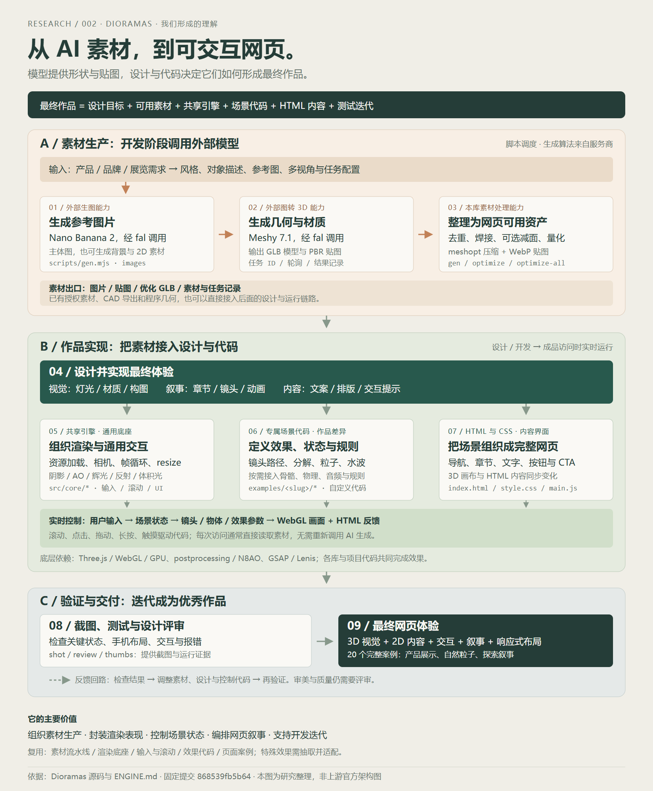

*本次对话生成的完整中文理解总览图，原 SVG 与 PNG 保持不变：外部模型、素材调度、设计、共享引擎、场景代码、网页与验证迭代；非上游官方架构图。*

### 003 · Oil UI：AI 前端设计方法、约束与复用研究

面向 AI 前端设计的 Skill、参考方法与辅助工具：覆盖任务路由、品类与标杆分析、风格与版式探索、视觉语言、素材/实时 3D/动效、规范润色、截图还原、浏览器取证和评审修正。拆解文本协议、宿主模型、Python 卡片与对比生成器、Node/CDP 截图工具及用户反馈的分工，说明与模型直接实现的区别、正确性与审美判断、约束和创意的平衡。保留原始中文引导图、上游署名样例、4 张风格卡、3 个版式小样及真实项目研究工作台，梳理个人与团队价值、UI/3D 迁移、适用场景、设计契约、阶段门禁、参考库、多维评审和工程联合验收等方向。文本规则依赖 Agent 遵守，现有实验未量化质量提升或创意上限，扩展方案仍待验证。

[研究文档](projects/003-oil-ui/README.md) · [研究记录](projects/003-oil-ui/research.md) · [原仓库](https://github.com/oil-oil/oil-ui)


*本次对话生成的完整中文引导图，原 PNG 保留：能力、原理、直接模型对照、创意平衡、价值、扩展与 3D 组合；上游样例为视觉拼贴，非新增对照实验证据。*

### 004 · Dvor：风格化世界、程序化建模与社区导览研究

浏览器中的风格化漫游作品源码：涵盖第一人称移动与轻量碰撞、空间文字解读、设施动画、杨絮、电车和小行星远景。全面拆解 core/world/content 模块、参数化几何与 Canvas 纹理、卡通色带与冷色阴影、深度轮廓与外壳、冷暖调色、FXAA、静态合批、实例树冠及平面到球面的坐标契约。沿用完整中文全景图和六类原作截图，以可操作的社区四站导览验证模块迁移；提供风格实验、保存与 JSON 导出、编程/图像模型提示词及截图校准。说明学习、创作、文化展览与导览价值，梳理真实场地、内容编辑、模型适配、叙事、触屏无障碍、LOD 和分区加载等扩展条件，区分已实现结果与建议、作品源码与完整引擎、桌面验证与真实设备边界。

[研究文档](projects/004-dvor/README.md) · [研究记录](projects/004-dvor/research.md) · [原仓库](https://github.com/amirmushichge/dvor)

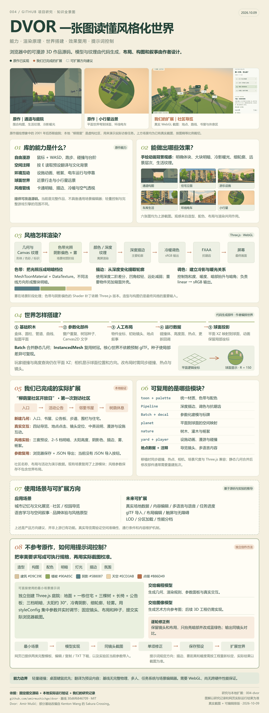

*沿用本次对话整理的完整中文全景图，原 PNG 字节保留：能力、渲染与世界原理、六类原作效果、社区扩展、复用、场景与提示词；采用真实署名截图和讲解示意，区别已实现与扩展建议。*

### 005 · Awesome GPT-6 Astra：作品合集、原理与复用研究

Astra 参与制作的社区游戏与互动作品合集。固定版本包含 175 项入口、六类玩法、五个仓内作品目录，25 项条目标注源码入口；研究覆盖发现试玩、创作过程与源码复用、README 驱动的目录解析与缓存、WebGL / Canvas / React 案例原理、成熟度与许可边界、学习与原型等场景，以及实测分层、资料检索、组件模板和版本追踪等扩展方向。网页沿用中文引导图，提供完整样例库、交互原理和真实轨道花园背景演示；未逐一验收全部作品。

[研究文档](projects/005-awesome-gpt-6-astra/README.md) · [研究记录](projects/005-awesome-gpt-6-astra/research.md) · [原仓库](https://github.com/MartinDelophy/awesome-gpt-6-astra)

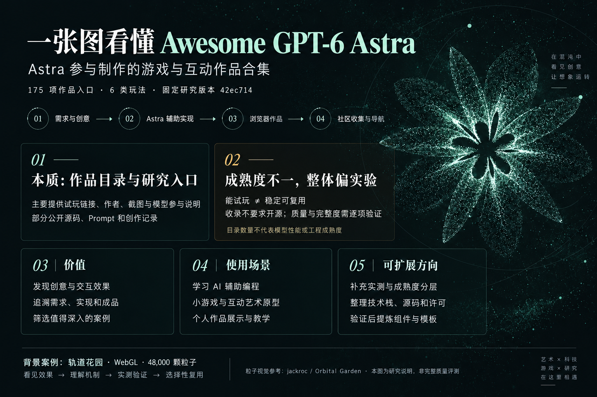

*AI 生成的中文研究说明图：社区作品收集、成熟度边界、价值、使用场景与扩展方向；粒子视觉参考轨道花园。*

### 006 · BeefTV：从创意到成片的 AI 视频工作台

BeefTV 是连接创意、参考媒体、模型生成与本地剪辑的 AI 视频工作台。以本次原全景图引导，全面说明手动界面、Pi 助手和 MCP/CLI 三种入口，文本/图片/视频/音频输入，生成素材、可播放成片与可编辑工作区输出；拆解画布、项目资产、协议适配、异步任务、Pi 与 Skills、受控操作层、时间线/FFmpeg 和插件扩展。讲清本地 SQLite 与资源存储、输入合同、任务轮询回收、助手权限与幂等、统一剪辑语义和 native/wasm 执行，展示三场景交互并引用维护者真实生成与 15 秒修订成片记录；评估广告产品、分镜预演、知识传播、多模型实验和资产迭代场景、上下文与工程复用价值，提出行业模板、新渠道、精细剪辑、质量评测、自动化和团队同步方向，区分源码依据、上游验收、本页示意及未实现建议。

[研究文档](projects/006-beeftv/README.md) · [研究记录](projects/006-beeftv/research.md) · [原仓库](https://github.com/glanderness/BeefTV)

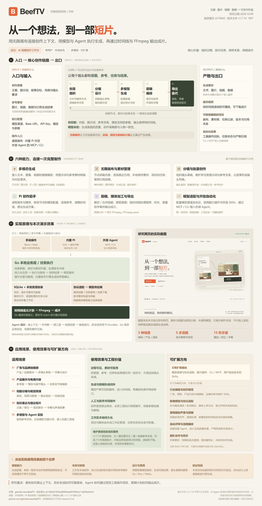

*本次对话生成的完整原能力全景图（2400×4623），保持原 PNG 不变；覆盖入口出口、能力、原理、研究页示意截图、场景、价值、扩展与边界，非上游官方架构图或实际生成效果。*

### 007 · Seiso：Markdown 文档检查、规则算法与扩展研究

面向代码仓库的 Markdown 文档约定与 Rust 静态检查器。全面梳理文档类型与语言、配置与工作区、Markdown 解析、章节角色、路径与跨文件索引、规则与例外、诊断与有限修复、内容缓存及 CLI 集成；解释词表、正则、结构启发式与 Jaccard 相似度的分工，区分 5 条默认稳定规则与 22 条预览规则。保留原始中文引导图，说明 AI 文档、多人与多文档维护、操作手册、文档站点和提交/CI 场景，对研究总库的引用质量、事实归属与复现依据的价值，以及配置、Agent 集成、自定义业务规则、语义审阅与知识系统扩展。研究网页与 Pages 发布已完成；不依赖大模型执行检查，不自动验证任意字段或技术事实，上游 CLI 未独立实跑。

[研究文档](projects/007-seiso/README.md) · [研究记录](projects/007-seiso/research.md) · [原仓库](https://github.com/scarletkc/seiso)

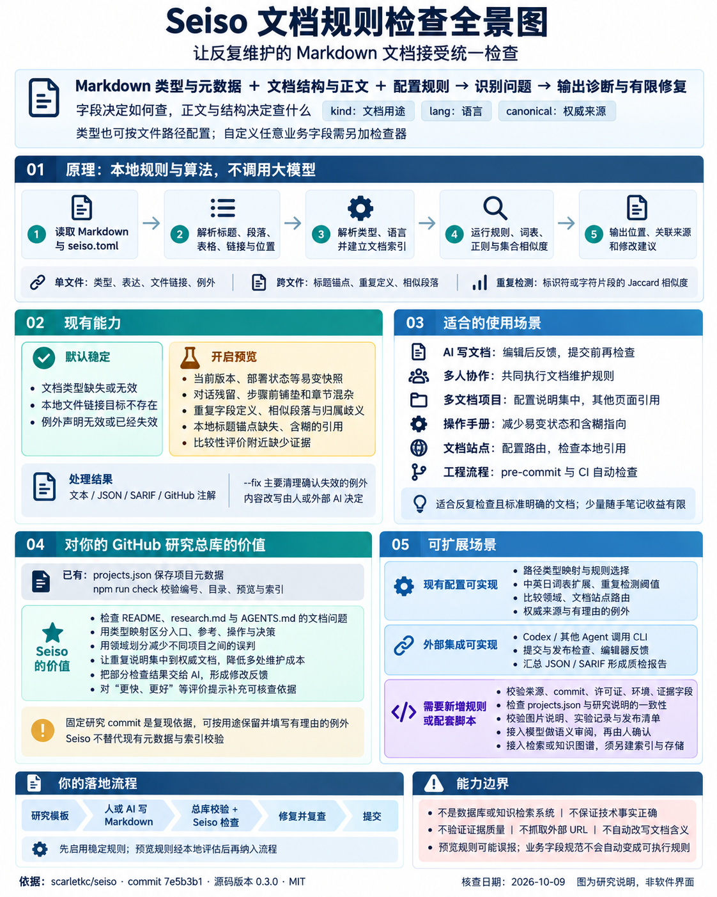

*本次对话生成的完整中文研究引导图，原 PNG 字节保留，非 Seiso 软件界面；固定 7e5b3b1 / 0.3.0，网页全面补充能力、模块、规则算法、个人价值、场景和扩展边界。*

### 008 · Realtime Solar System：实时语音、工具调用与 3D 场景联动研究

OpenAI 实时语音与 3D 网页的工程集成样例：语音问答联动天体聚焦、卫星、轨道、镜头复位、饼图 / 柱状图和 ISS 查询六个工具。完整拆解短期凭据、WebRTC / SDP、会话与事件、工具和提示词、Spline 动画适配、图表组件、外部数据及控制日志模块，说明语音 → 参数 → 场景动作 → 结果回传原理。沿用已生成的中文引导图，保留可操作的独立 Three.js 示意；梳理设备教学、社区导览、产品结构与研究总库场景、对已有 3D 项目的语音增量、投入条件和验证方法，以及真实语音接入、执行反馈、可信资料、通用适配、实时数据和任务评测方向。工程连接可参考，算法研究深度有限；本页使用本地关键词与系统朗读，未接通 Realtime，扩展和收益仍待开发验证。

[研究文档](projects/008-openai-realtime-solar-system/README.md) · [研究记录](projects/008-openai-realtime-solar-system/research.md) · [原仓库](https://github.com/openai/openai-realtime-solar-system)

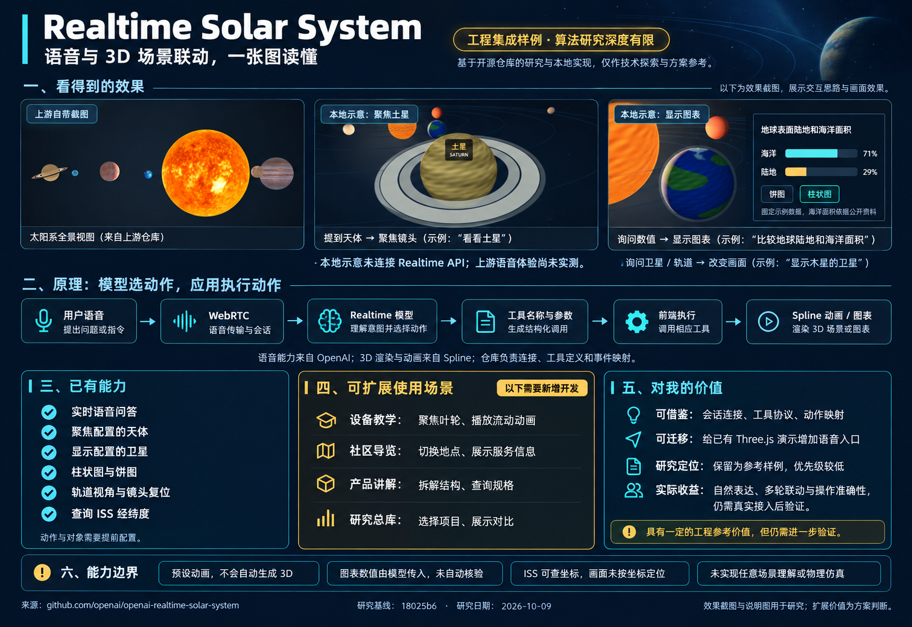

*AI 生成的中文理解汇总图：参考上游及本地效果，说明能力、场景、个人价值与边界；非原生软件截图。*

### 009 · Functional Emotions：油画动画与音乐同步

以已生成总览图汇总代码绘画与音乐 MV：展示原版八章和原创有声短片，说明七大模块、Skill 创作方法、确定性时间轴、油画渲染原理、可编辑工程价值与音乐定制及系列化产品方向。

[研究文档](projects/009-functional-emotions-video/README.md) · [研究记录](projects/009-functional-emotions-video/research.md) · [原仓库](https://github.com/ledbetterljoshua/functional-emotions-video)

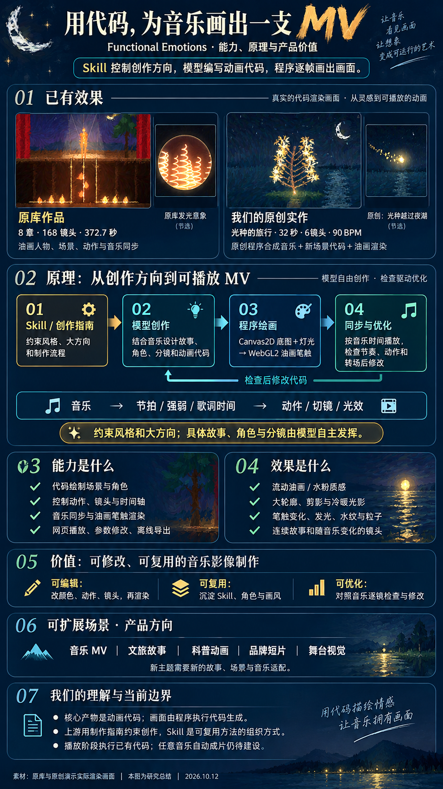

*已生成的研究总览图：AI 编排能力、效果、模块、原理、价值与扩展方向，嵌入原库和原创演示的实际代码渲染画面；非网页截图，产品化方向为研究建议。*

### 010 · Lemo-Opuscar：风格、导演方法与代码制片

让编程AI制作风格化新短片的Skill、风格规范与共享制片工具：包含9类43种完整风格、导演编排、Canvas/WebGL/Three.js绘制、统一五轨时间线、配音、配乐、拟音、字幕、逐帧渲染、混音及检查。拆解入口、风格、导演、画面、渲染、音频、校验与官方展台的职责；解释render\(t\)确定性画面、浏览器捕获与FFmpeg编码，以及OPUSCAR98的经典电影元素→统一角色→风格/动作/镜头再设计→代码动画场景思路。沿用本次生成的完整中文引导图，保留43种样片、98个致敬片段索引和本地蓝图实时画面，说明设备科普、产品发布、数据汇报、文化品牌、角色系列与网页演示场景，梳理个人表达、审美规范、可修改工程与路线评估价值。提出自有风格包、参数化场景、角色资产、多画幅/多语言、真实数据、互动与成片共用、制作质检台和效果评估等扩展条件，区分已验证网页、上游制片能力和未实现建议。

[研究文档](projects/010-lemo-opuscar/README.md) · [研究记录](projects/010-lemo-opuscar/research.md) · [原仓库](https://github.com/lemomo-ai/lemo-opuscar)

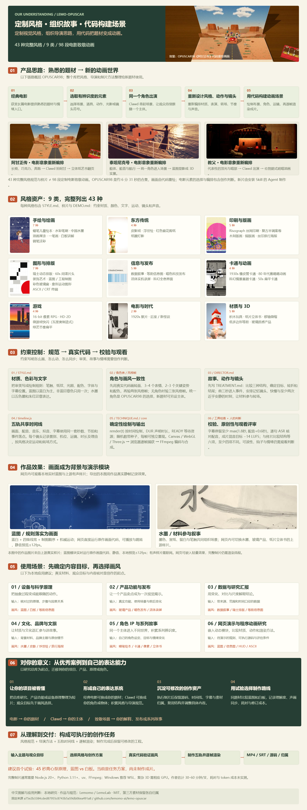

*沿用我们生成的1600×4219完整中文理解引导图，PNG与SVG原文件字节保留：电影元素创作链路、9类43种风格、约束、作品静帧、场景与个人价值；非上游官方架构图。*

### 011 · ShipVideo：从网页信息到代码短片

将公开网页或文字简报转为代码绘制的解释短片。全面梳理信息读取、叙事编排、HTML/CSS/SVG/Canvas 动画、技术检查、逐帧编码与签名下载；拆解 Next.js 入口与任务 API、OpenComputer 会话、导演 Agent、抓取/场景工具、虚拟时钟、Chromium 与 FFmpeg 模块。明确横屏静音 MP4 的输入输出、时间状态可控与模型创作变化、真实录屏和视觉评审边界；评估制作效率、产品发布、销售讲解、功能采用的条件性价值，以及我们当前仅借鉴“读取信息 → 编排内容 → 写动画代码 → 稳定渲染”的意义。保留原始中文引导图，整理中文模板、评审、成本记录、音频、竖屏、真实素材、多模型与批量任务等扩展方向；固定源码研究与响应式网页完成，上游生成和业务收益未实测。

[研究文档](projects/011-shipvideo/README.md) · [研究记录](projects/011-shipvideo/research.md) · [原仓库](https://github.com/diggerhq/shipvideo)


*原创代码绘制的中文全景图：能力、原理、效果示意、输入输出、价值边界和仅借鉴流程的结论；非上游实际成片。*

### 012 · Motion Graphics MV：音乐驱动的 AI 视频工作流

已有歌曲与创意驱动的 AI 音乐 MV 制作工作流。全面拆解 Opus 导演与工程师、Skill 制作合同、Ruby CLI/MCP 执行与任务管理、Fal 图像/视频/音频适配器、Python 音乐分析与抠图、p5.js/Chromium 按帧编排、Swift 后期与 FFmpeg 合成交付；说明角色、关键帧、绿幕表演、歌词与口型链路、连续主音轨、版本审查和请求恢复。沿用完整中文理解图，接入两支作者样片与四张真实截图，区分模型素材质量、代码控制与创作判断，梳理输入输出、使用场景、个人研究总库的复用价值，以及竖屏、Windows、替换模型、专用口型、制作工作台、预算和自动验收等扩展条件。研究固定源码与 MIT 许可；未运行上游付费制作或验证实际成本和全片质量。

[研究文档](projects/012-motion-graphics-music-video/README.md) · [研究记录](projects/012-motion-graphics-music-video/research.md) · [原仓库](https://github.com/makevoid/motion-graphics-music-video-skill)

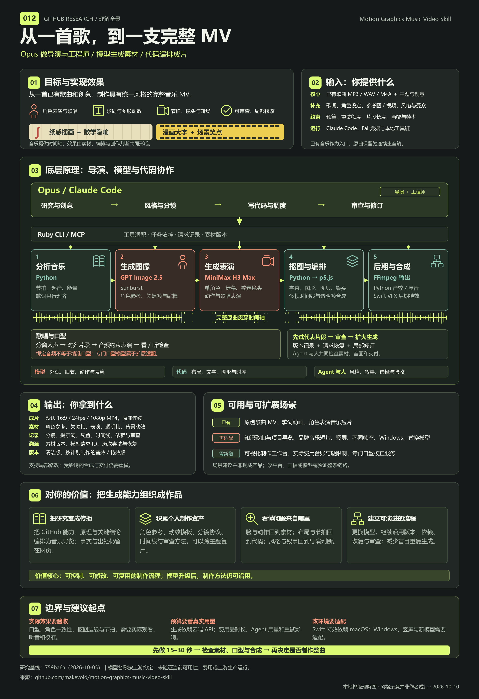

*2026-10-10 完成的完整中文理解图，PNG/SVG 原样保留：目标效果、输入输出、Opus 导演、模型生成、口型、代码编排、价值与扩展；本地原创排版，风格缩略为示意，非上游成片或界面。*

### 013 · 新疆互动沙盘：地理、历史与多尺度知识展示

本次研究的核心价值是全球认识→自然条件→人文联系：从整体到细节、从宏观定位到逐层引导，用条件、过程和结果认识地方。保留新疆R90可控3D原型，明确参考、已有实现、意义与缺口、扩展方向及AI开发方法；全量图、原帖入口、历史成片、演示与增量过程记录共同留档。

[研究文档](projects/013-xinjiang-knowledge-sandbox/README.md) · [研究记录](projects/013-xinjiang-knowledge-sandbox/research.md) · [原始演示](https://x.com/readyfor2025/status/2108409664018977249)


*地域3D探索全量研究总结：核心认识方法与十个分支全部展开，说明已有原型、参考呈现、研究意义、当前缺口、资料边界及未来开发；非原产品官方架构或实际界面截图。*

### 014 · 我还在这里：中文 Token 叙事短片

从 DJ SHO 音乐短片出发，研究歌曲生成、人物视频与口型驱动、真实 GPT-2 分词与下一片段预测、音乐节奏分析、七态词块字幕和镜头合成。以既有完整中文引导图串起原片与中文真实效果，提供 62 秒旁白、135.59 秒中文歌曲与动态演唱初版、21 镜头分镜、三轮失败样片和可追溯记录；拆解线上模型、分析缓存、时间线、播放器、合成导出和质量验收模块，说明阅读与节奏、情绪叙事、技术艺术和工程复用价值，梳理歌曲替换、多语言、数据教学、独立口型与制作工作台等扩展方向。网页与研究工程可复用，新增多场景中文演唱仍未通过口型验收。

[研究文档](projects/014-chinese-token-cinema/README.md) · [研究记录](projects/014-chinese-token-cinema/research.md) · [原始演示](https://x.com/DJ_SHO974/status/2108569544151146742)

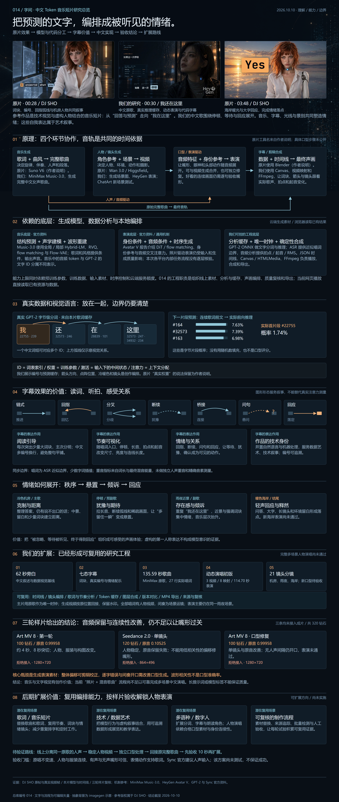

*沿用本次对话制作的 2880×6795 完整中文研究原图，PNG 字节保留，含两张署名原片帧与一张中文真实成片帧；图内结论截至 2026-10-10，网页与摘要于 2026-10-12 补全，三轮新增口型均未通过。*

### 015 · Three ILDA：激光效果、可复用舞台与内容接入研究

将 ILDA 点序列变为 Three.js 实时激光效果：解析分轨、固定点率振镜近似、关光与历史轨迹、辉光及空气光束；拆解上游五组核心职责、CPU/GPU 分工、素材来源与二维/深度边界。以原始理解总览图引导，保留 18 上游与 4 原创节目、三阶段调参和完整节目轮播；本地扩展五套模板、独立舞台项目与版本、编辑和撤销重做、效果绑定及共享装配，让 90 秒音乐、60 秒发布会和 108 秒 002 六部件泵讲解复用同一配置。完整整理能力、模块、原理、价值、接入流程、来源许可与验证证据，展开 16 类 64 项演出、传统表演、品牌、产品、教学、工业、文化、互动、直播、AI、XR、硬件及资产服务设想；区分已有原型与待验证产品，后续按场景使用。

[研究文档](projects/015-three-ilda/README.md) · [研究记录](projects/015-three-ilda/research.md) · [原仓库](https://github.com/artcodev/three-ilda)

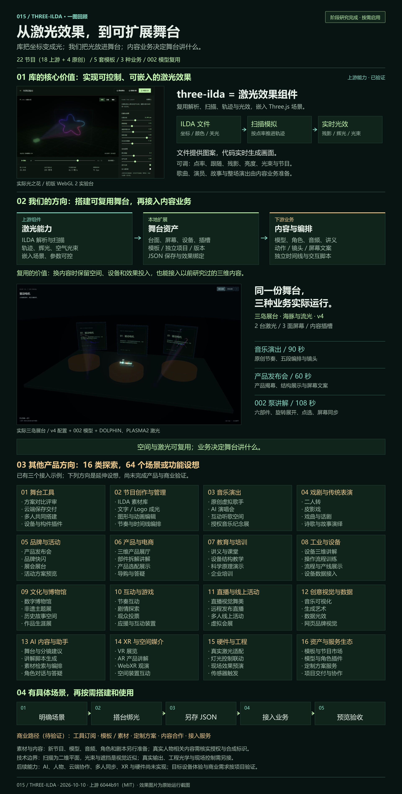

*沿用本次对话生成的原始中文理解总览图：嵌入真实激光与 v4 展台截图，汇总库能力、舞台与业务分工、三个实际示例及 16 类 / 64 项待验证方向；原图日期 2026-10-10，非上游官方架构图。*

### 016 · Agenvo：远程 Agent 连接与调度研究

自托管 MCP 中继，将 Codex、Herdr 中的 Claude Code 及 Paseo、Amp、Lody、OpenCode 接入通用助手；完整梳理能力、客户端/Relay/Connector 内置 Adapter 模块、原生接口与会话路由、部署数量、事件和故障语义、权限边界、官方远控重叠、实际价值及扩展方向。保留中文引导图，补充 v0.2.0 与当前源码变化；完成研究网页，原生 Agent 未独立实测。

[研究文档](projects/016-agenvo/README.md) · [研究记录](projects/016-agenvo/research.md) · [原仓库](https://github.com/Xuanwo/agenvo)

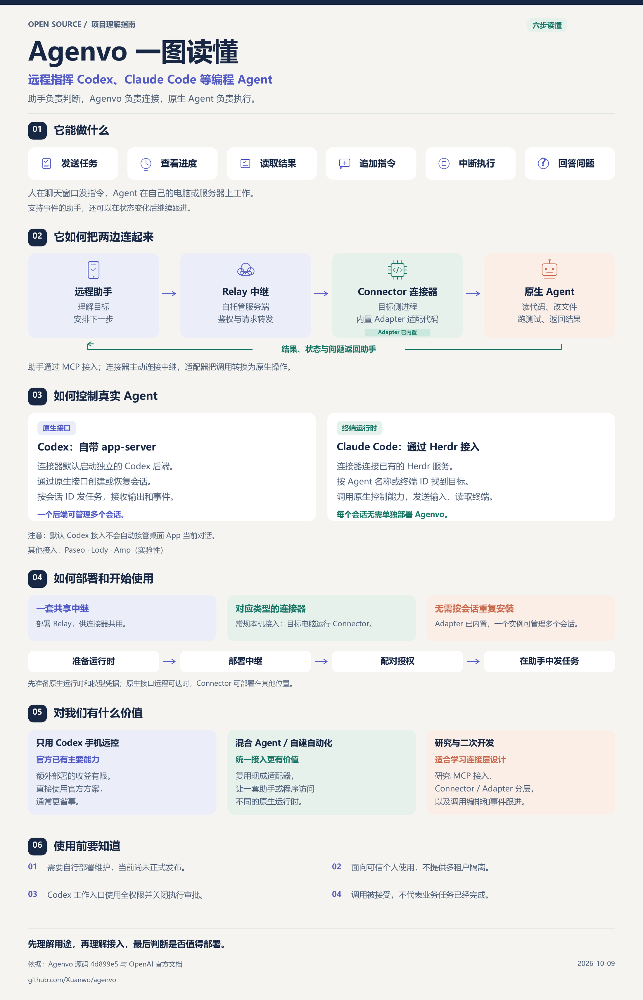

*原创中文完整引导图，非上游界面；原图基于 2026-10-09 的 4d899e5 快照，网页保留原图并补充 v0.2.0、Codex 独立服务、OpenCode 与 MCP 输出等更新。*

### 017 · Alook：群聊共享 Agent 与持续协作研究

群聊中的共享 AI 入口，让有访问权限的成员共同调用一个或多个本地 Agent。全面梳理身份与消息、Web/Daemon/驱动/队列/存储模块、消息唤醒与实际执行链路、文件记忆和跟进、自托管、多人协作价值、业务适配与多 Agent 边界、可扩展方向和研究总库复用意义；保留原始中文引导图，补充当前 0.1.48 源码核查。研究网页已完成，真实 Agent 未独立实跑。

[研究文档](projects/017-alook/README.md) · [研究记录](projects/017-alook/research.md) · [原仓库](https://github.com/alookai/alook)

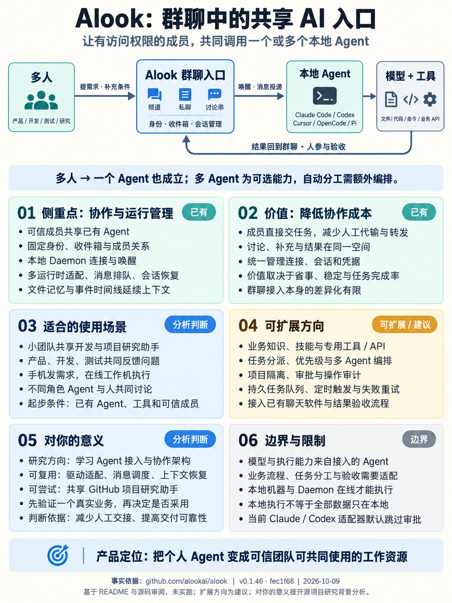

*本次对话生成的完整中文研究引导图，原 PNG 未改动，非上游界面；图示依据 2026-10-09 的 v0.1.46，网页补充 2026-10-12 固定源码、能力/模块/原理/价值/场景/扩展和验证边界。*

### 018 · 抖音内容工作流：下载、资料库与口播加工研究

一个将抖音公开内容获取、本地识别、资料库管理和 Codex 写作串联起来的 Skill。全面说明单条与整号下载、逐字稿与字幕、文案标签和封面 OCR、公开指标、续跑验收与批量口播改写；拆解 HTTP 下载器、专用 Edge/官方 SDK/Playwright、MLX Whisper、Apple Vision 和确定性辅助脚本的分工。评估风控、Windows 适配、模型成本和非商业许可，保留原始引导图，给出个人价值、产品意义及跨平台、检索、质量审核和任务面板等扩展建议。研究网页已完成，上游下载与真实账号未独立实测。

[研究文档](projects/018-ah-douyin-clean-downloader/README.md) · [研究记录](projects/018-ah-douyin-clean-downloader/research.md) · [原仓库](https://github.com/ahang008/ah-douyin-clean-downloader)

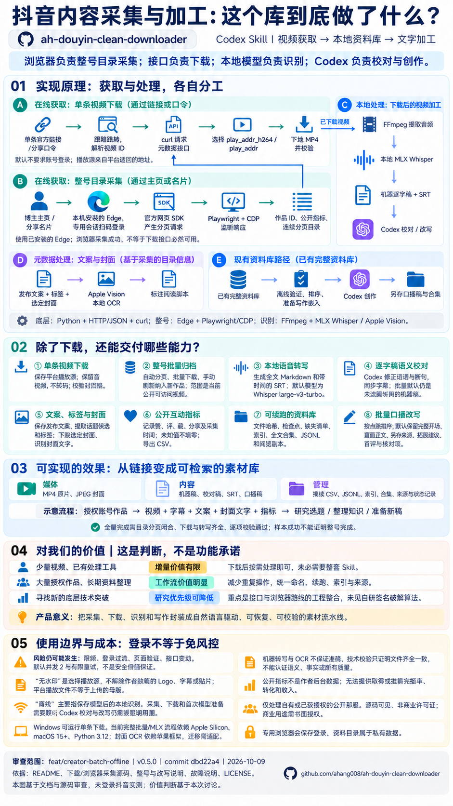

*本次对话生成的完整中文研究引导图，原 PNG 字节保留，非上游界面或采集结果；依据 v0.5.0 / dbd22a4，网页全面补充能力、模块、三条路线、价值、风控/环境/成本/许可边界与扩展建议。*

### 019 · LibTV Skills：专用创作服务接入与有限复用价值

面向外部 AI Agent 的 LibTV 专用创作服务接入 Skill，以技能说明、调用步骤和 Python 标准库脚本完成素材上传、会话消息、增量查询、项目切换与图片／视频结果下载。梳理故事与剧本、人物与场景、分镜与参考图、视频镜头、成片与修改的创作链，区分操作约束、LibTV 自家服务端 Agent 的编排、底层图片／视频模型的生成与画布呈现；拆解 1 个 Skill、5 个操作脚本和 1 个公共接口模块、Bearer 鉴权、异步会话、结果解析与平台耦合。沿用原始总结图，评估短剧、广告、MV、产品展示等官方描述场景、现有用户接入价值与我们自建系统的有限复用价值；说明兼容后端、解析泛化、任务恢复、参数与版本追踪及独立人物／分镜／剪辑系统等扩展的条件和成本。研究固定源码、MIT 许可与用户反馈，明确云端核心未公开、扩展方案未实现、未进行真实生成或成片质量验证。

[研究文档](projects/019-libtv-skills/README.md) · [研究记录](projects/019-libtv-skills/research.md) · [原仓库](https://github.com/libtv-labs/libtv-skills)


*本次对话 2026-10-09 制作的完整中文总结图，原 PNG 与 HTML 保留：创作链、外部 Agent／专用 Skill／LibTV 服务端 Agent／模型依赖、公开能力及对自建系统有限价值；独立说明图，非产品界面或生成效果实测。*
<!-- PROJECT_INDEX:END -->

## 开始一个子项目

需要 Node.js 22 或更高版本；总库脚本不依赖第三方包，无需安装依赖。

```sh
npm run project:new -- --slug example-repo --title "项目名称" --source "https://github.com/owner/repo" --summary "一句话说明研究价值" --tags "工具,Web"
```

命令会分配下一个编号，建立研究目录，并更新上面的索引与图片卡片。`example-repo` 是命令示例；实际收录内容见上方索引。

随后填写子项目的 `README.md` 和 `research.md`，用实际截图替换 `assets/preview.svg`；修改 `projects.json` 中的摘要、状态或图片后执行：

```sh
npm run index:sync
npm run check
```

## 仓库布局

```text
.
├── README.md                 # 对外入口：有序索引、摘要、预览图
├── projects.json             # 项目元数据，索引的唯一数据源
├── projects/                 # 001-xxx、002-xxx 等独立子项目
├── templates/project/        # README、研究记录、图片与 Web 模板
├── docs/                     # 收录规则与多 Web 发布说明
├── scripts/repo.mjs          # 新建项目、同步索引、校验、汇总站点
└── .github/workflows/        # 自动校验与手动 Pages 发布
```

## 研究与展示约定

- **总入口保持简洁**：根 README 放索引、研究价值和预览图，详细结论放在各子项目内。
- **记录可复现信息**：保留原仓库链接、研究时的版本或 commit、环境、运行步骤和结论依据。
- **图片就近维护**：放在对应子项目的 `assets/`，补充图片说明，优先使用实际界面截图或结构图。
- **子项目独立运行**：依赖、源码和运行方式由各子项目自行管理，总库不限定技术栈。
- **保留上游归属**：引入上游代码时保留其 LICENSE 和版权声明，在子项目中注明来源与修改范围。

初始化日期：2026-10-09。Web 通过统一 GitHub Pages 站点展示，发布步骤见[发布指南](docs/deployment.md)。
