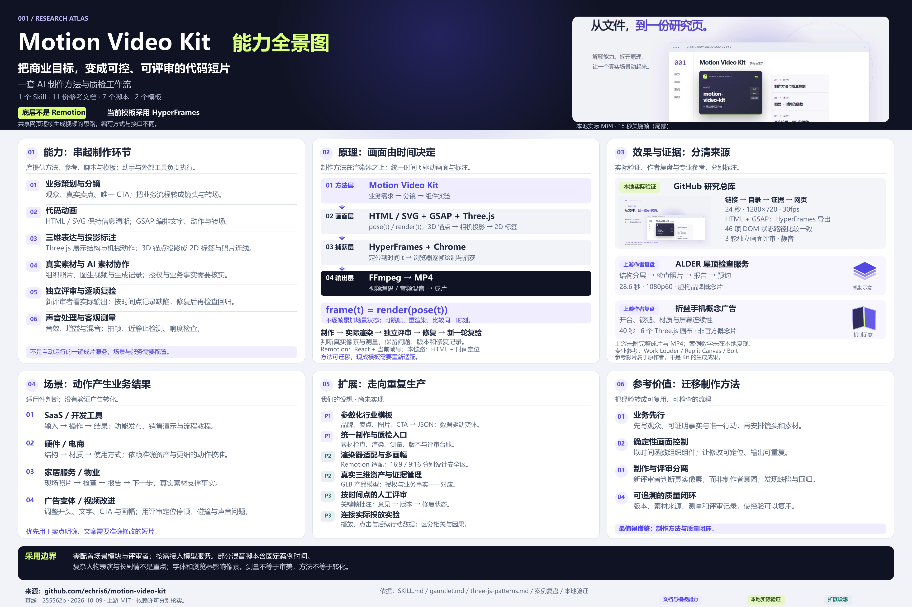

# 001 · Motion Video Kit 研究与演示

Motion Video Kit 是一套让 AI 助手制作商业短片的 Skill、参考资料、工具脚本与模板。本项目以已生成的能力全景图引导，完整梳理能力、模块、底层原理、已有案例、输入输出、使用场景、参考价值和扩展方向，并实际制作了一个 24 秒演示：**从 GitHub 链接到编号研究页**。

[返回总索引](../../README.md#有序索引) · [研究记录](research.md) · [Web 运行说明](web/README.md) · [本地需求](BRIEF.md) · [验证记录](verification.md)

| 项目 | 信息 |
| --- | --- |
| 原仓库 | [echris6/motion-video-kit](https://github.com/echris6/motion-video-kit) |
| 研究 commit | [255562b04b1e5ecaa4ba98e5c9aa191d5ba7f6fa](https://github.com/echris6/motion-video-kit/tree/255562b04b1e5ecaa4ba98e5c9aa191d5ba7f6fa) |
| 上游许可证 | MIT，Copyright (c) 2026 echris6；[保留原文](licenses/motion-video-kit-LICENSE) |
| 研究日期 | 2026-10-09 |
| 实作 | HTML / CSS / GSAP 3.15.0；HyperFrames 0.8.143 渲染 |
| 视频规格 | 24 秒，1280 × 720，30 fps，H.264，静音 |
| Pages 输出 | web/dist/，编号子路径 /001-motion-video-kit/ |
| 在线研究页 | [打开完整网页](https://yydshly.github.io/1009_codex_project/001-motion-video-kit/) |
| 网页整理日期 | 2026-10-12，延续上述固定研究版本 |

## 网页包含什么

1. **全景引导**：高清能力图、PNG/SVG 下载，定位、能力、模块、原理、证据、场景、价值、扩展与边界九个摘要条目。
2. **实际演示**：播放、暂停、重播、倍速、拖动时间与分镜定位。
3. **能力边界**：策划、代码动画、三维标注、素材组织、独立评审与音频工具。
4. **模块拆解**：1 个 Skill 的九步流程，11 份参考文件，7 个脚本的输入输出与限制，2 个模板的作用。
5. **底层原理**：四层架构、同一时刻的状态比较，以及与 Remotion 的关系。
6. **已有案例**：ALDER 屋顶服务片与折叠手机概念片的作者复盘，另附专业参考片原始链接。
7. **使用场景**：SaaS、硬件、电商、家居服务与广告变体的适用条件。
8. **参考价值**：业务先行、可控修改、制作与评审分离、可追溯台账，以及我们的采用判断。
9. **扩展方向**：模板参数化、统一质检、多渲染器与多比例、真实三维资产、人工评审、投放实验。


截图来自本次实现，不是上游项目界面。屋顶和手机图形明确标注为自绘机制示意；上游未随仓库提供完整成片，作者的案例数字未在本地复现。

## 一张图理解全库

[查看 PNG 原图（3840 × 2560）](assets/capability-map-v1.png) · [下载可编辑 SVG](assets/capability-map-v1.svg) · [图像来源与制作记录](assets/capability-map.metadata.json)



图中整理了六类制作能力、四层渲染架构、实际效果与作者案例、适用场景、六个扩展方向及方法参考价值。背景和本地案例模块嵌入本次 MP4 的第 18 秒实际关键帧；屋顶和手机仅为标明来源的机制示意。扩展方向是我们的设想，尚未实现。

## 核心理解

**它的底层不是 Remotion。** 研究版本中的示例链路是 Motion Video Kit 制作方法 → HTML / GSAP / Three.js 画面 → HyperFrames 逐帧定位和 Chrome 捕获 → FFmpeg 编码。HyperFrames 官方表示受到 Remotion 启发；共享“网页逐帧变成视频”的机制，不等于依赖 Remotion。策划与评审方法可以迁移，模板需要适配。

主要价值是把制作经验和评审约束写成可执行流程。它不是开箱即用的成片生成 API：模型服务、场景模块、渲染环境和评审者仍需配置。详见 [研究依据与限制](research.md)。

## 真实场景演示

我们用当前研究总库的真实编号、命令、目录和版本记录制作动画：链接卡片进入收录流程，生成 projects/001-motion-video-kit/，记录 commit 与 MIT 许可证，最后落入研究网页。画面是流程讲解示意，不会实际执行创建或发布操作。

这是本地原创的 2D 代码动画，实际使用 HyperFrames 输出 MP4；未复现上游三维产品广告。分镜见 [BRIEF.md](BRIEF.md)，实际画面评审与工具检查见 [verification.md](verification.md)。

## 本地运行

需要 Node.js 22+：

```powershell
cd projects/001-motion-video-kit/web
npm ci
npm run build
npm run dev
```

打开 [本地研究页](http://127.0.0.1:4311/1009_codex_project/001-motion-video-kit/)。Pages 构建已接入总库工作流；线上发布需运行总库的 Publish GitHub Pages 工作流。

视频导出：

```powershell
npm run motion:check
npm run render
npm run build
```

视频位于 web/renders/research-workflow.mp4；本机渲染后重新构建会显示下载入口。视频、依赖和构建产物不提交。干净环境的 Pages 构建仍可播放网页代码动画，未导出 MP4 时不显示下载链接。

上游 MIT 声明、GSAP 许可证与第三方素材说明见 [licenses/README.md](licenses/README.md)。
