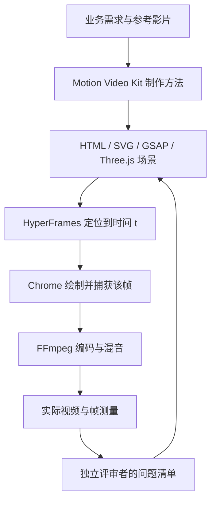

# 001 · Motion Video Kit 研究记录

## 结论与基线

**Motion Video Kit 是商业短片制作工作流，不是独立视频渲染引擎，也不是 Remotion 的封装。** 它提供 Skill、参考资料、测量脚本与模板，让 AI 助手按策划、制作、实际渲染、独立评审和修复的流程工作。

研究日期：2026-10-09。上游固定为 [255562b04b1e5ecaa4ba98e5c9aa191d5ba7f6fa](https://github.com/echris6/motion-video-kit/tree/255562b04b1e5ecaa4ba98e5c9aa191d5ba7f6fa)，许可证 MIT（Copyright (c) 2026 echris6）。本地阅读副本位于被忽略的 upstream/motion-video-kit/；许可证原文保存在本子项目 licenses/。

| 环境项 | 本次验证 |
| --- | --- |
| 系统 | Windows，PowerShell |
| Node.js / npm | 22.15.0 / 10.9.2 |
| GSAP | 3.15.0，锁定于子项目 package-lock.json |
| HyperFrames | 0.8.143，锁定于子项目 package-lock.json |
| 浏览器 | 系统 Google Chrome 154；软件截图模式，最终导出使用 1 个捕获 worker（初轮为2个） |
| FFmpeg | 本机 6.1.3；HyperFrames 负责实际编码 |
| 字体 | 操作系统中文字体；没有分发字体文件 |
| 输出 | H.264，1280 × 720，30 fps，720 帧，24.000 秒，静音 |

跨操作系统的字体和浏览器版本可能改变像素结果；本实验不声称跨平台逐像素一致。

## 能力是什么

固定版本包含 1 个 Skill、11 份参考文档、7 个工具脚本和 2 个模板。主要能力是把分散的制作方法串成一条可检查的流程。

| 能力 | 实际内容 | 依据与边界 |
| --- | --- | --- |
| 业务策划与分镜 | 定义观众、可证实卖点、唯一 CTA，规划动作与转场 | [SKILL.md](https://github.com/echris6/motion-video-kit/blob/255562b04b1e5ecaa4ba98e5c9aa191d5ba7f6fa/business-motion-film/SKILL.md)、[business-offers.md](https://github.com/echris6/motion-video-kit/blob/255562b04b1e5ecaa4ba98e5c9aa191d5ba7f6fa/business-motion-film/references/business-offers.md)；需要真实业务信息 |
| 代码动画 | HTML/SVG 界面、GSAP 时间轴、Three.js 产品动作 | [three-js-patterns.md](https://github.com/echris6/motion-video-kit/blob/255562b04b1e5ecaa4ba98e5c9aa191d5ba7f6fa/business-motion-film/references/three-js-patterns.md)；需要补入场景模块 |
| 三维锚点标注 | 把世界坐标投影到屏幕，连接标签、照片与产品位置 | [projected-overlays.js](https://github.com/echris6/motion-video-kit/blob/255562b04b1e5ecaa4ba98e5c9aa191d5ba7f6fa/business-motion-film/templates/projected-overlays.js)；不是完整产品资产 |
| 素材组织 | 真实素材、图生视频、生成记录与组件实验 | Skill 中的流程约定；不内置模型服务或 API 凭据 |
| 独立评审 | 新评审者看实际输出，记录问题，修复后由新一轮验证 | [gauntlet.md](https://github.com/echris6/motion-video-kit/blob/255562b04b1e5ecaa4ba98e5c9aa191d5ba7f6fa/business-motion-film/references/gauntlet.md)；需要助手或人组织 |
| 音频与测量 | 抽帧、冻结检测、响度、候选音效、增益与离线混音 | [audio.md](https://github.com/echris6/motion-video-kit/blob/255562b04b1e5ecaa4ba98e5c9aa191d5ba7f6fa/business-motion-film/references/audio.md)；部分脚本含案例固定时间参数 |

仓库未提供完整成片工程与 MP4，因此不是安装后即可自动生成某个现成广告。AI 图像或视频生成是可选素材来源，代码画面和文字仍可独立实现。

## 底层原理是什么

### 四类模块与输入输出

2026-10-12 的网页整理继续使用上述固定 commit，不重新定义为上游最新版本。

| 模块 | 内容与作用 | 使用边界 |
| --- | --- | --- |
| Skill | 1 个入口组织 Brief、参考、分镜、素材、组件实验、组装、全片评审、音频与交付九步流程 | 由助手读取执行，不是独立运行的后台服务 |
| 参考文档 | 11 份业务、动效、三维、真实性、质量、评审、音频与案例资料 | 分阶段读取，案例指标来自作者记录 |
| 工具脚本 | 7 个抽帧、近静止、响度、音效筛选、逐事件增益、柔化与离线混音脚本 | 数值帮助排查；混音含固定案例参数，Python 工具涉及 NumPy / SciPy，Shell 工具依赖 FFmpeg 等环境 |
| 模板 | component-lab.html 组件实验起点与 projected-overlays.js 三维锚点投影 | 要补场景模块；不会直接得到完整产品广告 |

输入是观众、可证明业务事实、唯一 CTA、品牌规范、参考机制与授权素材；交付目标包括主视频、海报帧、接触表、可编辑源码、素材生成记录与评审台账。本地验证只覆盖代码画面、时间定位、HyperFrames 渲染及画面评审，不包含 AI 素材或声音链路。



核心要求是 frame(t) = render(pose(t))。画面由统一时间决定，而不是依靠动画已经跑了多久或逐帧累加物理状态。2D 时间轴可暂停后定位；3D 场景用时间函数计算位置、姿态、相机与材质。三维标签根据同一时刻的相机投影重新计算屏幕位置。

HyperFrames 把 HTML 场景放进无头 Chrome，按目标帧率逐帧定位、捕获，再由 FFmpeg 编成视频。Kit 模板注册 window.__timelines 并响应 hf-seek；渲染器管理浏览器、资源与输出。[HyperFrames 官方实现说明](https://github.com/heygen-com/hyperframes#how-it-works)支持这条链路。

确定性使跳帧、转场定位、重复渲染和比较成为可能。它不会自动保证文案正确、结构真实、画面漂亮或广告有效。代码检查、像素检查和业务验证要分别做。

### 是 Remotion 吗

研究版本模板使用 HyperFrames、GSAP 与 Three.js；本地实作依赖同样没有 Remotion。HyperFrames 官方称其受 Remotion 启发，两者都使用浏览器画面生成视频。

| 项目 | HyperFrames 的这条链路 | Remotion |
| --- | --- | --- |
| 编写方式 | HTML、CSS、JavaScript 与可定位时间轴 | React 组件 |
| 时间表示 | 定位到时间 t 后捕获 | 读取当前帧号计算组件状态 |
| Kit 的关系 | 上游模板采用它 | 没有现成适配 |

依据：[HyperFrames 与 Remotion 官方对比](https://hyperframes.heygen.com/guides/hyperframes-vs-remotion)、[Remotion 基础文档](https://www.remotion.dev/docs/the-fundamentals)。**我们的推断**：策划、组件实验与独立评审方法可以迁移到 Remotion；模板的时间轴、渲染就绪与捕获接口需要重写，不是直接更换包名。

## 已有效果样例与证据等级

### 上游作者的制作复盘

- [ALDER 屋顶检查服务概念片](https://github.com/echris6/motion-video-kit/blob/255562b04b1e5ecaa4ba98e5c9aa191d5ba7f6fa/business-motion-film/references/case-study-alder.md)：作者记录 28.6 秒、1080p60，虚构品牌。用屋顶层次、检查照片、报告和预约 CTA 解释服务。作者报告冻结时间从早期约 10 秒降到最终约 0.7 秒，并多次调整音效与配乐。
- [折叠手机产品概念片](https://github.com/echris6/motion-video-kit/blob/255562b04b1e5ecaa4ba98e5c9aa191d5ba7f6fa/business-motion-film/references/case-study-duo.md)：作者记录 40 秒、六个 Three.js 画布、约 70 次组件及全片评审。重点是开合、铰链、屏幕连续性、材质与闭合动作。属于非官方概念片，不能理解为品牌官方项目。

以上是**作者文档中的记录**，本地没有获得或重新渲染完整上游成片。网页图形是自绘机制示意，不能当成影片截图。

### 可观看的原始参考影片

作者的 [launch-film-notes.md](https://github.com/echris6/motion-video-kit/blob/255562b04b1e5ecaa4ba98e5c9aa191d5ba7f6fa/business-motion-film/references/launch-film-notes.md) 研究了专业短片的手法。网页链接到原作者影片：

- [Work Louder：分层结构](https://x.com/MarkKnd/status/2022261281114468759)
- [Replit Canvas：连续画布](https://x.com/Replit/status/2060097656207413613)
- [Bolt：前景转场](https://x.com/boltdotnew/status/2039024467846860972)

这些是制作参考，不是 Kit 生成的成果；本项目仅链接，不转载第三方视频。

### 本地实际演示

采用我们正在维护的真实 GitHub 研究总库。观众是维护者与读者，唯一行动是打开编号 001 开始研究。依据包括 project:new 命令、projects.json、projects/001-motion-video-kit/、index:sync、版本与 MIT 许可证。

| 时间 | 画面与叙事作用 |
| --- | --- |
| 0–4 秒 | GitHub 项目卡片，把链接变成可复用研究的问题 |
| 4–9 秒 | 收录命令与真实子项目目录 |
| 9–14 秒 | 版本、许可证与来源 |
| 14–20 秒 | 同一项目卡片进入研究网页，呈现整理后的结果 |
| 20–24 秒 | 编号 001 与开始研究的 CTA |

源画面为 HTML/CSS，GSAP 负责可定位动画。网页外层 requestAnimationFrame 只推进播放器时间；场景收到时间后定位时间轴，不通过累计帧计算状态。HyperFrames 使用同一场景导出 MP4。没有外部模型调用、客户数据、生成素材或配乐。

动画中收录命令是节选，省略了标题、来源和摘要参数。本次实际创建命令如下（Windows PowerShell 使用 npm.cmd 与停止解析标记保留双连字符）：

```powershell
npm.cmd --% run project:new -- --slug motion-video-kit --title "Motion Video Kit 研究与演示" --source "https://github.com/echris6/motion-video-kit" --summary "研究AI商业短片工作流、确定性渲染与独立评审，演示从GitHub链接到编号研究页。" --tags "AI视频,HyperFrames,GSAP,研究工作流"
```

这条命令记录创建过程；已有项目时不要重复执行。

网页比较 18 → 8 秒与 2 → 8 秒两条路径，检查 46 个元素的变换、透明度和颜色。它验证本场景的 DOM 状态恢复，不等于全片逐像素校验。实际 MP4、关键帧、独立评审和检查结果见 [verification.md](verification.md)。

## 使用场景

以下是结合工作流与本地实验的适用性判断，未验证商业转化：

- **SaaS 与开发工具**：输入、操作、结果；功能发布、销售说明和流程教程。本次最接近这一类。
- **电商与硬件**：结构、材质与操作；需要准确三维资产和更细运动校准。
- **家居服务与物业**：现场照片、检查、报告与预约；真实素材支撑事实，三维解释空间。
- **广告变体与视频改进**：调整开头、文字、CTA 与画幅，用抽帧、测量和独立评审找出问题。

更适合卖点明确、文案需要准确修改的短片。复杂人物表演与长剧情并非重点。多轮评审和三维制作仍需时间；冻结率、响度不能替代叙事和业务判断。

## 可扩展方向

以下均为我们的设想，**没有作为已实现能力交付**：

| 优先级 | 方向 | 下一步验证标准 |
| --- | --- | --- |
| P1 | 品牌、卖点、图片、CTA 参数化为 JSON | 修改数据生成另一条片，文字不溢出 |
| P1 | 渲染、检查、测量、评审台账统一入口 | 一条命令生成视频与可追溯记录 |
| P2 | Remotion 适配及 16:9 / 9:16 分别编排 | 跨接口、跨画幅保持可读性 |
| P2 | GLB 产品资产、授权与事实来源管理 | 标注跟随模型，事实与来源对应 |
| P3 | 时间点人工批注与版本复验 | 意见关联关键帧、下一版与修复状态 |
| P3 | 实际投放实验 | 使用真实播放与行动数据，区分相关性与因果 |

## 我们的参考价值判断

- **业务先行**：把真实需求、可证明事实和单一行动先写清，再决定表现手法，适合研究工具和服务流程的说明。
- **确定性控制**：以时间函数管理动作与标注，让修改可定位、版本可比较、输出可重复；本地 DOM 状态实验的证据不能扩张为跨环境逐像素保证。
- **制作与评审分离**：独立观察实际输出，而非只检查源码是否运行；把发现、修复与回归对应到具体时间点。
- **经验可追溯**：保留素材、版本、抽帧、测量与评审记录，比只保留最后的成片更方便迁移到其他代码动画工作。

优先借鉴 Brief、组件实验、时间函数与评审台账；渲染器和素材服务按需要适配。以上是基于工作流与本地实验的研究判断，不是已验证的生产效率、审美提升或广告转化结论。

## 采用时的限制

1. component-lab.html 是组件实验模板，需要场景模块，并非完整工程。
2. [offline-mix.py](https://github.com/echris6/motion-video-kit/blob/255562b04b1e5ecaa4ba98e5c9aa191d5ba7f6fa/business-motion-film/scripts/offline-mix.py) 含 40 秒案例的固定时间与片段安排，迁移时必须修改。
3. 独立评审是组织方法，不是安装后自动出现的服务。本次按上游要求使用新的评审代理观察实际视频，并保留报告。
4. 冻结检测是阈值启发式：缓慢背景运动会降低冻结率，却不保证信息在推进。静音是本次需求选择，音频管线没有复现。
5. 本次复现范围是 2D 代码动画、浏览器时间定位与 HyperFrames 导出；上游三维广告、AI 素材生成与混音工具未完整运行。
6. 字体与 Chrome 环境影响输出。上游 MIT、GSAP 标准许可分别适用，不能把所有依赖笼统描述为 MIT。
