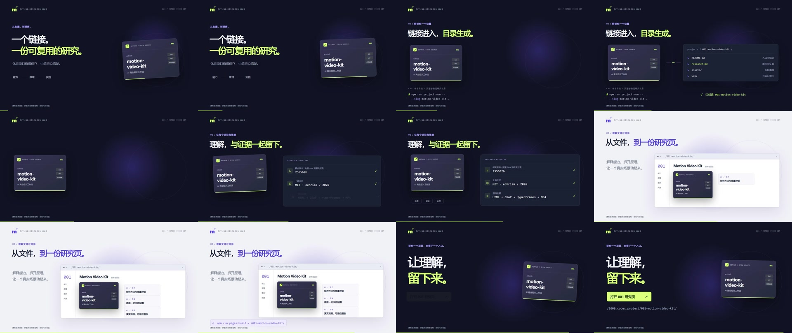

# 本地实作验证记录

日期：2026-10-09。验证范围是中文研究页、真实总库流程的2D代码动画，以及 HyperFrames 实际渲染。上游三维案例、AI素材和音频混音没有复现。

## 网页与交互

使用 Codex 浏览器对本地编号地址进行实际操作：

- 播放会推进时间；暂停保留时间；重播从0开始。
- 0.5倍速可选，完整播放后自动停止在24秒。
- 时间滑块支持键盘Home/End，显示0秒/24秒；分镜按钮定位到6.8、11.5、18、21.5秒的可读画面。
- 四层架构按钮切换对应解释与来源链接。
- 两条定位路径比较：18→8秒与2→8秒，46个元素的变换、透明度、颜色等DOM状态相同。桌面与窄屏均实际点击通过。
- 默认桌面截图1265×712；窄屏测试配置390×844，截图内容375×812，页面scrollWidth与clientWidth均375，没有页面横向溢出。移动目录保留局部横向滚动，浏览器测试尺寸已恢复。

截图见 [桌面](assets/site-desktop.jpg) 和 [窄屏](assets/site-mobile.jpg)。场景的细小证据文本宜在桌面或原尺寸视频阅读，窄屏播放器主要用于观看动作与控制时间。

## 渲染与工具检查

最终导出采用系统 Chrome 154、软件截图、1个worker；HyperFrames 0.8.143 在约40.5秒完成720帧及H.264编码。初轮2个worker可完成，后续并行检查时一次捕获停滞；导出默认改为1个worker。打包headless shell无法在本机启动，渲染脚本使用官方浏览器路径覆盖机制选择系统Chrome。

HyperFrames实际检查汇总见 [validation.json](assets/validation.json)：

| 检查 | 结果 |
| --- | --- |
| 运行时 | 0错误、0警告 |
| 布局 | 10个采样时刻，0错误、0警告 |
| 文字对比度 | 5个采样时刻，114项检查全部通过 |
| 静态lint | 0错误、8项建议 |

lint建议针对单文件的分镜密度和嵌套结构，建议未来拆为子合成；没有掩盖为“零警告”。采样检查不代替完整视频评审。

实际视频位于被忽略的 web/renders/research-workflow.mp4；静音是明确设计选择，没有音频流，LUFS不适用。规格、SHA256与全片帧差测量见 [film-metrics.json](assets/film-metrics.json)。灰度差阈值只能发现近静止区间，不能证明叙事推进或商业效果。

## 独立评审台账

按上游 [Gauntlet要求](https://github.com/echris6/motion-video-kit/blob/255562b04b1e5ecaa4ba98e5c9aa191d5ba7f6fa/business-motion-film/references/gauntlet.md)，每轮评审使用新的代理，只提供实际视频、Brief、参考规则与前轮报告，不提供制作推理。评审者自行抽帧与测量。

| 轮次 | 实际输出与问题 | 修订与结果 |
| --- | --- | --- |
| 01 | 初版MP4；评审帧保存在web/review-frames/round01/。命令晚于目录、CTA含糊、转场标题相叠 | [REVISE报告](critic-round-01.md)。调整因果顺序、明确编号网页入口、旧标题退出后再进新标题、放大证据文字 |
| 02 | 修订MP4，保留副本web/renders/research-workflow-round02.mp4 | [SHIP报告](critic-round-02.md)。无新碰撞、裁切或空白；可选短标签与阅读停留保留。指标另存[round02](assets/film-metrics-round02.json) |
| 03 | 最终MP4；120张间隔帧、46张原尺寸关键帧及124张转场密集帧 | [SHIP报告](critic-round-03.md)，未发现新碰撞、裁切、闪帧或空白。最终近静止累计7.000秒，最长0.700秒；严格阈值累计1.900秒，最长0.567秒。均为阈值测量，不能当作长时间完全冻结 |

## 总库集成

项目编号固定为001。projects.json登记来源commit、实际截图与pagesDir=web/dist；两个GitHub工作流加入npm ci、build与verify。其他子项目的配置保留。

根目录 index:sync、check、pages:build 均实际执行通过；编号产物为 _site/001-motion-video-kit/index.html。发布仍由总库手动 Publish GitHub Pages 工作流控制，本任务没有提交、推送或执行线上发布。

视频、构建目录、依赖与密集评审帧被忽略；网页源文件、许可证、实际截图和验证摘要可随研究记录提交。无凭据或外部模型服务配置。

## 能力全景图

同日补充 [3840 × 2560 PNG](assets/capability-map-v1.png) 与 [可编辑 SVG](assets/capability-map-v1.svg)，使用原生 SVG 排版和 Sharp 0.35.5 导出，实际查看原尺寸 PNG 并修正文字与模块边界。背景与本地案例嵌入原始第18秒 MP4 关键帧，屋顶和手机是标注为机制示意的原创图形。图中区分文档能力、本地验证、作者复盘和未来扩展，未把概念案例描述为本地复现。

网页“能力边界”章节加入原图与 SVG 入口，构建复制两份静态资源。补图后重新执行 Web build、verify 与总库 index:sync、check、pages:build，全部通过；Pages 汇总包含两份图像文件。生成脚本、完整文案及来源记录保存在子项目中；线上发布仍由用户控制。

## 2026-10-12 完整网页复核

按九个章节补充首屏全景图、完整摘要、四类模块与方法价值；沿用原有演示与固定上游 commit。全景图原版不变。桌面宽1265px、窄屏测试配置390×844（内容宽375px），均有9条摘要，PNG实际加载尺寸3840×2560，页面scrollWidth等于clientWidth，没有横向溢出。原图与SVG链接使用编号子路径下的相对资源。

实际点击模块入口、展开11份参考、跳转演示第18秒，播放正常推进并在24秒结束恢复播放按钮；两条时间路径比较仍得到相同46项DOM状态。浏览器观测记录出现一次MutationObserver.observe类型错误，页面源码与GSAP执行代码没有对应调用；未据此宣称控制台完全无错误，以上功能通过实际操作确认。保存[桌面首屏](assets/site-overview-desktop.png)与[窄屏首屏](assets/site-overview-mobile.png)。

本轮独立发布包及线上部署检查见[deployment.md](deployment.md)。原有三轮画面评审仅针对原24秒成片，不描述为新增网页的独立评审。
