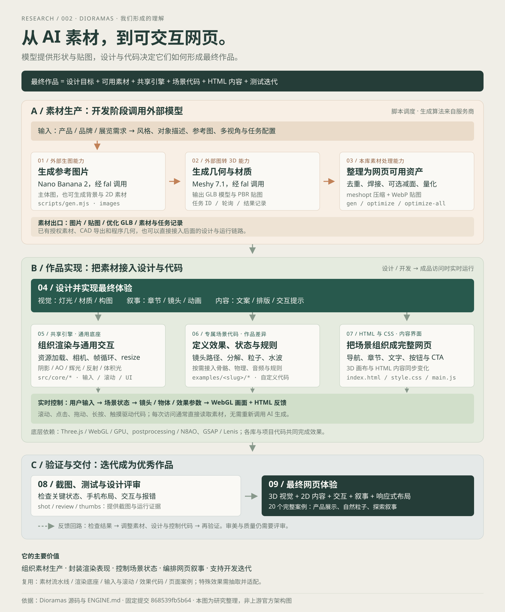
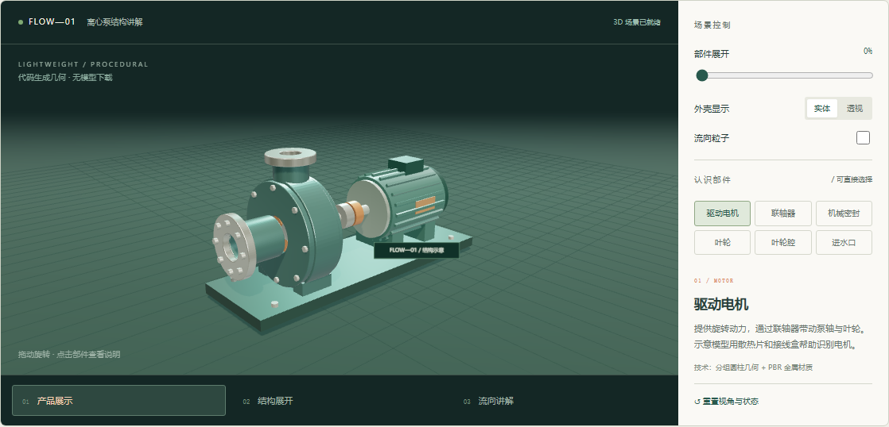

# 002 · Dioramas：3D 网页编排与场景实验

> Dioramas 将外部生图与图转 3D 服务、素材调度与优化、共享实时引擎、场景专属代码和 HTML/CSS 编排为完整交互网页。研究覆盖能力、9 个共享核心模块、7 项开发工具、20 个案例、制作与运行原理、应用场景、设计与工程价值、复用条件及扩展验证。保留原理解总览图，用离心泵结构讲解实验验证输入、状态、画面与内容之间的连接。

[返回总索引](../../README.md) · [完整研究记录](research.md) · [Web 运行说明](web/README.md) · [部署与验证记录](deployment.md)

| 项目 | 信息 |
| --- | --- |
| 原仓库 | https://github.com/blendi-remade/dioramas |
| 固定研究提交 | [868539fb5b64a843071a2247d5d8bacb706a07b1](https://github.com/blendi-remade/dioramas/commit/868539fb5b64a843071a2247d5d8bacb706a07b1) |
| 研究日期 | 2026-10-09 |
| 完整整理与发布 | 2026-10-12；保留固定源码与原引导图 |
| 上游代码 / 素材许可 | MIT / CC BY 4.0；引入 20 张小体积案例截图，未引入模型或上游代码 |
| 本地环境 | Windows / PowerShell，Node.js 22.15.0，npm 10.9.2 |
| 本地实现 | 原生 JavaScript、Three.js 0.186.1、Vite 8.3.4 |
| 验证范围 | 上游文档与源码研究；本地独立实验运行验证 |
| 发布配置 | 构建到 web/dist，汇总到 /002-dioramas/；实际发布结果见 deployment.md |

## 我们形成的理解

Dioramas 的核心价值在于组织素材生产、封装渲染表现、控制场景状态，以及将 3D 与 HTML 内容编排成完整网页。

AI 生图与图转 3D 能力来自 fal 上的外部模型服务。实时图形基础来自 Three.js 与其他成熟库。共享核心和各案例还提供了自定义反射、体积光、程序纹理、粒子、水面、镜头与交互逻辑。其技术价值主要在工程整合与视觉实现。

模型通常提供几何、贴图、材质和可选动画；它如何响应滚动、如何展开、如何与文字配合，仍需要程序与设计。很多特殊效果位于案例目录，提炼成通用模块需要额外工作。

完整链路：设计需求 → 外部生图 → 外部图转 3D → 调度与素材优化 → 场景和网页设计 → 共享引擎 + 专属场景代码 + HTML / CSS → 实时交互与渲染 → 截图、测试和评审迭代 → 最终作品。也可使用已有授权素材、CAD 导出或程序几何，直接进入后面的实现链路。

“引擎”指可复用的运行底座。Three.js / WebGL 提供底层图形能力，Dioramas 封装资源、相机、帧循环、后期、输入、滚动和通用 UI；具体规则、视觉主题、章节内容和排版在作品代码中实现。生图与图转 3D 在制作阶段运行，成品通常直接加载资产，用户交互无需重新生成素材。

总览为本次源码研究整理，并非上游官方架构图。[SVG 矢量图](assets/understanding-map.svg) · [PNG 图片](assets/understanding-map.png)。

## Web 内容

- 能力与定位：素材流水线、渲染封装、完整体验编排。
- 完整摘要：定位、能力、模块、原理、效果与证据、场景、价值、扩展、边界九个维度，与总库元数据一致。
- 理解总览：一张完整链路图、四层职责说明、SVG / PNG 下载与大图查看。
- 底层原理：制作阶段与访问阶段两条链路，节点可查看职责与源码。
- 共享引擎与开发工具：运行模块、机甲蓄力的控制示例、7 项工具及产出边界。
- 已有效果：20 个案例的上游截图，支持分类筛选、点击放大、前后切换；保留图源、许可、源码和证据级别。
- 使用场景：品牌产品、线上展览、设备认知与培训。
- 可复用技术：9 项技术的来源、迁移方法和本次采用情况。
- 价值判断：素材与体验解耦、通用机制复用、设计可修改、对象与内容关联、开发证据、对我们的迁移意义。
- 真实场景实验：供水泵售前展示与部件认知。
- 扩展方向：授权资产与语义、配置化、特效模块、教学任务、设备分级和质量台账；分别列出下一步验收标准。
- 来源与边界：固定提交、许可证、验证范围与限制。

## 实际预览

实际截图来自本子项目运行的页面；泵体为代码生成的简化教学结构，并非上游界面或真实厂商设备。可旋转、选中部件、调整展开、切换外壳显示和流向。

## 能力与模块

| 模块层 | 能力与已有实现 | 复用条件 |
| --- | --- | --- |
| 素材生产 | gen 调度 fal 上的生图和图转 3D，记录参数、任务与结果 | 外部模型认证与费用；任务配置需适配 |
| 素材优化 | optimize / optimize-all 去重、焊接、可选减面、量化、meshopt 与 WebP | 保持质量并在目标设备检查效果与加载成本 |
| 渲染与资源 | engine / assets：帧循环、相机、尺寸适配、环境与后期、模型 / 贴图加载与表面采样 | 正确素材、场景参数、资产语义与性能预算 |
| 输入、滚动与 UI | input / scroll / ui：指针、平滑、滚动进度、文字、加载、光标和导航 | 页面定义触发条件、规则、排版和等效输入 |
| 自定义视觉与案例信息 | reflector / volumetric / textures / worlds：反射、体积光、程序纹理及案例目录 | 接入场景、调参与控制额外 GPU 成本 |
| 专属作品 | examples 中的镜头、水波、粒子、液体、分解、物理、音频或规则 | 阅读辅助模块，准备合适素材并抽取接口 |
| 开发检查 | gen、optimize、optimize-all、shot、review、contact、thumbs | 环境、目录、端口和浏览器参数需要适配；证据仍需评审 |

上述共享核心为 9 个文件。Three.js、postprocessing、N8AO、GSAP、Lenis 和其他依赖提供底层能力；仓库组织接口并补充自定义实现。生成脚本的输出是素材，最终网页的设计与交互由开发实现。

## 使用价值与场景

适合品牌产品、线上展览、艺术或自然主题、设备售前与部件认知等“体验本身承载内容”的页面。价值包括同一素材的多种表达、共同运行机制复用、设计参数和规则可修改、空间对象与说明关联，以及生成记录和实际画面的检查证据。

本次泵实验将部件 ID、展开、透明度、镜头与说明对应起来，并拆出可由宿主传入 Three.js 的 pump-model.js 和 pump-parts.js。它验证一种迁移方法，没有证明工业结构精度、完整仿真、制作效率提升或商业转化。

## 可扩展方向与验收

| 方向 | 下一步验收标准 |
| --- | --- |
| 授权资产与部件语义 | 第二个产品正确装配、选择、展开，说明与来源可追溯 |
| SceneConfig 与编辑界面 | 修改配置得到另一场景；无效配置有明确提示 |
| 特效和交互模块化 | 同一模块运行在两个场景，更新与销毁不遗留资源 |
| 专业审核的教学任务 | 内容审核通过，反馈对应专业内容与真实数据来源 |
| 设备分级与替代视图 | 手机和笔记本达到各自预算，关闭 3D 后主要内容仍可读 |
| 素材与质量台账 | 修改能追踪输入、输出、费用、版本、评审与修复证据 |

这些是扩展建议，尚未作为通用系统实现。整体网格需要分件后才能按结构展开，实际设备数据和专业仿真需要独立来源。

## 运行

在本目录下进入 web，执行 npm ci，再执行 npm run dev；访问 http://127.0.0.1:5192/。

构建执行 npm run build。完整命令、Pages 子路径与验证记录见 [Web 说明](web/README.md) 和 [研究记录](research.md)。

## 实验边界与归属

没有下载上游模型、大文件或完整仓库，没有调用付费生成服务。本实验参考技术思路，独立编写场景与控制代码，没有复制 Dioramas 的引擎源码。

场景针对真实使用需求设计，没有对应品牌、型号或产品尺寸。结构、展开与流向用于讲解，不计算流量、扬程或检修参数。上游已有案例依据 README 和部分源码整理，本次未逐一运行上游 20 个网站。

研究来源：[Dioramas](https://github.com/blendi-remade/dioramas)。代码 MIT，Copyright (c) 2026 Blendi；素材 CC BY 4.0。第三方依赖及许可见 [THIRD_PARTY_NOTICES.md](web/THIRD_PARTY_NOTICES.md)，Three.js 保留原始许可证。

## 上游效果图览

“已有效果”已加入上游 public/img/index 中的全部 20 张 WebP。单张 50,048–181,244 字节，合计 1,791,330 字节。图片保持原样，按 CC BY 4.0 署名，支持页面内放大与键盘左右切换。

这些是原项目的静态案例画面；完整 3D 交互仍需要上游模型，当前未加载。来源清单与 Git blob 哈希在 [图片清单](assets/upstream-gallery/manifest.json)，验证记录在 [图览检查](assets/gallery-verification.json)。
