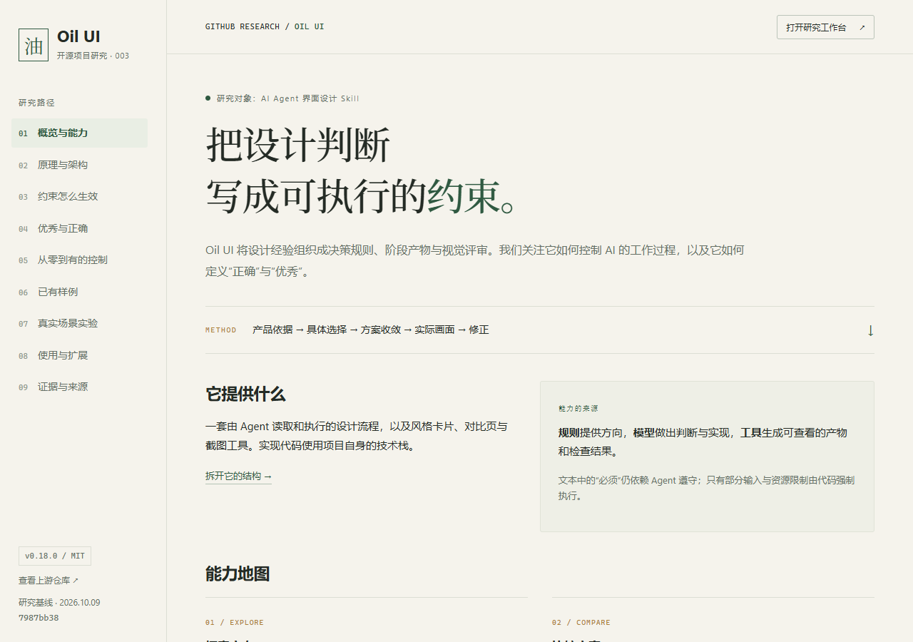

# 003 · Oil UI：AI 前端设计方法、约束与复用研究

Oil UI 是供 AI Agent 执行的前端界面设计 Skill、参考方法与辅助工具。以我们生成的完整中文引导图组织阅读，全面说明方向探索、方案比较、视觉语言、素材与动效、规范润色、截图还原、取证评审等能力，拆解文本协议、宿主模型、Python 生成器和 Node/CDP 工具的分工。进一步比较模型直接实现、约束与创意、UI 与 3D 工具，整理个人和团队价值、适用场景、复用条件及可扩展方向。

[返回总索引](../../README.md) · [详细研究](research.md) · [网页说明](web/README.md) · [上游仓库](https://github.com/oil-oil/oil-ui)

| 项目 | 信息 |
| --- | --- |
| 研究版本 | v0.18.0，`7987bb38afeea1ff8e96641b3ffebb5601fe67d2` |
| 研究日期 | 固定源码与引导图：2026-10-09；网页汇总与发布整理：2026-10-12 |
| 上游许可 | MIT，Copyright (c) 2026 oil-oil |
| 本地环境 | Windows / PowerShell，Node 22.15.0，Python 3.10.11 |
| 网页 | 原生 HTML / CSS / JavaScript，无 npm 依赖 |
| 本地地址 | 启动后访问 <http://127.0.0.1:4173/> |
| 发布地址 | <https://yydshly.github.io/1009_codex_project/003-oil-ui/>；部署状态以 [发布记录](assets/publication.json) 为准 |

## 网页覆盖的研究问题

十三个章节展示引导图与能力、模块与产物、原理与架构、约束机制、正确与优秀、从零到有的控制、与模型直接实现的区别、上游样例、真实场景、个人与产品价值、使用与扩展、证据与来源及研究汇总。架构与阶段控制可以点击查看；规则可展开查看执行者和源码依据。

新增的 [研究汇总网页](http://127.0.0.1:4173/#summary) 整理了能力定位、对我们的价值、约束与创意的平衡、与 Dioramas / Dvor 的差异，以及迁移到 3D 的方法和待验证问题。要点是提取设计控制方法，区分正确性门槛与审美选择；现有实验尚不能证明 Skill 的质量提升幅度。

[一图总览](assets/oil-ui-understanding-v1.png) 将这些理解整理为七个模块，并接入上游样例视觉拼贴。通过内置 image_gen 制作，完整 [生成提示词](assets/oil-ui-understanding-prompt.txt) 已保留；图像属于研究表达，不是新的效果验证。入口直接展示完整原图，可以单独放大；PNG 未重新生成或裁切。

## 实际预览



*实际浏览器截图，非占位图。上游样例与本地实验分别标注。*

## 运行

在仓库根目录运行：

```sh
node projects/003-oil-ui/scripts/build.mjs
node projects/003-oil-ui/scripts/serve.mjs
```

打开 `/` 阅读研究，打开 `/demo.html` 操作工作台。默认端口 4173，可通过 `OIL_UI_PORT` 指定。

重新生成风格与版式对比页：

```sh
node projects/003-oil-ui/scripts/generate-experiment.mjs
```

该步骤需要 Python 3.10+，直接执行本项目保留的两个上游生成器。生成页已纳入仓库，普通运行与 Pages 构建不要求 Python。

## 真实场景

维护多个 GitHub 项目的研究队列。工作台读取根 `projects.json` 的构建快照，支持名称、编号和标签搜索、状态筛选、项目选择、笔记保存读回、保存失败提示与 JSON 导出。

笔记保存在浏览器本机，不写回仓库，不接入账号或服务端。实验包括 4 张风格卡片、3 个版式小样、设计约定和选型记录。本次自主选定方向，没有伪造用户选择；由实现 Agent 自检，未独立评审，未给审美分数。

## 结论、价值与扩展

最值得提取的是范围路由、模糊词翻译、候选差异、小样选择、方向约定和证据驱动的修正。正确性适合设门槛；审美保留选择，探索后再逐步固定。Dioramas 另有资产与渲染能力，Dvor 是具体风格化作品，三者可以按责任组合，不能直接做质量排名。

扩展可围绕设计约定 schema、显式阶段状态与门禁、团队参考与偏好库、多维评审、跨设备和工程联合验收、图像/3D 工具接入与规则版本管理。这些属于建议；需在同任务、模型、素材与预算下对照验证完成度、辨识度与修改成本，现有实验尚未量化提升。

## 来源与修改

上游代码副本位于 `tools/oil-ui/`，保留 MIT LICENSE，未修改两个生成器和对比页模板。模板字体保留 OFL。上游公开样例图原样保存在 `assets/`；研究网页、工作台、示例配置与测试为本项目新增实现。来源清单见 [素材说明](assets/README.md) 与 [研究记录](research.md)。
