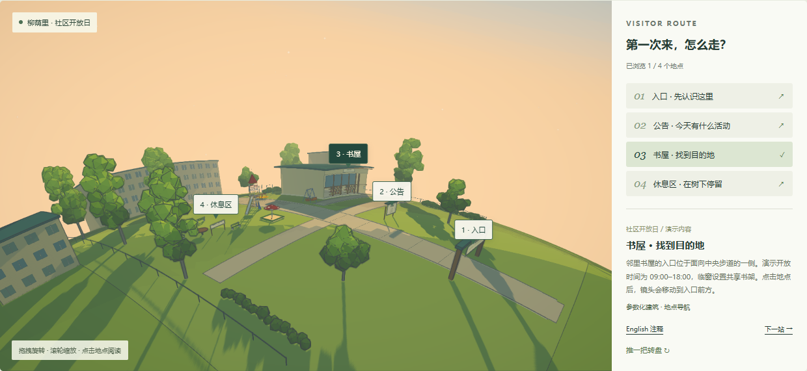

# 004 · Dvor：风格化世界、程序化建模与社区导览研究

> 用原始全景图引导，全面研究浏览器漫游、轻量碰撞、空间文字、设施与电车动画、代码建模、Canvas 纹理、卡通明暗、深度轮廓、冷暖调色、FXAA 和球面坐标。以真实社区导览验证模块迁移，提供风格参数与编程/图像模型提示词，说明学习、创作和产品价值，以及内容、编辑、资产、叙事、设备和性能等扩展条件。

[返回总索引](../../README.md#有序索引) · [研究记录](research.md) · [Web 运行说明](web/README.md)

[一图总览：高清 PNG](assets/dvor-overview.png) · [可编辑图稿](assets/dvor-overview.html) · [制图内容与提示词](assets/dvor-overview-prompt.txt)

一张图串起能力、渲染与建模原理、原作六类视觉效果、社区扩展、模块复用、使用场景与提示词控制；图内采用已有真实截图，明确区分已实现能力与扩展建议。

| 项目 | 信息 |
| --- | --- |
| 原仓库 | [amirmushichge/dvor](https://github.com/amirmushichge/dvor) |
| 研究版本 | [`30d6f684670915865743c79f44f931a43d987113`](https://github.com/amirmushichge/dvor/tree/30d6f684670915865743c79f44f931a43d987113) |
| 上游许可证 | MIT；[Dvor 声明](LICENSE.dvor)、[Sakura Crossing 声明](LICENSE.sakura-crossing) 均保留 |
| 研究日期 | 基线研究 2026-10-09；完整整理与发布 2026-10-12 |
| 技术栈 | Three.js 0.180.0、Vite 6.4.3、Node.js 22+ |
| 当前状态 | 完整研究指南、原图导读与真实社区实验完成；10 项场景、7 项提示词和 5 项完整指南检查通过 |
| 在线网页 | [GitHub Pages · 完整研究与实验](https://yydshly.github.io/1009_codex_project/004-dvor/)；2026-10-12 部署与公网检查通过 |

## 网页回答的六个问题

1. **能力**：浏览器中的完整风格化漫游作品，支持行走、碰撞、空间文字解读和轻量物件互动。它提供可改造的源码，尚没有通用场景编辑器。
2. **原理**：代码构造几何与 Canvas 纹理 → 卡通色带及冷色阴影 → 颜色/深度离屏渲染 → 深度描边 → 冷暖调色 → FXAA。作者先在平面布置物件，再把世界映射到球面。
3. **已有样例**：六张上游原始截图；可进入实际构建的上游庭院，查看通道、游乐场、车库、电车与小行星远景。
4. **使用场景**：城市记忆、文化展览、社区/校园导览、语言学习与风格原型。产品方向属于基于源码和实验的推导。
5. **可扩展方向**：真实场地数据、内容编辑、多语言、任务状态、模型导入、LOD、移动端性能与无障碍入口。
6. **可复用效果**：卡通材质、调色/描边管线、建模积木、球面坐标、实例树木、杨絮、设施动画和玩家控制，均实际用于本地新场景。

## 模块与研究价值

上游 `core/` 管理配色、卡通材质、纹理、显示管线、轮廓、天空与玩家；`world/` 包含建模积木、住宅、自然、庭院设施、街道、车库、球面与布局；`content/` 关联预设翻译与地点背景。本地新增 `community.js`、`content.js`、`demo.js` 和提示词工具，将复用基础应用到新几何、路线、镜头与交互。

核心原理是代码生成部件与文字纹理，由作者布置空间和叙事；静态几何按材质合批、树冠实例化。渲染依次形成色带与阴影、颜色和深度、深度描边、调色与 FXAA；雾在场景阶段处理。世界由平面 XZ 映射到球面显示，玩家碰撞和高度查询保留平面逻辑。详细文件职责、输入输出与移植条件见网页模块表和 [研究记录](research.md)。

学习者可以通过同镜头参数比较理解风格因果，创作者可以复用管线与建模积木，内容团队可以把位置与故事关联。对研究总库，它是具有源码、许可证、截图和交互证据的迁移样本。现有实验未证明商业转化、量化效率或真实用户任务改善。

扩展可分为三步：先确认真实场地与内容更新、设备和阅读入口，再完善配置、编辑与 glTF 适配，最后按任务增加语音/进度、LOD、分区加载和质量分档。具体方向仍需独立实现和验收；球面艺术效果与真实导航的准确性分别评估。

## 实际场景演示

演示一个明确的使用任务：**首次到访社区的访客，查看活动公告，找到邻里书屋，再选择休息点。**

“柳荫里社区开放日”的名称、布局与服务信息为虚构演示数据，不对应真实地址。场景使用实际 Three.js 几何，能拖拽、缩放、键鼠漫游、点击公告、切换中英说明、按四站导览，并推动转盘。书屋和入口等模型由本地代码搭建，树木、长椅、设施和渲染基础来自上游。



*本地浏览器实际截图：新社区几何、四站路线与空间标记。更多截图及来源见 [assets/README.md](assets/README.md)。*

网页提供三套风格预设，以及色带、太阳高度、描边、空气透视、阴影色、杨絮开关。参数直接改变实际材质、光源与渲染管线；可保存到浏览器或导出 JSON。场景布局在代码中修改，网页目前没有拖拽建模编辑器。

## 独立创作与提示词

网页新增 `#prompts` 章节，把我们对风格控制的理解整理为七项视觉规格、编程模型/图像模型的完整模板，以及四个逐轮修正示例。

模板可以编辑、切换、复制和下载 TXT；3D 模板可带入实验区当前的色带、太阳、阴影、描边和雾设置。切换模板保留本次编辑，下载文本用于长期保存；复制不可用时提供手动选中文本。

提示词用于独立创作，需要交给模型执行并用实际截图校准；本页现有 3D 场景仍按“来源与修改”所述复用上游代码。模板正文统一维护在 [prompt-guide.js](web/src/prompt-guide.js)。

## 运行与复现

```sh
cd projects/004-dvor/web
npm ci
npm run dev
```

开发地址为 `http://127.0.0.1:5194/`。构建预览：

```sh
npm run build
npm run preview
```

预览地址为 `http://127.0.0.1:5195/`。页面是纯静态应用，无 API 密钥、后端或外部 CDN。通过 HTTP 打开，不能直接双击 `index.html`。

```sh
# 先启动构建预览，再在另一个终端执行
npm run verify

# 在总库根目录汇总站点
npm run index:sync
npm run check
npm run pages:build
```

## 发布与验证

源码已提交至总库 `main`，发布源码提交为 [`eaeb0fd`](https://github.com/yydshly/1009_codex_project/commit/eaeb0fdf3d3d10e6552f612223c23685810be866)。[GitHub Pages 发布运行](https://github.com/yydshly/1009_codex_project/actions/runs/38228369558) 与 [索引校验运行](https://github.com/yydshly/1009_codex_project/actions/runs/38228317865) 均成功。

本地 22 项浏览器检查及编号子路径验证通过。公网实际检查确认研究页与 WebGL 初始化、六张样例、原图 SHA-256、模块/价值/扩展/提示词内容、动态原作世界、电车和热点，以及三份 MIT 文件 HTTP 200；根首页完整摘要与 `projects.json` 一致。见 [部署记录](assets/deployment.json)、[公网页面检查](assets/public-pages-verification.json) 和 [公开摘要检查](assets/public-index-verification.json)。

## 来源与修改

`web/src/vendor/` 引入基线的 `core/`、`world/`、`content/` 共 19 个文件。其中 `toon.js` 有一处 Three.js r180 兼容修正，其余 18 个文件保持原样；修改说明见 [vendor 来源](web/src/vendor/README.md)。网页新增中文研究说明、社区世界、导览界面、轨道摄像机、参数控制和验证脚本。上游模式复现原始世界几何，使用本页新增的摄像机与渲染配置，并非逐像素还原原始应用的菜单和镜头。

Dvor 的庭院创作归属 Amir Mušić；部分渲染、移动和界面基础改编自 Kenton Wang 的 [Sakura Crossing](https://github.com/Kenton-GMI/sakura-crossing)。六张截图来自上游 `docs/shots/`，在网页中标注来源。两份完整许可证同时进入静态构建产物。
