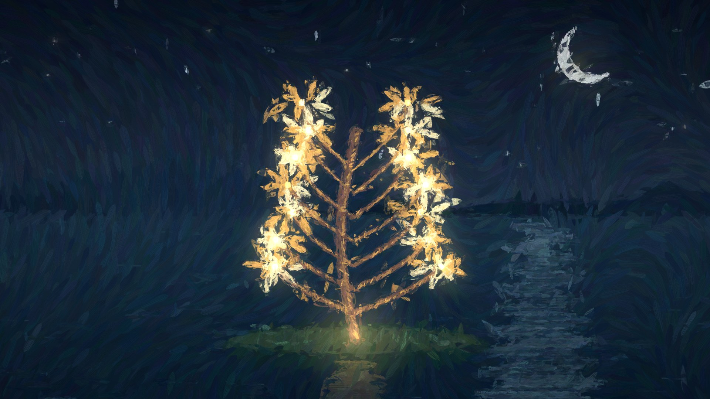

# 009 · Functional Emotions：油画动画与音乐同步

以已有总览图引导阅读，完整汇总代码绘画、音乐 MV、七大模块、创作约束、原理、效果、价值与扩展方向。保留原版八章 MV 和 32 秒原创有声实作《光种的旅行》，提供独立创作提示词。

核心是“模型在制作阶段编写动画代码 → 程序逐帧绘画 → 音乐同步与检查优化”。用户只指定画风和大方向，故事与分镜交给模型发挥；Skill 可沉淀创作流程，原库实际使用分镜与动画指南。网页播放既有代码作品。

[返回总索引](../../README.md#有序索引) · [研究记录](research.md) · [网页说明](web/README.md) · [验证记录](verification.md) · [原仓库](https://github.com/ledbetterljoshua/functional-emotions-video)

| 项目 | 信息 |
| --- | --- |
| 固定提交 | [b34c20a4f8f64ee87079a2ae2fdedf2cf1990a49](https://github.com/ledbetterljoshua/functional-emotions-video/tree/b34c20a4f8f64ee87079a2ae2fdedf2cf1990a49) |
| 研究日期 | 2026-10-09，Asia/Shanghai |
| 代码许可 | MIT，Copyright (c) 2026 Joshua Ledbetter；[保留的原文](web/vendor/functional-emotions/LICENSE) |
| 本地实现 | 原生 HTML / CSS / JavaScript；上游 WebGL2 渲染器与八个章节 |
| 本机环境 | Windows、Node.js 22.15.0、Chrome、Intel UHD Graphics / ANGLE Direct3D11 |
| 发布目录 | web/dist/；使用 Node.js 标准库构建，无需安装网页依赖 |
| Pages 路径 | [公开研究网页](https://yydshly.github.io/1009_codex_project/009-functional-emotions-video/)；部署状态见验证记录 |

## 引导图

*采用此前生成的同一张研究总览图。AI 编排的信息图嵌入原库及原创演示的真实代码渲染素材，非网页截图。网页支持放大、缩放和下载原始 PNG。*

## 能力、模块与价值摘要

| 维度 | 说明 |
| --- | --- |
| 定位 | 一支音乐 MV 的源码工程，加上可复用的绘画引擎、时间轴和制作方法；创作时模型写码，播放时程序绘画。 |
| 已有效果 | 原库八章、168 镜头、372.7 秒；本项目 32 秒、六镜头原创有声光树故事。大笔触、冷暖光影、剪影、水纹、粒子与发光形成诗意叙事。 |
| 能力 | 绘制角色和场景、编排镜头动作、音乐时间同步、油画渲染、交互调参、定位重绘、离线输出和联系表评审。 |
| 模块 | 音乐分析；故事分镜／创作指南；人物与章节代码；镜头时间轴；画风引擎；播放器；导出与质量检查。 |
| 原理 | Canvas2D 底画和光层 → WebGL2 多尺度笔触重绘 → 发光与纹理合成。歌曲时间、节拍、强弱及词时间为动作编排提供依据。 |
| 创作约束 | 用户只定风格和大方向；模型自由创作故事、意象、分镜和技术方案，自行建立一致性规范并通过实际效果改进代码。 |
| 价值 | 留下可修改、可重渲染的工程，方便反复调整、版本迭代、角色及画风复用、专辑／品牌系列创作与其他视频工作流衔接。 |
| 使用场景 | 首先是音乐定制 MV，也可探索诗歌／歌词影像、科普动画、文化与文旅故事、品牌短片和舞台视觉。 |
| 可扩展方向 | 接入用户音乐分析、模型服务、自动分镜写码、质量评审、渲染任务与批量导出、版本管理、系列模板和素材管理。 |
| 当前边界 | 网页没有在线模型或自动听歌成片；本地音频只替换伴奏。原创音乐和场景按共同乐谱设计；通用平台与业务扩展仍待建设。 |

## 可以体验什么

1. 顺序播放原作品八章、168 个镜头的完整画面（372.7 秒），点击章节定位；也可切换四段精选实验。
2. 点击“播放原版 MV”或“播放原版音乐”，直接联网读取上游 MP3，同步画面、暂停、拖动和重播。可切换静音观看或本地音频；其他音频仅伴随播放，不会重新编排。
3. 调节笔触粗细和变化频率，再恢复原场景设置。
4. 浏览八个章节的真实 1080p 渲染截图，查看大图，并展开原作品故事结构。
5. 阅读场景绘制、音乐同步、镜头动作、离线导出和画面评审的能力说明。
6. 切换科学概念、文化故事、品牌叙事、舞台视觉四种扩展设想，比较输入、可复用基础、新增工作和价值。
7. 查看与 001 Motion Video Kit、004 Dvor、006 BeefTV 的联系，以及源码、许可与验证边界。
8. 播放原创《光种的旅行》，按六个镜头定位，对比底画与油画，修改暖金/青绿配色，下载原创音乐与乐谱数据；本机完成离线导出后可观看 MP4。
9. 查看七个模块的职责、复用方式与新增工作，以及从单曲定制到系列模板、批量制作的路线；复制或下载独立创作提示词。

## 本次原创实作

《光种的旅行》让一颗光种越过夜湖、落水、聚光、抽芽、盛放，再把光还给夜空。音乐由本次助手编写乐谱并使用程序合成：32 秒、90 BPM、48 拍，含钟琴、和声、低音与轻打击乐。每八拍进入一个新镜头。

新场景和镜头代码由本次助手编写；油画笔触复用上游 MIT 渲染器。播放时用音乐时间定位画面。它完成了一次“音乐 → 分镜与动画代码 → 风格化 MV”的真实制作，尚未提供任意音乐自动成片服务，也没有在网页运行时调用 Opus。

*本次新场景代码实际渲染画面。音频与场景是原创，上游只提供油画渲染器。*

## 核心理解

用户只约束审美和大的方向，具体故事、角色、意象和分镜由模型创作。Skill 可组织风格、流程与评审方法；原库实际采用 STORYBOARD.md 和 ANIMATION_GUIDE.md，当前网页说明这种方法，没有接入在线模型或自动成片服务。

歌曲时间、节拍与音频特征提供动作和切镜的依据；具体故事与动作由分镜和代码规定。Canvas2D 绘制底画与光层，WebGL2 用约六万个笔触重绘，再加入发光、织纹、颗粒和暗角。

换一首歌或一个主题，需要重新分析音频、编写分镜和场景。《光种的旅行》已完成一次原创适配；科学、文化、品牌和舞台四类业务扩展仍是建议。

## 一张图与独立创作提示词

网页总览区支持放大、缩放与 PNG 下载；“理解与提示词”区提供独立的创作任务，可复制或下载 TXT。提示词不要求依赖原库，只约束审美和大方向，模型自主选择技术方案。详见 [素材说明](assets/overview/README.md) 与 [独立提示词](assets/overview/mv-creative-prompt.txt)。

网页实际截图见 [桌面总览](assets/overview-desktop.png) 与 [手机总览](assets/overview-mobile.png)。

## 本地运行

需要 Node.js 22+；网页没有第三方构建依赖。在总库根目录执行：

    npm.cmd run build --prefix projects/009-functional-emotions-video/web
    npm.cmd run check --prefix projects/009-functional-emotions-video/web
    npm.cmd run dev --prefix projects/009-functional-emotions-video/web

打开 [本地研究页](http://127.0.0.1:4319/1009_codex_project/009-functional-emotions-video/)。实时片段需要 WebGL2；截图与说明不依赖 GPU。

总库校验与汇总：

    npm.cmd run index:sync
    npm.cmd run check
    npm.cmd run pages:build

## 来源与修改

引入原渲染器、动画工具和八个章节，并实现完整画面、精选循环、原曲联网播放和本地音频控制。保留数字音频特征；原词时间查询转换为数字标识与时间点，LYRICS 为空。八张截图来自同一固定提交的完整原项目，由本机实际渲染。详见 [上游代码与修改说明](web/vendor/functional-emotions/README.md)。

上游歌曲文件与完整歌词没有纳入构建产物。点击原版播放后，浏览器直接读取固定上游提交的 MP3。新增原创音乐 WAV 与真实渲染静帧作为本项目演示资源保存；原版歌曲的 MIT 排除声明仍保留。
