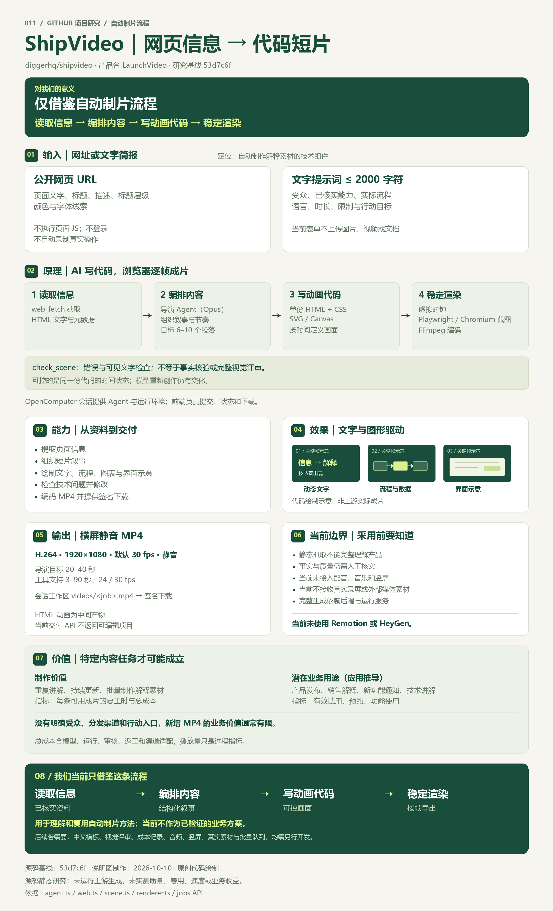

# 011 · ShipVideo：从网页信息到代码短片

用原始中文引导图和完整研究网页说明 ShipVideo 如何把公开网页或文字简报转成代码绘制的解释短片。覆盖能力、八类模块、从提交到下载的任务链路、逐帧渲染原理、输入输出与效果、条件性业务价值、对我们的意义和可扩展方向。当前仅借鉴“读取信息 → 编排内容 → 写动画代码 → 稳定渲染”的流程，上游生成与业务收益未实测。

[返回总索引](../../README.md#有序索引) · [研究记录](research.md) · [网页说明](web/README.md) · [验证记录](verification.md) · [原仓库](https://github.com/diggerhq/shipvideo)

## 一图总览

*原创代码绘制的中文研究说明图。关键帧为代码动画示意，非上游实际成片；上层业务用途为推导，未验证收益。对我们当前仅有流程借鉴意义。*

[高清 PNG](assets/overview-infographic.png) · [可编辑 SVG](assets/overview-infographic.svg) · [绘制脚本](assets/build-overview.py) · [设计提示词与生成记录](assets/overview-prompt.txt) · [事实依据](research.md)

| 项目 | 信息 |
| --- | --- |
| 原仓库 | [diggerhq/shipvideo](https://github.com/diggerhq/shipvideo)；产品名 LaunchVideo |
| 固定提交 | [53d7c6f752fb85b449de8cf806b77ad21808a8f1](https://github.com/diggerhq/shipvideo/tree/53d7c6f752fb85b449de8cf806b77ad21808a8f1)，提交日期 2026-10-01 |
| 研究日期 | 2026-10-09，Asia/Shanghai |
| 内容更新 | 2026-10-12：补全十项理解摘要、八类模块、任务链路和效果边界；复核上游提交未变，原始引导图保持不变 |
| 上游许可证 | 研究提交未发现 LICENSE，GitHub 仓库元数据 license 为 null；本子项目未引入上游实现代码 |
| 本地环境 | Windows、Node.js 22.15.0；2026-10-10 使用内置浏览器，2026-10-12 使用静态和 HTTP 检查 |
| 实现 | 原生 HTML / CSS / JavaScript；Node.js 标准库预览与检查，无第三方依赖 |
| 完成范围 | 源码研究、原图保留、完整研究网页、摘要和索引同步、静态及 HTTP 核验；既有交互验证见日期记录 |
| 尚未验证 | 上游 Agent 运行、模型付费生成、中文成片质量、耗时及成本 |
| Pages 目录 | web/public/；[在线研究页](https://yydshly.github.io/1009_codex_project/011-shipvideo/)；发布验证结果见 verification.md |

## 网页预览

*2026-10-10 的本地研究网页实际桌面截图，未包含 2026-10-12 新增模块。代码动画为本项目原创机制示意，不是上游生成结果。*

[业务价值模块截图](assets/business-value.jpg) · [完整桌面截图](assets/overview-desktop.jpg) · [完整手机截图](assets/overview-mobile.jpg) · [图片说明](assets/README.md)

## 可以体验什么

1. 查看网址与提示词两种入口，编辑简报，切换方式后保留当前编辑内容。
2. 区分输入、HTML 中间产物、最终 MP4 与签名下载；了解横屏、帧率、时长和静音规格。
3. 查看读取、叙事、代码绘图、检查、导出五项能力。
4. 点击 AI、虚拟时钟、浏览器、FFmpeg 四个环节，查看职责和原理伪代码。
5. 切换产品发布、功能更新、技术解释、研究传播四种场景，比较准备材料、输出与适用边界。
6. 将当前场景载入 24 秒预设动画，播放、暂停、重播、拖动时间和反向定位。
7. 载入场景提示词，编辑并复制；展开扩展建议和固定提交的源码依据。
8. 查看制作效率、产品获客、销售解释、功能采用四种业务用途；对照制作工时、有效预约、实际使用等指标，判断短片是否值得制作。
9. 查看并打开中文全景图原图，集中理解能力、原理、效果、输入输出和价值边界。
10. 阅读与 projects.json 同步的十项完整摘要，展开八类模块与从提交到签名下载的五步任务链路。

## 完整理解摘要

| 主题 | 理解 |
| --- | --- |
| 定位与能力 | Agent 自动组织叙事并写动画程序，连接静态网页读取、代码绘图、技术检查和文件交付。 |
| 模块 | Next.js Web、任务创建 API、会话与运行环境、导演 Agent、web_fetch、场景工具、逐帧渲染器、状态与交付 API。 |
| 原理 | JOB 进入会话后生成单份 HTML；虚拟时钟控制帧时间，Chromium 截图交给 FFmpeg。固定代码的时间状态可控，模型重新创作仍有变化。 |
| 输入输出 | URL 或 ≤2000 字符文字简报；输出 1080p、H.264、默认 30 fps 静音 MP4 与签名 URL。导演目标 20–40 秒，工具支持 3–90 秒及 24/30 fps。 |
| 效果与边界 | 动态文字、流程、图表和绘制界面适合解释；抓取不执行页面 JS、不登录、不录制操作，当前未接入声音、竖屏和真实素材。 |
| 业务价值 | 重复制作、产品发布、销售讲解、新功能通知等特定内容任务才可能受益；需要受众、分发、行动入口及总成本和业务指标验证。 |
| 对我们的意义 | 当前直接商业价值有限，仅借鉴自动制片流程与模块分工，不作为已验证的业务方案。 |
| 可扩展方向 | 中文模板、视觉评审、成本记录、音频字幕、竖屏、真实素材、多模型、本地适配与持久队列预算；均需另行开发。 |
| 引导图与证据 | 2026-10-10 的 PNG/SVG 字节原样保留；2026-10-12 复核 main 仍为 53d7c6f。记录源码、环境和许可证发现，未运行上游 Agent。 |

网页不抓取网址、不调用模型、不收集 API Key，不提供实际 MP4 下载。动画是可运行的本地说明，按钮不会启动上游生成服务。两个产品发布与更新案例为假想产品示例，均在简报中标明。

## 核心理解

ShipVideo 用 Agent 串起信息读取、分镜、单份 HTML 动画、技术检查与 MP4 交付。当前渲染器直接使用 Playwright、Chromium、虚拟时钟和 FFmpeg，没有使用 Remotion 或 HeyGen。

实际业务价值在于复用已有产品信息、降低重复制作与解释负担，以及为分发和客户行动提供素材。减少工时可以直接核算；获客、销售和功能使用的改善需要实际验证，仓库没有提供转化提升证据。

对当前总库：直接商业价值有限，我们仅借鉴“读取信息 → 编排内容 → 写动画代码 → 稳定渲染”的流程。重点是已核实资料、结构化叙事、可控画面和逐帧导出，不据此确认获客、增收或批量制作需求。

扩展建议包括结构化简报、中文模板、视觉评审、用量记录、竖屏、音频合成、真实操作素材、多模型和批量任务；这些均未实现。

## 本地运行

需要 Node.js 22+，无需安装依赖。在仓库根目录执行：

    npm.cmd run check --prefix projects/011-shipvideo/web
    npm.cmd run build --prefix projects/011-shipvideo/web
    npm.cmd run dev --prefix projects/011-shipvideo/web

打开 [本地研究页](http://127.0.0.1:4321/1009_codex_project/011-shipvideo/)。

总库校验与发布汇总：

    npm.cmd run index:sync
    npm.cmd run check
    npm.cmd run pages:build

本页是纯静态文件；build 仅把 projects.json 的完整摘要同步到 HTML，无需安装依赖。Pages 工作流执行 build 与 check 后汇总 web/public。跨项目链接和“返回总索引”依赖先执行 pages:build；预览服务器会从 _site/ 读取相应页面。

## 来源与修改

结论依据为固定提交的 README、Agent、三个工具、API 路由及依赖文件，完整链接见 [research.md](research.md)。官网的 Vercel Blob 文案与当前会话工作区实现不同，以固定提交代码为准。

本页的布局、文案、动画、脚本与图像截图均为本项目制作。没有将上游代码、Logo 或示例视频引入本子项目。后续直接复用上游实现前，需要明确授权与来源声明。
