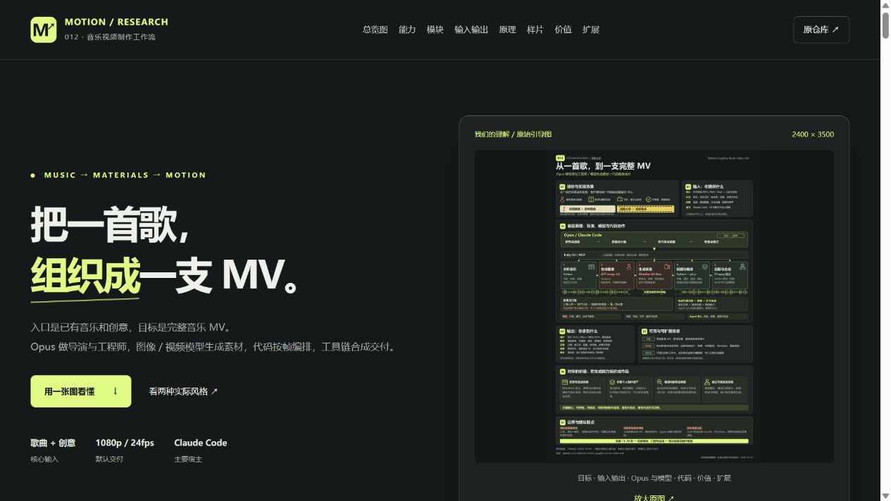

# 012 · Motion Graphics MV：音乐驱动的 AI 视频工作流

> 音乐提供时间轴，模型提供素材，代码编排成片，Agent 组织制作。

[在线研究网页](https://yydshly.github.io/1009_codex_project/012-motion-graphics-music-video/) · [返回总索引](../../README.md#有序索引) · [研究记录](research.md) · [网页运行说明](web/README.md) · [原仓库](https://github.com/makevoid/motion-graphics-music-video-skill)

| 项目 | 信息 |
| --- | --- |
| 原仓库 | makevoid/motion-graphics-music-video-skill |
| 研究提交 | [759ba6a7c80e2771f4dd69792e74383d71512e35](https://github.com/makevoid/motion-graphics-music-video-skill/tree/759ba6a7c80e2771f4dd69792e74383d71512e35) |
| 提交时间 | 2026-10-05T12:19:47Z |
| 上游许可证 | [MIT](https://github.com/makevoid/motion-graphics-music-video-skill/blob/759ba6a7c80e2771f4dd69792e74383d71512e35/LICENSE)，Copyright (c) 2026 makevoid |
| 研究日期 | 2026-10-09；10-10 理解图与样片；10-12 全面汇总及上游 main 复核（Asia/Shanghai） |
| 完成范围 | 文档与关键源码研究、原创网页、浏览器交互和 Pages 汇总验证 |
| 上游运行 | 未启动上游、未调用付费模型、未逐帧评审作者样片 |
| Pages 发布 | [公开研究网页](https://yydshly.github.io/1009_codex_project/012-motion-graphics-music-video/)；2026-10-12 部署成功并验证，记录见 research.md |

## 网页汇总

本页全面整理目标、能力、模块、原理、输入输出、效果与口型、场景、个人价值、扩展和验证边界。首页使用我们 2026-10-10 完成的理解图，完整 PNG／SVG 原文件字节保留，可放大、下载与折叠阅读。

- 五个可切换制作环节：音乐分析、分镜规划、素材生成、代码编排、合成交付。
- 输入与输出清单：已有歌曲和创意，生成整曲 MP4、素材、计划、配置及审查记录。
- 可交互原理图：Agent、Ruby CLI/MCP、云端模型、本地制作与 FFmpeg。
- 三种应用判断：独立音乐 MV、知识歌曲与研究导览、品牌音乐短片；可下载制作 brief。
- 对总库的价值：动态导览、制作协议、模型与代码分工；链接 001、006、009 子项目。
- 八组模块说明输入、产出与源码依据；详细解释 Opus 导演与工程师、Ruby 执行、云端生成、本地媒体工具和制作状态。
- 九个扩展方向：角色动效库、竖屏、Windows、模型替换、工作台、预算、专用口型／多人互动、知识导览、自动验收；标明复用、适配或新增。
- 两支作者成片的页内 YouTube 播放、四张实际截图及风格对照；点击截图切换构图，离线仍能查看。
- 成片效果分工：模型提供角色与表演素材，代码组织图形与时间线，Agent 与人做创作选择和审查。

## 预览

*一张图汇总目标效果、输入输出、Opus 导演、图像／视频模型、口型与代码编排、扩展场景、个人价值和边界。2400×3500 本地排版理解图，风格缩略为示意，非上游成片。可编辑源文件见 [SVG](assets/overview-infographic.svg)。内置生图两次网络失败后采用本地渲染，尝试提示词保留在 [记录](assets/overview-infographic.prompt.txt)。*

*本轮实际网页截图：原始理解图作为首页导览，正文包含模块、口型、样片、价值与扩展。手机截图见 [mobile-20261012.jpg](assets/mobile-20261012.jpg)。*

*2026-10-09 初版网页截图，保留作为过程记录。16 秒原创 SVG 分层示意已移至制作能力段；2026-10-12 首页改用完整理解图，不是上游界面或模型生成成片。*

*2026-10-10 更新：两支作者样片可页内播放，四张真实截图可切换。风格、效果分工和截图来源在页面及研究记录中说明。*

## 如何阅读与运行

网页为原生 HTML/CSS/JavaScript，无第三方运行时依赖；本地预览使用 Node.js 22+。

    cd projects/012-motion-graphics-music-video/web
    npm.cmd run dev

访问 http://127.0.0.1:4182/ 。脚本检查：npm.cmd run check。

在根目录同步并汇总站点：

    npm.cmd run index:sync
    npm.cmd run check
    npm.cmd run pages:build

编号子路径预览：在 web 目录执行 npm.cmd run preview:pages，访问 http://127.0.0.1:4183/012-motion-graphics-music-video/ 。

## 关键结论

库的核心是已有音乐驱动的 MV 生产流程。模型负责角色与表演，p5 直接绘制图形、文字、镜头和合成布局，Python 处理分析、抠图和音频，Swift 提供 macOS 后期特效，Ruby 统一执行并记录过程。

最值得复用的是版本化素材、分批试做与审查、任务依赖和请求恢复。复杂节奏、口型、角色一致性与实际费用需要分别验证；Windows 和竖屏需要适配。详见 [research.md](research.md)。

## 能力、模块与原理

目标是用已有歌曲与创意制作完整 MV。Opus 在 Claude Code 中承担导演与工程师：视觉研究、计划、角色设定、分镜、提示词、代码、工具调用与审查。Ruby CLI/MCP 统一执行并保存过程，Fal 适配图像／视频／音频服务。图像模型建立参考与关键帧，视频模型提供表演；代码也直接产生文字、图形、镜头与转场。

| 模块 | 主要输入 | 主要产出 |
| --- | --- | --- |
| Skill + Opus | 歌曲、创意、歌词、参考与约束 | PLAN、分镜、提示词、代码与审查判断 |
| Ruby CLI / MCP | 工具任务、配置与插件凭据 | 独立项目、执行结果、manifest |
| Python 音乐分析 + 音频适配 | 主音轨与歌词 | 节拍／起音／能量 JSON、人声与音频素材 |
| 图像／视频模型 + Fal | 角色参考、提示词、目标音频 | 角色图、关键帧、背景、绿幕表演 |
| Python 抠图 | 绿幕片段与参数 | 透明角色帧、边缘检查素材 |
| p5.js + Chromium | 素材、歌词／节拍时间点、场景代码 | 逐帧图形／文字、场景画面与预览 |
| Python / Swift / FFmpeg | 画面、全曲音乐、音效与 VFX 配置 | 清洁版与计划中的完成版 MP4 |
| 依赖／版本／批次管理 | 任务图、请求回执、素材与审查状态 | 缓存、可追溯记录、恢复与下一批任务 |

每段 H3 默认 5–15 秒，单角色绿幕、锁镜头，后续抠图放入代码场景；多角色分别生成，再在 p5 中相遇、合成。p5 按整数帧组织时间线，完整原曲持续作为主音轨。素材与版式分离，改文字或布局可复用表演；角色或镜头更换后仍需重建受影响合成。Ruby 管任务状态，实际子 Agent 由宿主启动。

## 输入输出与口型

核心输入为 MP3/WAV/M4A 音乐和创意描述；可补歌词、视觉参考、角色、受众、预算、时长与画幅。运行还需上游工具链与 Fal 凭据。默认输出 16:9、24fps、1080p MP4，附角色参考、关键帧、表演片段、透明帧、背景、场景代码、配置、计划、请求 ID 与审查记录；按计划保留清洁版及特效／音效版。

歌唱链路为分离人声 → 对齐并截取片段 → 用参考图、提示词和目标音频生成演唱表演 → 正常速度、慢速和嘴部裁切检查。`target_audio_url` 绑定目标音频，不证明逐音素精准口型。专用口型服务需新增适配；演唱片段应匹配人声，避免靠重定时追音乐。

## 场景、价值与扩展

已有歌曲 MV、歌词动画、角色演唱与默认链路匹配。知识歌曲、研究导览、品牌音乐短片为应用建议；准确内容、品牌素材和交付格式要另行准备。对当前研究总库，优先借鉴制作合同、版本／任务依赖、分批试做与审查，把研究内容动态传播，并积累角色与动效资产。

成片质量由模型素材、代码编排和创作审查共同形成。该库的增量是组织生产和局部迭代，未训练新模型；实际省时、费用与质量收益需试做。建议用 15–30 秒代表性音乐先验证一条完整链。

扩展可分为三类：复用角色与动效模板；适配竖屏／帧率、Windows、替换模型、专用口型与多人互动；新增工作台、预算硬限制、资料到知识短片、自动验收和用量比较。每项均需定义输入、依赖、验收和失败恢复，不是本站已接入的生产功能。

## 环境、成本与研究边界

上游主要面向 Claude Code，建议 Ruby 3.2+ / Bundler、Node.js 22+、Python、Chrome、FFmpeg、ImageMagick；Swift VFX 需 macOS 14+ / Swift 5.9+。Windows 需要环境、字体、渲染适配，并替换或远程执行 Swift 后期。作者的约 3 分钟作品、30 美元 Fal 额度及 300 万 Opus token 为经验值，实际需核算 Agent 用量与重试。

2026-10-12 通过 GitHub API 复核上游 main 仍为研究提交。默认模型名称仅记录该快照约定，未核验当前服务可用性。已研究文档和关键代码、抽样观看两支样片并验证研究网页；未启动上游生产、付费生成、实测节拍准确率、全面口型和最终成片质量。

## 来源与本地修改

上游资料快照仅存放在被忽略的 upstream/motion-graphics-music-video-skill-review/，保留其 LICENSE。网页与 SVG 示意为本次原创，未引入上游实现代码、字体或 Logo；通过固定提交链接引用文档和源码。作者样片通过 YouTube 嵌入与原片链接访问，未下载完整视频。四张截图用于理解风格，出处和时间点见 [图片说明](assets/upstream-frames/README.md)。视频及截图内容的权利归原权利人，上游代码 MIT 不等于样片媒体的许可。
