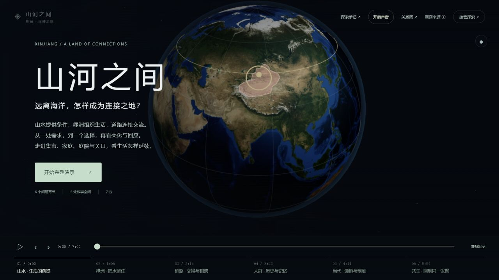

# 013 · 新疆互动沙盘：地理、历史与多尺度知识展示

## 阶段归档与后续设计

2026-10-14，按用户决定将当前探索作为阶段成果归档。三维运行能力基线为 **R90**；R91 只整理总结、反思与归档入口。已有平台继续可用，保留自由操作、四个导演、语音字幕和观察记录；后续方向是依据真实事件建设区域、县域或历史聚落、具体地点的地图层级，再将人物行动与事件过程连接起来。

[阶段总结与后续设计](web/public/assets/records/stage-retrospective.md)是后续开发的首读材料，包含能力与内容覆盖、问题成因、六个地图尺度、史实节点表、各条线索的扩展方向和验收顺序。[阶段归档清单](stage-archive.json)记录运行基线、资料与恢复入口。[网页总览](web/public/overview.html#stage-review)提供可读摘要，历史轮次继续保留。

Git 提交保存当前源码、运行素材、设计反思和逐轮清单；完整历史源码视图、截图、影片、声音母片及候选版本继续由本机共享素材库保存。异机恢复还需共享对象与清单，详见[存储与恢复](storage/README.md)。本阶段定位为可操作探索原型，内容覆盖和历史场景精度尚未达到完整产品目标。

以下保留各轮成果与研究过程；当前阶段结论以上述总结和 R90 记录为准。

## R90 · 四条记录与四个导演接通

保存记录恢复到统一主线，同时恢复主题、镜头、参数与选择。旧四条记录和旧地点地址兼容；都护、西迁不再默认进入张骞导演。地点可以直接开始对应近景讲解，同一观察按语义更新保存。

一号冰川新增9幕自然导览与6段MiniMax旁白，沿地球→天山→冰谷，分开观察2023-08-31真实地表、流动示意与变化试验，再返回全域地图。四主题共52幕，旧录音与原视频共享。真实地表与教学变化分别标注，不作实测年度变化或预测。[实际检查与增量记录](process/round-90/README.md)。


## R88 · 统一入口，保留完整探索

主线整理为地球定位→新疆全域地图→主动选择历史事件→地点与模型→返回地图。重复导航、标题和播放器合并；世界图层、八段年代、自然与生活场景、分析工具折叠保留。“全部线索”提供统一目录。区域地图先停住，用户选中对象后再靠近；三条历史的影响幕一次进入关联模型。统一年代切换，避免其他历史阶段沿用上一条事件路径。

三条自动导演实际完整播放到结尾（15+14+14幕），原有暂停、缩放、接管、字幕与返回保留。另行检查水路、绿洲、庭院、关口、冰川、雅丹与其他年代入口。本轮没有增加人物动作、音频或影片副本，也没有宣称写实质量已达到参考效果。过程与最终源码按round-87基底增量保存，详见[本轮记录](process/round-88/README.md)。


## R86 · 三条路径，用实际模型变化接回地图

张骞路径进入喀什的跨时期交换情境后，选择织物、补给或器物，画面依次突出需要、搬运交接、使用与不同人物回应。金色联系线跟随真实搬运位置，完成使用后变为青色；镜头、当前标题、步骤与字幕读取实际模型状态。未选的需要保留，完成的观察带回交流地图。

都护路径以现代轮台地域作定位参照，进入抽象结构后，点击一次即可依次观察入口、屋盖展开、标记通过通道进入再返回。方向箭头随进入和返回改变，屋盖与往来均可暂停，仍可自由缩放；完成后带回机构与地方地图。旧部件、单独屋盖和联系操作折叠保留，锡伯的按年代屯居与水利样板继续沿用。

导演近景的观察步骤也由真实模型状态推进。修正跨路径切换时错误保存/恢复其他模型视角的问题；进入场景必须核对实际工作台场景，不能只因引导文字已切换就开始讲解。保留三路径43幕、37份有效旁白、下方选幕、自由接管、暂停与返回地图；本轮复用已有声音，没有新增影片或音频副本。

历史依据与机制情境分开：张骞出使不等于后来的整个交流网络，集市不作汉代喀什或张骞停留的复原；结构不是乌垒城实测布局或真实行政程序。现有近景仍为解释模型，人物与建筑资产尚未达到写实历史复原。本轮只改善联动、观察与交互，没有宣称三条路径已同等完成。

截图、早期裁切和错误切换候选、检查、依据与最终源码以round-85为基底按SHA-256增量保存，旧影片与声音继续共享。

## R85 · 从河谷条件，到人物行动的完整样板

本轮先完成锡伯路径的屯居与水利样板。迁移的政策背景与河谷的生产条件分别说明；初期灌溉保留，后建大渠和新增耕地按年代出现。1766年春起的住处、支流水源、步行和耕作相接；19世纪初先显示待接水的扩耕空间，再沿主渠推进施工，接向田边；1808年初先沿主渠来水，再进入田边支渠，展开湿润田区，居民随后走向田间观察和劳作。

每个年代有三个可点选节点和重播入口。镜头、当前标题、字幕和实际模型进度同步；标牌按屏幕大小约束并随观察对象收拢，详细形制与原生活实验折叠保留。滚轮缩放或转动只接管镜头，动画继续；主动暂停冻结动作，仍可观察。返回伊犁河谷地图带回已完成的阶段观察。自动导演的三个近景阶段沿用同一套模型状态，更新五段MiniMax旁白与字幕。

依据国家民委《锡伯族·历史沿革》和《锡伯族·风俗习惯》，2026-10-14复核。资料支持安置、初期支流灌溉、人口增长、图伯特组织开渠及1808年初竣工放水；没有精定开工年。服饰与建筑只参考传统形制，匿名人物、步行、工具动作、田块与渠线是解释性设计；不是同一家人跨42年的传记、实测灌溉或清代村落复原。

本轮聚焦锡伯样板；张骞、都护与全部旧场景保留，尚未统一到同等细节标准。截图、候选画面、五段声音母片、字幕时序、检查与源码以round-84为基线按SHA-256增量保存；没有新增整片录像或累计打包。当前记录见process/round-85/。

## R83 · 服饰、斜顶民居与渠边劳动的形制观察

本轮重点更新锡伯路径近景。依据国家民委《锡伯族·风俗习惯》的传统形制记述，增建斜顶土墙房、木门窗、低墙庭院，男子长袍、腰带、圆顶帽和长靴；改善人物头身比例、双手握柄、工具落地、河面和叶形。资料不能证明某座1766年民居或某套1808年服装；面容、颜色、裁片、数量与布局属于原创模型设计，不作逐件历史复原。

“全景、民居、服饰、劳动与渠水”四种观察将镜头、对象标记、介绍和字幕连在一起。锡伯自动导演的安置幕观察右侧屯居与初期灌溉，开渠幕靠近劳动现场，放水幕恢复水系全景；用户可缩放、暂停、自由接管与返回来时地图。旧家庭选择和原人物建筑模型继续保留为独立情境。原五段R82 MiniMax旁白与已有环境音继续复用，没有新生成语音或整片影片。

传统形制来源：https://www.neac.gov.cn/seac/ztzl/xbz/fsxg.shtml 。年代来源：https://www.neac.gov.cn/seac/ztzl/xbz/lsyg.shtml 。核查于2026-10-14，表示范围见assets/settlement-period-sources.json。当前仍是有依据的可操作示意模型，未达到完整写实复原；张骞和都护的其他近景资产没有在本轮统一改成经过考证的古代场景。

## R82 · 察布查尔：按年代观察屯居与水利

默认锡伯导演的近景不再比较虚构的“先安顿/先引水”历史决策，而是可切换的三个阶段：1766年春以后安置与初期支流灌溉、19世纪初组织开挖新渠、1808年初大渠竣工放水。国家民委资料说明初期已有利用绰霍尔河等支流水源的灌溉与耕作；不得把农业出现整体推迟到1808年，也不得把新大渠提前到1766年。

3D模型保留右侧住处与初期田地，左侧新渠槽在施工阶段逐段延伸；放水阶段青色水流前进，新增田垄随后显现。人物是匿名的安置/劳动符号，不指定历史人物身份，不宣称同一家人在42年中容貌不变。人物服饰、房屋及渠线仍是关系示意，不是清代村庄或真实大渠布局复原，作物变化不是实测水文/即时生长。未将开工年硬写成1802年。

锡伯导演新增“1808放水”一幕；三路径合计43幕，张骞15、都护14、锡伯14。五段MiniMax近景旁白更新；导演素材总38份（含归档荒漠1份），有效历史导演37份，其中28份独立录音、9份复用历史旁白。旧录音在已有冻结轮次保留。新语音为speech-2.8-hd、Chinese (Mandarin)_Gentleman、32kHz单声道，-18 LUFS目标混音；字幕未做逐字对齐。

支持切换年代、重播阶段、暂停/继续、自由镜头、导演接管后继续当前变化和返回地图。切回早期会收回后建新渠及其阴影。原有生活情境有明确独立入口，修复“先安顿/先引水”按钮只转发到旧控件而未改变实际模型的问题。

史实依据：国家民委《锡伯族·历史沿革》 https://www.neac.gov.cn/seac/ztzl/xbz/lsyg.shtml ，黑龙江省人民政府（省民宗委资料） https://www.hlj.gov.cn/hlj/c108504/202503/c00_31820374.shtml ，核查于2026-10-14。过程见process/round-82/，使用process_store.py按SHA-256在round-81上增量保存；没有新增累计打包影片。

## R81 · 历史依据纠正

R80的沙丘、风沙、取水与人物行进没有对应张骞第一次出使路段的依据，不能作为历史复原。已将荒漠近景与旧旁白移出默认历史导演；已有模型保留为独立动画实验，入口、标签与介绍均明确无历史行程归属。下面的R80记录是已被本轮纠正的探索过程，不能当作当前历史实现依据。

依据《史记·大宛列传》及中国国家博物馆的出使介绍，地图依次展示出陇西、长期扣留、到大宛、经康居到大月氏、至大夏及归途再被扣留后返汉。补齐康居、大夏；拘留地点不定点，地域之间不连未经本项目考定的道路。现代地域参照不是古国边界或古都坐标。

本轮重新生成一条MiniMax旁白，逐段突出相应地域；字幕与视觉提示采用接口段落时间，段落内语句位置按文字长度估计，尚非逐字对齐。三条历史导演共42幕，37份已有录音保留，其中旧荒漠录音仅归档；现用导演录音36份，跨路径实际独立新增录音27份。暂停、接管、缩放及返回地图保留。汉代人物服饰与沿途景观尚未完成考据，不将独立实验视为汉代复原。

来源：《史记·大宛列传》 https://ctext.org/shiji/da-wan-lie-zhuan/zhs ；中国国家博物馆 https://en.chnmuseum.cn/Portals/0/web/exhibition/exhibitions/161120Chines-Epic/ 。来源复核、实际截图、音频母片、请求与交付哈希、检查及源码增量记录见process/round-81/。

## R80 · 张骞远行从地图走进荒漠

第一次出使新增地域方向图：长安、陇西方向、大宛和大月氏为地域参照，标记在十余年扣留阶段停止；不把第一次出使画成后来的长期交流网络。从同一入口进入原创荒漠近景，五位随行者、驮马、旌节、行装、足迹与风沙随进程运动；迎风缩短步幅、抬手护脸，补给时停下并取水。可以切换风沙、主动停留、拖动进度、旋转缩放、重新跟随和返回历史地图。

张骞自动导演在背景之后接上“第一次远行”“走进荒漠”，再返回外交结果、长期交流和喀什集市。新增两条MiniMax旁白与同步字幕；三条导演共43幕、37份独立录音，旧音频继续复用。15个模型场景含新增远行场景，原有操作保留。镜头自动避开通道上的沙丘遮挡。

地域方向不表示考证逐站行程；地貌、人物动作和服饰为原创情境，未作具体地点或汉代服装的考古复原。新增环境声由WebAudio合成，不是实地录音。主检查102项与故事播放器14项通过；浏览器检查新增两幕的自然衔接、暂停、接管、返回、风沙、补给及390×844窄屏，未将局部验证写成三条全片重新验收。实际截图、音频源素材与源码按round-79基底增量保存，见process/round-80/。

## R78 · 选幕常驻，观看时可自由调整镜头

导演的全部幕次直接显示在底部，当前幕高亮；小屏可横向滑动，切幕或改变窗口大小时自动显示当前幕。滚轮缩放、拖动转动只调整镜头，旁白、字幕、地图与人物动作继续推进。主动暂停后调整镜头仍保持暂停；可点击“恢复导演镜头”，下一幕会恢复该幕构图。明确点击“自由探索”或“返回地图”才退出导演。

镜头到位的回调继续保留，避免缩放中断地图到模型的进入。R77完整复核都护与西迁；本轮验证地球、历史和模型的镜头操作、暂停语义、直接选幕和小屏布局。实际截图、检查与增量源码见process/round-78/。

## R76 · 张骞完整样板与全幕配音

从地球到新疆山河，再到出使、长期交流和喀什集市；同一位置图贯穿探索。画布与说明、字幕分开，近景抬高机位，人物的需要、交接、使用和回应由真实动作驱动。选择织物、补给、器物后，完成回应才记入观察，再回图理解用途与联系。保留自由操作、暂停、幕次选择、三路径导演与返回地图。

补齐三条导演的14段地点、模型及回看MiniMax旁白，41个幕次都有音频和同步字幕，合用35个独立录音；旧音频继续复用。全部26条导演音频完成混音与字幕校验。实际截图、检查、音频源素材和增量源码见process/round-76/。模型与色线用于机制观察和地域联系，不新增历史复原结论。

## R74 · 自动导演的有声空间引导

地球三幕 → 新疆地形、地点、问题三个停点 → 连续历史 → 地点操作 → 回看。新增12条MiniMax导览与同步字幕，共享开场录音并引用原九条历史MP3；当前对象高亮，暂停、选幕、自由接管和返回继续可用。过程及源码以round-74增量保留。


## R73 · 自动导演回到地球、地理、历史与地点的认识顺序

三条导演先辨大陆、中国与周边、新疆范围，再沿球面读新疆地理；开场不提前展示历史路线和模型。历史背景、过程与影响连续推进，随后定位地点、观察模型回应并回图停住。顶部可选认识层级；暂停、选幕、自由接管与原探索继续保留。新增开场使用文字引导，沿用九段历史旁白；本轮实际验证和增量源码见process/round-73/。

## R72 · 洲名分层与连续新疆范围

地球上的亚洲、欧洲、非洲等洲名用不同文字色、较大字号与英文辅助标注区分；洲与海洋先显示，靠近后国家、城市和山河细节接续出现。新疆用独立暖金轮廓和透明填充突出，标签避开范围；定位新疆不再同时强调整个中国，选择国家时仍保留原来的国家高亮与自由操作。

同一个已有定位轮廓贴合地球与区域地表，贯穿地图和历史空间。地理比较的说明与图例跟随实际画面，聚焦天山时关键关联地点保持清晰。三条路径、自动导演、暂停、接管、近景选择与返回地图继续保留。

本轮实际检查正常窗口、手机、国家定位、三路径地图预览和导演入口/退出；主检查88项及故事播放器13项通过。不是三条全片重新验收。过程按round-70源码基底增量去重保存，R71诊断保留，详见process/round-72/。

## R70 · 从地球选问题，让三条路径在画面里不同

地球入口直接显示张骞出使、西域都护、锡伯西迁三个问题。选好后仍可旋转地球、观察国家与周边；沿球面进入新疆，接上所选路径的地图引导，拖动或缩放可停止引导。刷新已有地图链接不强制重播入口，返回地图和既有自由探索继续保留。

地图推进分别为「通道与商旅 → 集市交换」、「机构显现 → 双向地方联络」、「河谷抵达 → 住房、田地与家庭」。商旅、行装与来访者沿已有关系线移动并贴合地面；都护机构先出现，联系随后展开。地点预览先显现，再发生接手、点头或家庭回应，暂停和点选进度可以重现同一姿势；近景继续使用原有集市、结构、家庭和水路交互。

三条自动导演共用这些变化，保留暂停、选幕、自由接管和返回地图。本轮未新增历史事实、考证路线、语音或影像；模型及动作解释空间与生活机制。源代码、实际截图和验证按 round-69 为基底增量去重保存，详见 process/round-70/。


## R69 · 地点选择、模型操作和返回地图接通

地图新增“在这里动手观察”入口：喀什接货物交接，吐鲁番接水路剖面，轮台接结构内外联系，察布查尔接安顿与引水。画面底部可直接走进当前地点；先保留原位的地图联系与模型预览，再由用户打开近景。

修复选中吐鲁番后仍被带向喀什的问题。地图讲解、历史终点按钮、路径末端和模型入口跟随所选地点；张骞自动导演仍沿既定喀什主线演示。三条历史路径分别记住进入前的地图视角，按事件和地点保存本次页面中的实际观察。返回地图显示已观察标记、人物或结构回应，以及这些回应怎样连接地理问题；刷新恢复路径，但不保存本次交互记录。

本轮沿用既有模型、地理资料和音视频，没有新增配音或写实资产。见 process/round-69/；按 round-68 基底增量去重保存。


## R68 · 从地理线索，接到历史与地点回应

三条路径共用可控制的地图引导：先突出地势，再展开地点联系，最后靠近对应地点并显现已有模型预览。张骞线对照天山、盆地与喀什；都护线对照地势、地方与轮台结构；西迁线对照天山、伊犁河谷与察布查尔。三个步骤可点选、播放、暂停，拖动或缩放即停止自动引导；选中的地图步骤随链接恢复。

地图里的「听故事」直接从当前地域进入既有历史旁白与同步字幕，不再要求重走全球定位。返回保存进入前的镜头、观察方向、路径与地点；在集市、家庭或结构中完成的观察可以带回地图。三条自动导演都补上同一套新疆地图引入，先读地理，再进入历史三幕与近景；手动入口、自由接管、返回和旧场景继续保留。

地图桥接使用逐步屏幕讲解，本轮没有新增配音；历史继续复用九段MiniMax旁白。没有新增历史事实、考证路线或写实资产。过程按 round-67 基底增量去重保存，见 process/round-68/。

## R67 · 让国家范围、空间层级与进入新疆更清楚

地球入口收拢为「地球全景 → 中国与周边 → 新疆山河 → 进入新疆」四步；周边视图靠近亚洲，山河视图减淡国家着色，保留地形纹理。国家定位与图层开关移到首屏，经纬、水汽、交流、距离及手动历史入口收在可展开区域，原有能力继续保留。

国家名称支持悬停或键盘聚焦预览轮廓，点击才确认定位；可一键重新定位新疆。标记数量同时适应画布宽高，优先保留当前选择、中国和新疆周边国家，并避让标题、导演面板和镜头工具；「显示更多标注」的选择随链接保留。进入新疆时国家图层随镜头渐隐，取消可恢复原视图。

复用 R66 的国家数据、影像和全部音视频；移除约242个不再使用的国家圆点网格，预览轮廓复用单一对象并释放替换几何。本轮浏览器实测覆盖桌面、窄屏、手机、预览与确认、密度持久化、进入/取消/返回、经纬图层和张骞导演首幕暂停与退出；不把首幕检查描述为三条全程重放。截图与源码按 round-66 基底增量保存，见 process/round-67/。

## R66 · 地球上的国家范围与中文标记

地球叠加 Natural Earth 1:50m 国家与地区轮廓、淡色分区和中文名称；点击名称或定位菜单会转向该地区，并同步高亮轮廓与范围。新疆保留单独定位，周边视图优先显示八个邻国；远处标记按缩放和遮挡自动收拢，背面标记隐藏。国家边界、名称、着色可独立开关并随链接保留。

数据在本地复用，不依赖在线地图服务。国家几何约776 KB；原始GeoJSON压缩保留，来源、版本、哈希和名称调整写入 `world-countries-source.json`。现代轮廓保留来源的默认实际控制范围表示，争议/未定段使用虚线。原有三路径导演、山系与距离观察、自由操作和地图入口继续保留。

本轮截图、数据原件、验证和源码以 round-65 为基底增量保存，见 `process/round-66/`。


## R65 · 三条历史路径接入自动导演

入口可选「张骞出使」「西域都护」「锡伯西迁」。每条在实时3D平台中经过地球、周边地理、三幕历史、地点与近景，再把实际观察带回地图。历史讲解复用九段已有 MiniMax 语音与同步字幕；空间桥接和近景示范有画面说明，不声称已有全程新配音。

张骞路径在喀什集市依次展示织物、补给、器物的交接与使用；西域都护路径在轮台地域参照后展示入口、展开屋盖与双向内外联系；锡伯路径保留家庭安顿与引水比较。回应完成才推进，三条路径保留各自地点与返回地图。暂停、选幕、重看、切换路径、自由接管继续可用。

过程以 round-64 为基底按 SHA-256 增量保存；既有声音、影片、地形和纹理继续复用，不重新输出累计视频包。浏览器验证及本轮素材见 `process/round-65/`。


## R64 · 自动导演：从远行到安顿

新增显眼的「自动导演」入口，首条路线以锡伯西迁为主题：地球定位、出发、抵达、河谷、安置、地点、先安顿、先引水、返回地图，共九幕。直接调度当前3D地图和模型，沿用三段已有 MiniMax 历史旁白与字幕；空间桥接和家庭幕保留文字引导。家庭幕以真实动作完成信号推进，示范结果与用户观察分开保存。

支持暂停、继续、上一幕、下一幕、选幕、静音、重看、拖动接管和返回联系地图。页面刷新只显示导演入口，不强制播放。现有三条历史探索、地图对照与近景模型保留。当前自动导演先覆盖锡伯路径；不是三条历史路径都已自动编排。源码、实际截图与检查按 SHA-256 增量保存，未复制原音视频或重新生成影片。


## R63 · 让历史联系与周边地理一起变化

三条路径各有三个地图步骤：交流先辨山地与入口，再展开盆地两侧的联系并进入绿洲；都护先显示地方聚落，再出现机构与联络，最后进入结构；西迁从起讫方向靠近伊犁河谷，再进入安置与生活。点选山地、盆地或河谷会突出相应位置并弱化其他联系；可在同一视角下切换“只看地理”和“叠加历史联系”。路线展开、方向箭头与模型预览可暂停重看，缩放时保留连续地图。进入地点仍沿用刚才的地理图层，返回恢复主题、地点和本次地图视角。

沿用既有影像、模型和语音；地理色带是位置强调，关系线不是考证行程或辖境。增量素材与验证见[本轮记录](web/public/assets/records/round-63.md)。


## R62 · 把地图、周边与模型接成可探索的空间

新增连续球面的联系地图：出使与交流、机构与地方、西迁与安置分别显示廊道、地方联络、跨区域起讫。用户先看完整联系，再靠近新疆、选择地点，观察已有模型预览并主动进入场景；可恢复刚才的联系地图。旧区域链接接入同一入口，地形分析与旧场景仍可使用。近景沿用原有教学模型，本轮没有新增写实资产或全球连续LOD。


## R61 · 让讲解指向真实的画面变化

已接通可取消的地球→新疆→历史定位。讲解对象在地表高亮：山系与盆地分别强调，路线焦点随前端移动，影响阶段指向对应模型。点击模型焦点可以定位并进入地点，返回保留进度和动作时钟。介绍卡收拢，详细文字可展开。沿用原音频与素材；字幕保留完整问句。镜头节点依据既有旁白时间块估算，不是逐字对齐。


<!-- PROJECT-OVERVIEW -->

## R60 · 让画面承担介绍与引导（2026-10-13）

历史画面增加章节开场：当前地域、背景问题、简短介绍与读图图例。三条历史路径的九幕分别说明这一层为什么值得观察；地图标签从地名扩展为地点及其作用。画面中的三个观察按钮沿用同一事件时钟，选择后镜头、路线、模型阶段一起变化。字幕下方提供下一幕或地点入口，先定位，再主动进入地点介绍与模型。

长段字幕按句展示，完整文字保留在资料展开区。句子在原音频段落内按字数估算时间，不宣称逐字对齐。原有语音、自由镜头、暂停、回拨与返回地图保留。[本轮记录](web/public/assets/records/round-60.md)记录实际截图与检查，素材以round-59为基底增量保存。

## R59 · 让模型落在地图里，让人物动作接上讲解（2026-10-13）

历史微缩模型按当前显示的高程三角面贴地，人物、建筑与路线更贴近地表。去掉集市、聚落的整块矩形底板，以柔和地面边缘和接触阴影接入区域影像；路线改细并降低浮高，保留山河与地方之间的关系。

近看可见土墙、布面织纹、木纹等轻量程序材质。人物手臂、腿部使用双段关节，交接按靠近、递出、接住、查看和带走分段进行；城门前的接待、家庭安置与田边活动各有对应动作。画面上的简短提示随实际动作变化，帮助把讲解、物品变化和人物回应连起来。

沿用原故事语音、字幕和暂停功能，宽中近观察点、自由拖动、主动进入模型与返回地图继续保留。素材以round-58为基底按SHA-256增量保存，旧音视频不重复复制。

[直接操作历史探索](http://127.0.0.1:4313/1009_codex_project/013-xinjiang-knowledge-sandbox/?trail=zhang&learn=world) · [R59网页汇总](http://127.0.0.1:4313/1009_codex_project/013-xinjiang-knowledge-sandbox/overview.html?edition=r59#history-trails) · [本轮过程记录](web/public/assets/records/round-59.md) · [R58记录](web/public/assets/records/round-58.md) · [R58截图](web/public/assets/process/r58-visual.png)。

本轮完善地图与教学微缩模型的融合，未增加历史实景复原或全球连续LOD。材质为程序视觉细节，人物和活动是解释机制的原创情境，不代表考证人物、建筑或行政过程。

## R58 · 在球面上看清地理背景与历史变化（2026-10-13）

本轮集中补强画面：商旅与集市、门塔与聚落、安置住房与田渠改为更丰富的球面微缩模型，局部动作随事件进度展开。天山、塔里木盆地和伊犁河谷使用已有坐标增加贴地高亮与简短地名，随背景、过程、影响调整强弱，帮助理解地域条件。

历史观察增加宽、中、近三种观察点与斜俯视，可主动“靠近看变化”。手动拖动后继续使用自由镜头；地点与独立模型仍由用户选择进入，返回地图与已有选择、实际回应保留。R57九段约186秒MiniMax讲解、字幕和暂停静音功能继续沿用，本轮没有重新生成旁白。

[打开历史探索](http://127.0.0.1:4313/1009_codex_project/013-xinjiang-knowledge-sandbox/?trail=zhang&learn=world) · [R58网页汇总](http://127.0.0.1:4313/1009_codex_project/013-xinjiang-knowledge-sandbox/overview.html?edition=r58#history-trails) · [本轮过程记录](web/public/assets/records/round-58.md) · [R57记录](web/public/assets/records/round-57.md)。以round-57为基底按SHA-256增量保存截图、检查和源码，原媒体共享。

微缩模型表达历史问题与空间关系，仍属于教学原型。地理高亮不画实测山脊、河道或政区范围；模型不复原古城与真实人物，近景写实和全球连续LOD仍未完成。

## R57 · 故事讲解与可操作的历史联系（2026-10-13）

三条路径按背景、过程、影响组织九段故事，新增约186秒MiniMax普通话合成讲解。播放、暂停、静音与阶段选择由用户控制；原始时段字幕、讲解和3D进度对应，球面符号缩小并分段出现，让重点随故事推进。讲解结束后由用户主动定位地点、进入模型，仍可自由旋转和返回地图。

张骞路径从外交目的、出使经历走向长期交流，再用集市观察具体需要与使用；西域都护从已有聚落、机构设立走向地方联系，结构新增“外侧→城门→通道→内部→返回”的可暂停概念演示；西迁区分1764年出发、1765年抵伊犁、1766年安置与后期建设，再用家庭选择观察安顿和用水。人物回应与联系演示实际完成后，观察才带回地图。

[开始故事与探索](http://127.0.0.1:4313/1009_codex_project/013-xinjiang-knowledge-sandbox/?trail=zhang&learn=world) · [R57网页汇总](http://127.0.0.1:4313/1009_codex_project/013-xinjiang-knowledge-sandbox/overview.html?edition=r57#history-trails) · [本轮过程记录](web/public/assets/records/round-57.md) · [R56记录](web/public/assets/records/round-56.md)。过程以round-56为基底按SHA-256增量保留，既有音视频继续共享，只新增本轮语音与改动素材。

当前仍是可操作的教学原型。金线不复原张骞行程，轮台与机构模型不复原乌垒或行政流程，家庭不对应真实个体；局部模型仍是独立尺度，全球连续LOD与近景资产品质继续列为差距。

## R56 · 三条历史路径的连续地图与尺度衔接（2026-10-13）

背景、过程、影响改为连续且可逆的地图变化；点阶段可展开或回看，拖进度条立即定位，暂停与自由拖动继续可用。球面镜头围绕地心移动，避免绕局部目标插值时切入地球。

张骞出使、西域都护与锡伯西迁的地点页保留原事件进度、路线和符号，并高亮所选地点。进入集市、结构或家庭前说明要观察的问题；模型内新增直接返回地点地图，未完成观察也能返回。回到同一球面时平滑恢复原镜头，模型的选择、暂停状态与既有观察保留。

本轮以既有资料和模型为基础，未新增历史推断或资产。新增解释区把画面变化与历史意义对应起来；出使、长期交流、机构概念、迁移安置与后期水利仍分别标注。教学符号不是考证行程、辖区边界或遗址复原。局部模型仍是独立尺度的教学场景，地球与模型采用明确的定位和淡入交接，并未实现全球连续LOD。

[直接操作三条路径](http://127.0.0.1:4313/1009_codex_project/013-xinjiang-knowledge-sandbox/?trail=zhang&learn=world) · [本轮网页说明](http://127.0.0.1:4313/1009_codex_project/013-xinjiang-knowledge-sandbox/overview.html?edition=r56#history-trails)。截图、交互诊断、检查和源码使用round-55为基底按SHA-256增量保存，旧音视频继续共享。

## R55 · 张骞与西域都护：两条完整的自主探索路径（2026-10-13）

新增“从出使到交流”“从机构到地方”，与原西迁路径并列：地球定位 → 新疆整体地图 → 背景、过程与影响 → 主动定位地点 → 操作模型 → 带实际观察返回事件地图。三条路径可互切；地图连续保留球面，自由镜头与主动打开分析保留。

张骞路径用盆地边缘的地理参照进入出使与跨时期交流，再定位喀什；织物、补给、器物分别交给家庭、远行者、手艺人，实际使用与后续动作完成才记录。人物标记跟随位置与状态。西域都护路径先看天山和盆地北缘，再看地方聚落、前60年机构符号与地域联系；轮台作为现代地域参照，主动进入抽象结构，展开屋盖、高亮城门/通道/围墙/内部空间，完成观察后带回地图。没有将现代轮台坐标或结构示意当作乌垒遗址复原。

本页保留各路径的事件进度、观察、模型和镜头，重新进入可恢复暂停状态；刷新只恢复URL中的路径、尺度、地点和历史进度。原模型、视频与音频继续使用；本轮26项检查及实际浏览器操作记录见round-55，基于round-54按SHA-256增量保存。

[张骞完整探索](http://127.0.0.1:4313/1009_codex_project/013-xinjiang-knowledge-sandbox/?trail=zhang&learn=world) · [西域都护完整探索](http://127.0.0.1:4313/1009_codex_project/013-xinjiang-knowledge-sandbox/?trail=protectorate&learn=world) · [网页汇总](http://127.0.0.1:4313/1009_codex_project/013-xinjiang-knowledge-sandbox/overview.html?edition=r55#history-trails)。当前仍为教学地理与原创模型表达；全球连续LOD、资产写实程度和更多历史事件仍有提升空间。


## R54 · 从远行到安顿：一条完整的自主探索路径（2026-10-13）

新增可随时退出的聚焦路径：地球定位 → 伊犁河谷 → 锡伯西迁 → 察布查尔 → 家庭选择 → 带观察回到历史地图。每层集中说明一个问题和进入下一层的缘由。历史继续在同一球面，用户主动打开分析与近景；原三事件、四主题地图、全部场景、声音与自由操作保留。

家庭初次进入等待选择；先安顿或先引水驱动不同的灯火、渠水和人物回应顺序。画面标记跟随状态变化，实际回应完成后才留下本次观察，重复选择只留一份。返回保留事件和镜头，重新进入家庭恢复选择与暂停状态。观察与精确镜头保留在本页打开期间，URL只记录路径、尺度与事件进程。历史年代、方向示意和原创家庭情境分别说明。

[直接开始完整探索](http://127.0.0.1:4313/1009_codex_project/013-xinjiang-knowledge-sandbox/?trail=migration&learn=world) · [网页汇总](http://127.0.0.1:4313/1009_codex_project/013-xinjiang-knowledge-sandbox/overview.html?edition=r54#migration-trail)。本轮改善探索组织与反馈，未增加写实扫描、全球LOD或新配音，资产质感仍有提升空间。截图、验证和源码以round-53为基底按SHA-256增量共享。


## R53 · 历史事件留在连续球面，地点与分析由用户选择（2026-10-13）

在R52连续地理空间中加入三类球面事件：张骞主题展开往来、交换与多地点联系；都护主题从地方聚落显现机构结构，再展开联络；锡伯西迁主题在同一地球上连接盛京方向与伊犁，随后缩到察布查尔的安置与后期引水。背景、过程、影响会改变3D路线、移动符号与结构，不只是换文字。

点事件地点先进行地理定位，显示来由与可探索内容；随后由用户主动进入地点、近景模型或事件分析。自由操作、暂停、回拨、原人物选择与回应保留。分析返回、地点模型返回及轮台原工具返回恢复球面事件进程、选点和镜头；回全域恢复主题和原视角。本次会话保存精确镜头，URL保存事件、进程、节点与视图类型。

[从地球开始](http://127.0.0.1:4313/1009_codex_project/013-xinjiang-knowledge-sandbox/?learn=world&learnWorld=exchange&worldMotion=0) · [直接操作球面西迁事件](http://127.0.0.1:4313/1009_codex_project/013-xinjiang-knowledge-sandbox/?learn=history&learnPeriod=qing&learnEvent=xibe&learnProgress=0.5&historySurface=globe) · [网页汇总](http://127.0.0.1:4313/1009_codex_project/013-xinjiang-knowledge-sandbox/overview.html?edition=r53#continuous-history)。当前三个事件有可操作过程，其他时代仍是资料与地域索引。现代参照、教学路线与原创符号不是考证行程或遗址复原；全球连续LOD和近景写实资产仍未补齐。所有旧影像、声音与影片沿用，截图、候选、检查和源码以round-52为基底按SHA-256增量保存。


## R52 · 地理空间连续，地形分析按需打开（2026-10-13）

修正地球直接换成区域地形块的入口。默认新疆地图与地点定位继续沿同一个地球球面靠近，保留周边影像和地域参照；区域影像、有限DEM网格与标注使用同一经纬位置。没有把新疆从地球切出，也没有生成新影像。地形分析作为主动打开的工具保留，历史分析和地点模型仍使用原工具与场景。

四主题地图、对象选择、周边观察、自由镜头、取消飞行与返回保留。球面定位地点后才由用户打开模型；模型返回恢复原地点和镜头。地理空间与地形分析分别记住本次镜头；URL记录视图类型。球面6倍高程夸张只影响显示，范围外不延伸DEM。固定区域网格并非全球地形流式加载、连续LOD或实时影像。

[从地球靠近新疆](http://127.0.0.1:4313/1009_codex_project/013-xinjiang-knowledge-sandbox/?learn=world&learnWorld=position&worldMotion=0) · [直接操作连续球面地图](http://127.0.0.1:4313/1009_codex_project/013-xinjiang-knowledge-sandbox/?learn=map&learnLens=relief&mapSurface=globe) · [网页汇总](http://127.0.0.1:4313/1009_codex_project/013-xinjiang-knowledge-sandbox/overview.html?edition=r52#geographic-space)。表示范围见web/public/assets/regional-surface-sources.json。截图、候选与源码以round-51为基底按SHA-256增量保留；旧媒体继续共享。


## R51 · 从交流问题，到可对照的绿洲水路（2026-10-13）

把交流路线继续做进可操作场景：地球定位 → 全域通道 → 秦汉事件 → 吐鲁番用水条件 → 地面用水选择 → 在地图重新定位喀什、观察交换。历史到工程是跨时期机制延伸，两个地点是独立案例比较；不编成同一水路、商队或货物的连续行程。

水路增加四处结构观察、淤积与清理、滞后的下游响应、空腔蓄水池、田垄水线与取水者回应。可以调来水、停住动作、记录不同条件，再回看结果。指标是原创显示强度，没有实测水文单位或产量推断。本次探索返回保留条件、响应帧和对照表；URL仅保留条件与选中的结构。普通旧模型、历史工具、影片与声音继续使用原有逻辑。

[从地球开始](http://127.0.0.1:4313/1009_codex_project/013-xinjiang-knowledge-sandbox/?learn=world&learnWorld=exchange) · [操作水路](http://127.0.0.1:4313/1009_codex_project/013-xinjiang-knowledge-sandbox/?learn=place&learnPlace=turpan&learnModel=1&learnScene=karez) · [网页汇总](http://127.0.0.1:4313/1009_codex_project/013-xinjiang-knowledge-sandbox/overview.html?edition=r51#oasis-inquiry)。结构依据ICID与公开遗产资料，聚落/交流关系依据UNESCO廊道说明，表示范围见assets/karez-inquiry-sources.json。其他时代的过程模型、全球连续地形加载与写实资产仍未补齐。本轮按round-50基底增量保存，不新增影片或语音副本。

## R50 · 地球、地图、历史与地点的引导衔接（2026-10-13）

每层增加来路与观察目的，地球说明为什么放大到地图；地图用所选地理对象接入时代与事件。秦汉、清代的三条事件直接复用原3D对象，在当前引导里控制背景、过程与影响，说明、进程和标记相应变化，不必先跳到另一套介绍页。

交流入口的金线沿上一层现代地域参照展开，队伍与网络依次变化；这是往来机制示意，不是张骞或使团行程。地点先定位，事件图标短暂淡出，再进入原模型。喀什选择织物后孩子使用、家人回应；回历史保留进度和镜头，回全域保留本次稳定视角与选点。轮台结构继续使用原完整工具，西迁连接家庭；不同案例、时代与模型性质分别说明。

[从地球开始操作](http://127.0.0.1:4313/1009_codex_project/013-xinjiang-knowledge-sandbox/?learn=world&learnWorld=exchange) · [网页汇总](http://127.0.0.1:4313/1009_codex_project/013-xinjiang-knowledge-sandbox/overview.html?edition=r50#connected-learning)。保留14场景、八主题地球、四主题地图、八段历史索引、原片和声音；其他时代仍未有同等事件过程模型。未增加全球高程、历史测绘、写实资产、声音或影片。过程截图、候选、检查和源码以round-49为基底SHA-256增量保留，旧媒体不复制。


## R49 · 地球开场：问题、图形与自主操作（2026-10-12）

参考已保存原片的地球模型与西风示意，把入口组织成找到新疆、确定位置、理解环境、连接历史、走近山河五个可选问题。原六主题继续保留，新加西风与内陆、大陆与交流，共八主题。球面经纬网、赤道和纬度观察带补上位置认知；青色气流带和金色地域联系线/分支逐段展开，阶段说明与进程同步。点球面标记可跳到观察阶段，暂停时仍能旋转；暂停和手动进度在URL中保留。

气候问题进入伊犁河谷水主题，交流问题进入天山南侧通道观察，随后连接原历史事件与地点模型。沿用NASA影像、高程、声音和场景。青线是概念来流，金线是现代地域联系，都不是天气轨迹、考证行程或特定年代的真实路线。全球连续LOD、近景写实与新旁白没有在本轮补齐。

[操作地球开场](http://127.0.0.1:4313/1009_codex_project/013-xinjiang-knowledge-sandbox/?learn=world&learnWorld=position) · [网页汇总](http://127.0.0.1:4313/1009_codex_project/013-xinjiang-knowledge-sandbox/overview.html?edition=r49#world-entry) · [来源范围](web/public/assets/world-intro-sources.json)。实际截图、候选、验证与源码以round-48为基底SHA-256增量保留；旧原片、语音和影像不复制。


## R48 · 新疆地图成为可点选的认识入口（2026-10-12）

保留R47六种地球认识图层，进入新疆后用四类主题选择山地、盆地、流域、现代城市和通道观察线。选点联动图形、镜头、真实DEM剖面、相关时代与地点；北向随地图旋转，取样可以启动、暂停和手动回看。全域画面扩大，七地点图鉴按需打开，原14场景和自由操作保留。

从地图进入历史保留刚才的地理条件与镜头，明确来由并提前展示事件操作。已有事件返回接回所选地图，地点模型与人物选择继续走原有操作；地图/历史/事件/家庭/返回流程实际走通，返回前后镜头数组相同。

[直接操作地图](http://127.0.0.1:4313/1009_codex_project/013-xinjiang-knowledge-sandbox/?learn=map&learnLens=relief&mapPick=tianshan) · [当前地图能力汇总](http://127.0.0.1:4313/1009_codex_project/013-xinjiang-knowledge-sandbox/overview.html?edition=r48#map-exploration)。概括山系、流域和观察线不是实测范围、河道或历史行程；城市积木仅为符号。沿用原高程、影像、模型和声音，近景写实精度与全球连续LOD仍有差距。截图、候选、检查与源码以round-47为基底按SHA-256增量保存，旧媒体不复制。

## R47 · 地球入口的六种可操作认识图层（2026-10-12）

地球新增大陆与海洋、中国西北与现代城市、八个邻国方位、球面三山两盆、乌鲁木齐经纬定位、五城市球面距离比较和整体到局部的尺度选择。六种主题改变球面对象、标记、线条和镜头；点击标签可以转到对应方位，背面标签随遮挡隐藏，标签避让标题与彼此。

地球全景、欧亚大陆、靠近新疆再进入全域地图；进入前先靠近新疆，期间可以取消或拖动接管，跨尺度过渡时收起旧标记。顶部地球入口与旧planet链接接入新版，原地图、八段历史、事件、地点、模型和自由操作保留。距离动态可单独暂停，比较数值与选定城市同步。

全球底图沿用NASA 2004年6月影像，不增加副本；国家点不是国界，山系线为位置教学，距离线不是交通或历史路线，当前仍未加载全球高程。地理说明复核新疆政府2022年概况。截图、候选、验证与源码以round-46为基底按SHA-256增量保存，原影片、语音和影像复用。

## R46 · 集市、家庭、庭院与关口的实时生活细节（2026-10-12）

集市新增下垂布棚、磨损铺地、木构货台、储货、手推车与驮包绑带；家庭新增门窗、门槛、行囊、晾晒、田边叶片和渠岸路径；庭院用分枝、薄叶与果串替代重复椭圆叶，补充器皿、靠边坐凳和学习空间；关口增加行人边缘、等候遮棚、交接台单据及随方案变化的植物缓冲。

地图先靠近地点，再进入各幕正在发生事情的近景。选择后看实际物品交接、孩子接过工具、桌边学习者回应节拍，以及车队、等候与绿带变化。家庭选择后用2.4秒缓步接近门前，原进程滑杆仍可回看。场景内增加简短操作引导与过程标记，单一模型不再重复展示进入按钮；暂停时仍可自由转动，返回恢复进入前地图镜头。

细节为原创教学表达，继续沿用现有高程、影像、人物骨架与声音；没有新增实景扫描或历史复原资产。保留地球、历史索引、事件、自由操作和旧影片。截图、候选、检查与源码以round-45为基底按SHA-256增量保存，旧影片、语音和影像不重复复制。

## R45 · 近景环境、人物与地点到场景的衔接（2026-10-12）

绿洲补充土壤微表面、渠岸散石、步道、田边植被、树枝与叶片、门窗框、遮布、器皿和编篮。树冠与织物随同一场景时钟轻动，暂停后停留。生活场景共享更圆润的衣服轮廓、衣领、接缝与重心微动作，原接触、视线、人物回应和声音系统继续使用。

从地点地图进入模型时，先靠近选中的经纬度，再衔接到场景近景。可以取消或拖动接管，返回恢复进入前的地点地图镜头。周边区域地形改为柔和边缘与场景地面衔接，避免叠加一块缩小地图。原地球、历史事件、全部场景和自由操作保留。

新增均为原创教学布景；没有新增实测高程、近景扫描或历史复原资料。真实冰谷与区域影像沿用已有数据，全球到街景仍不是连续LOD。截图、候选、检查与源码以round-44为基底增量去重保存，旧影片、音频和影像没有复制。

## R44 · 地点入口重新接回丰富的实时场景（2026-10-12）

地图增加七个可探索地点与原有场景预览；地点页先展示问题、场景和直接入口，再展开历史与资料。每个地点有真实区域DEM取样剖面和联动游标，比较线只作地理观察，不表示实测河道或历史行程。

吐鲁番可以在绿洲生活与地下水路之间切换，集市、家庭、庭院、关口的原控件直接出现在地点页。选择后镜头靠近对应人物，保留手动接管、动作暂停与返回地点地图；周边复用原区域地形背景，教学情境不作实景复原。人物与建筑仍为已有原创模型，没有引入新的写实扫描资产。

截图、候选、界面审查、浏览器记录与源码以round-43为基底按SHA-256增量保存；预览复用现有素材，没有重复下载影像、复制影片或重新生成语音。

## R43 · 地球、地图、历史与地点的认识入口（2026-10-12）

[从地球开始认识新疆](http://127.0.0.1:4313/1009_codex_project/013-xinjiang-knowledge-sandbox/?learn=world)：建立欧亚内陆方位与经纬度/尺度认识，再分层读三山两盆、水与绿洲、城市与区域。

史前、秦汉、魏晋南北朝、隋唐、五代宋辽金元、明代、清代、近现代八段历史索引，逐段呈现背景、变化、影响、地域参照与资料；选择时代改变3D地点和教学联系线。秦汉与清代可进入原三个事件操作，再返回时代索引。七个地点说明来由、观察问题和模型适用范围，模型参数可操作，返回保留本次地点地图镜头。

完整轮廓定位示意、14个主要现代城市与官方标准地图入口帮助补齐全域认识。定位小图不是行政区划图，3D高程边缘仍有覆盖不足，超出部分不推算；八段不是完整地方史，各时代尚无独立的历史复原模型。古今地名、教学路线和原创情境分别说明。原14场景、山河通道、影片/声音/字幕与工具保留，截图与源码按SHA-256增量归档，本轮未重制影片或音频。


## R42 · 地理问题驱动的可操作探索（2026-10-12）

区域底图更新为NASA原生500米影像裁片（5520×3360，约5.58MB）。保持原DEM，全球原图仅临时处理，来源、哈希和投影见 `web/public/assets/regional-imagery-500m.json`。

地球定位 → 三山两盆 → 历史通道 → 吐鲁番 → 地下水路模型 → 返回地图。以“山河如何成为通道”为入口，地图与公开高程剖面同步，选择两条教学几何线能看到距离、地表起伏和取样位置变化。可打开原有张骞事件；模型有剖面、来水、暂停与部件标记，返回保留本次通道选择和镜头。

[从地球开始操作](http://127.0.0.1:4313/1009_codex_project/013-xinjiang-knowledge-sandbox/?explore=passage&exploreStep=world)。原14场景、事件、资料、影片、语音和工具继续保留。本轮没有生成影片或语音；原影片保留在总览中。通道不是考证行程，DEM不代表通行条件，坎儿井为通用结构。近景数据与全球连续地形仍有精度和尺度衔接限制。

浏览器验证：五步进入与返回、通道比较、沿线游标、侧视/俯视、剖面开合、0/100来水、暂停、部件标记、原事件跳转和多个视口。过程按SHA-256增量保存；不复制历史累计包。

## R40 · 让历史变化发生在3D地图里

[直接操作3D平台](http://127.0.0.1:4313/1009_codex_project/013-xinjiang-knowledge-sandbox/)：地球定位新疆 → 地图与主题 → 事件背景、过程与影响 → 地点 → 模型 → 返回。原14个场景、自由镜头、参数、配置与探索记录继续保留。

张骞线以通行条件、携物前行和交换网络展开；都护线从已有地方聚落到机构和往来联系；西迁线从全球方向到抵达、安置及后续引水。下一步运行变化后停在观察阶段，画内标记可靠近实际对象；地点交代为什么来到这里、接下来可以探索什么。

进入模型前先靠近地点，再以保留画面的过渡衔接；可中止或自由操作，返回恢复原主题、选点和镜头。模型卡直接显示人物实际回应。复用已有数据与声画素材，图标化对象为教学表达，尺度切换仍非全球连续地形加载。[当前能力与实际画面](http://127.0.0.1:4313/1009_codex_project/013-xinjiang-knowledge-sandbox/overview.html#event-reading) · [R40过程与验证](process/round-40/README.md)。
<!-- /PROJECT-OVERVIEW -->

[过程素材与增量保存](storage/README.md)：截图、影片、未采用版本和源码记录按内容共享，每轮保留独立清单与查看入口。旧完整包按需重建，避免累计重复归档。

<!-- R23-DELIVERY -->
## R23历史版本 · 走近地形与人的动作

保留从地球、区域、具体地点进入人物故事的完整路线。冰谷、天池与冰川收支场景由同一份局部高程网格从区域坐标连续展开；进入完成及取消后恢复原网格，未增加高程样本。影像照明与细微显示法线经过调整，原始10米Sentinel影像及DEM数据保持不变。

人物脚步随移动距离推进，落脚时保持地面支撑、停止后收步；多层场景动作在每帧从上一帧混合到最后一个动作意图。拨弦和手鼓使用不同双手位置，庭院里的观察、示范与拍点回应接到具体器物。织物、木器、陶器有独立表面处理，集市和家庭补充折布、木格与生活用品。服饰、纹样、布景与节奏仍为原创示意，不是历史或民族服饰复原。

哈密入口首先关联哈密木卡姆资料；四类区域风格依据[UNESCO记录](https://ich.unesco.org/en/RL/uyghur-muqam-of-xinjiang-00109)，不同资料不自动套用一套真实曲式或舞步。原49个音频不改，12条新导览旁白按用户要求稍后补。

六章33段，内容8:32；实际完整片 **10:31**。[完整交互体验](http://127.0.0.1:4313/1009_codex_project/013-xinjiang-knowledge-sandbox/?demo=1) · [整段影片](process/round-23/recordings/xinjiang-spatial-story.mp4) · [前后实际画面对比](process/round-23/physical-details-comparison.jpg) · [过程素材与验证](process/round-23/README.md)。以下轮次保留为历史版本。
<!-- /R23-DELIVERY -->

<!-- R22-DELIVERY -->
## 历史版本 · 地点与选择共同组织故事

地图持续保留六处案例位置、首次浏览顺序与实际选择；可回到区域选点，再恢复刚才的场景与选择。六个区域内的生活场景由三维地理窗口展开进入，抵达后保留同一份区域影像与高程作为环境背景。人物布景为原创教学情境，区域地形不能当作街区实测模型。

前一处的观察改变后一处先关注的需求与自动演示分支：家门来水 → 织物与照护；田间来水 → 补给与使用；家书 → 观察后回应；工具 → 主动参与。交互模式仍等待用户选择，可以改选另一项。不同地点、年代与社区之间是问题比较，不能理解为实际水系或历史因果。

六章33段，内容8:32；实际完整片 **10:40**。减少说明牌，讲解标记按顺序一次出现一个；地球、区域与原理模型的既有镜头保留。12条新导览旁白按约定后补，49个原MiniMax文件保持原哈希。人物仍为简化创作模型，尚不能视为达到原视频的全部品质与知识深度。

[完整交互体验](http://127.0.0.1:4313/1009_codex_project/013-xinjiang-knowledge-sandbox/?demo=1) · [整段实际影片](process/round-22/recordings/xinjiang-spatial-story.mp4) · [R21与R22实际画面对比](process/round-22/r21-r22-comparison.jpg) · [本轮素材记录](process/round-22/README.md)。以下轮次保留为历史版本。
<!-- /R22-DELIVERY -->

<!-- R21-DELIVERY -->
## 历史体验 · 连续靠近一个地点

地球保持原比例渐隐，同经纬度的地表窗口展开为新疆地形。区域镜头继续靠近定位点，再重叠进入局部地形或人物场景，镜头在抵达处接续；冰谷、喀什集市和关口同坐标的尺度转换也有完整过渡。跨地点先回到地图，西迁与结尾回到地球，每一站的引导解释下一步为什么去那里。

六章33段，内容时间8:32；本轮实际整段影片 **10:36**，含地图定位与结尾停留。八项检查、19段实际空间过渡与29个实际播放语音检查通过。定位暂停与手动续播保留镜头位置，人物需要与对白从抵达后开始。

12条新导览旁白继续按用户安排后补，原有49个MiniMax文件保留。实际母片、时间日志、镜头采样、前后对比、截图与源码均保留，R20及更早归档未覆盖。

[打开完整体验](http://127.0.0.1:4313/1009_codex_project/013-xinjiang-knowledge-sandbox/?demo=1) · [整段实际影片](process/round-21/recordings/xinjiang-spatial-story.mp4) · [地理进入人物的实际连续帧](process/round-21/geography-to-story-contact-sheet.jpg) · [本轮记录](process/round-21/README.md)
<!-- /R21-DELIVERY -->

<!-- R20-DELIVERY -->
## 历史体验 · 从地球到地点

恢复空间旅行主线：**地球 → 欧亚大陆 → 新疆三山两盆 → 地图定位 → 局部地形与当地故事 → 回到整体与地球**。入口可以旋转地球、点击新疆，或从区域地图选点。跨地点先回到地图，喀什、东北启程、伊犁抵达、哈密与霍尔果斯分别交代位置和时代，生活模型不再替代区域地理。

六章33段，内容时间512秒（8:32）；定位镜头保留讲解时间。人物动作、五处选择、对白、物件交接与讲解标记继续保留。**用户选择先完成画面，新增/改写的12条MiniMax导览旁白稍后补**；不播放不符新镜头的旧旁白，原有人物语音和21条匹配旁白继续可用。

[打开空间旅行](http://127.0.0.1:4313/1009_codex_project/013-xinjiang-knowledge-sandbox/?demo=1) · [本轮素材与依据](process/round-20/README.md)。R19及以前素材未覆盖，以下旧轮次记录保留为历史版本。

实际完整演示影片 **10:08**（含定位镜头与结尾），1280×720、六章33段。展示版只剪去两处录制等待，所有章节、选择与实际对白保留；原始WebM、未剪MP4、时间日志、前后截图及源码均保留。

[观看整段成片](process/round-20/recordings/xinjiang-spatial-story.mp4) · [实际影片关键帧](process/round-20/spatial-story-contact-sheet.jpg)
<!-- /R20-DELIVERY -->

<!-- R19-DELIVERY -->
R19 整段成品：实际完整影片约 8:10，六章30段内容主线7:54。讲解用定位点、连接线和短说明指向真实地形、设施、物件与人物；五处选择的变化与回应拥有不同标记。集市三种货物使用双方共享接触点，家庭走到可见的门前，镜头先看双手再看回应，跨幕飞越缓启缓停。场景准备与严重阻塞的耗时单独记录并保留内容时间，避免讲解或回应跳过开头。原音频保持不变；人物、物品与动作仍为原创教学表达。

[R19 过程与依据](process/round-19/README.md)；实际完整母片、MP4、30段标记时间、选择日志、前后实帧、原生分支检查与录制源码继续保留。
<!-- /R19-DELIVERY -->


<!-- R18-DELIVERY:START -->
R18 已完成整段人物与跨幕接续改进：真实 MiniMax 对白振幅驱动口型，加入视线、眨眼、呼吸与共享手掌交接点；人物回应时让出阅读空间。五幕选择变成水碗、货物、行装、学习记录和关口空间的实体线索，结尾回到对应选择的展台。

六章30段内容时钟7:54；本轮实际完整影片 **8:05**，包含地图入口与结尾。原地形/影像、49条MiniMax音频未替换或重新生成。人物与动作保持原创简化风格，口型是音量同步；不同年代和社区以主题比较连接。

- [完整有声影片](process/round-18/recordings/xinjiang-lived-story.mp4)
- [R17与R18实际影片对比](process/round-18/comparison-r18.jpg)
- [本轮来源、素材与检查](process/round-18/README.md)
<!-- R18-DELIVERY:END -->

<!-- R17-LATEST:START -->
## 历史成品 · R17

新疆立体地图直接展开主题与六个场景入口。沿着来水、交换、远行、传习与当代协作，**五处参与点**把需要交到用户手中：开场安排家里与田里的来水；集市选择织物、补给或器物；家庭安排引水或安顿；庭院选择观察或参与；关口选择通行、交接或绿带安排。后续四幕统一为 **需求 → 选择 → 变化 → 人物回应**，动作与声音完成后才继续，结果接上下一段镜头。

六章、30 段主线为 **474 秒（7:54）**；本轮实际完整有声影片为 **8:37（516.60 秒）**，包含地图入口与结尾停留。完整观看自动展示标明的演示选择，交互观看可接管、等待回应并从结果回看自己的安排。30 条旁白与 19 条可用分支对白采用 **MiniMax `speech-2.8-hd`、9 个系统声线**；环境、脚步与教学节奏继续由原创 WebAudio 构成。可用对白数不等于自动片同时播放的对白数。

[打开整段成品](http://127.0.0.1:4313/1009_codex_project/013-xinjiang-knowledge-sandbox/?demo=1) · [R17 完整有声影片](process/round-17/recordings/xinjiang-lived-story.mp4) · [网页探索手记](web/public/explorations.html#guided-scenes) · [本轮素材与核验](process/round-17/README.md) · [语音来源与处理](process/round-17/audio-source/README.md)。

真实 DEM 与 NASA／Sentinel 影像沿用既有来源；人物、对白、生活空间与空间安排属于原创教学表达，不是历史复原、社区访谈、真实木卡姆演出或官方政策成效。原演示源码及对应 GitHub 仓库仍未确认。R16 已实作的分支截图、未完成交付的录制恢复记录和此前全部素材继续保留，完整成片以本轮实际核验为准。

## 历轮交付记录
<!-- R17-LATEST:END -->

R15 重做入口和前一分钟：新疆立体地形、主题筛选与六个场景直接出现。18 秒进入原创绿洲，约 28 秒说完需求后停下来，选择先给家里或田里来水；水闸、支渠、人物动作与普通话创作对白共同回应。主线为六章、30 段、**452 秒（7:32）**，含六处微缩舞台；完整观看自动演示，交互观看可随时接管并回看本页选择。当前版本采用统一浅倒角、土墙与木材、暖色光线和转场文字时机。[打开成品](http://127.0.0.1:4313/1009_codex_project/013-xinjiang-knowledge-sandbox/?demo=1) · [入口与选择的探索记录](web/public/explorations.html#entry-flow) · [R15 过程与核验](process/round-15/README.md)。

原视频只作为思路参考，原演示的源码与 GitHub 仓库仍未确认。当前实现使用固定版本 Three.js，真实 DEM 和影像有独立来源；人物、房屋、水渠与协商空间为原创教学情境。以下 R1—R14 内容是保留的历轮记录，时长和数据以各轮档案为准。

[R15 完整有声影片](process/round-15/recordings/xinjiang-lived-story.mp4) 约 8:04，包含新版地图入口、六章故事与结尾停留。30 段顺序、双声道音频及全片解码检查通过，修正后的转场无检测到的黑幕；29 张截图与拼版、声音母片、三份未采用检查片和实际录制源码均保留。完整素材见 [R15 冻结清单](process/round-15/materials.json)。

第十四轮继续把民族经验与治理选择放进人物活动：家庭把家书或工具交给孩子，庭院以四类木卡姆资料卡连接示范与学习，关口里的居民、运输工和生境维护者围桌表达需求；选择集中转运、轮换通行或保留生境，观察人物、车队、等待区与缓冲带怎样回应。六章、30 段、五处空间的完整主线为 **7 分 38 秒（458 秒）**，使用 30 条中文合成旁白与 10 条原创角色对白。[打开成品](http://127.0.0.1:4313/1009_codex_project/013-xinjiang-knowledge-sandbox/?demo=1) · [网页探索手记](web/public/explorations.html#social-depth) · [本轮素材与核验记录](process/round-14/README.md)。完整自然播放与音画解码已通过。[R14 完整有声影片](process/round-14/recordings/xinjiang-lived-story.mp4) 为实际录制，含入口与结尾约 7:56；声音、前后截图、完整母片与源码均保留。

## 七个领域怎样进入同一条线

山地冰雪与来水 → 绿洲生产 → 集市交换 → 历史调遣与家庭生活 → 另一社区的文化传习 → 当代公共服务与空间协商 → 回看自己的选择。自然条件、具体需求和组织方式共同推进故事；这是一条主题解释线，不是同一流域、同一家庭或连续年代的历史复原。

| 领域 | 场景中的具体载体 | 进入画面的变化与互动 |
| --- | --- | --- |
| 自然 | 冰雪、融水、风蚀、绿带与生境 | 流动与收支教学试验、地貌阶段、保留生境后的空间变化 |
| 地理 | 真实高程与影像，山系、盆地、沟谷、绿洲和通道节点 | 地球—区域—局部观察，地形与生活空间之间的镜头联动 |
| 历史 | 丝路交换与 1764—1766 年锡伯西迁、迁驻 | 家庭准备、远行、抵达和之后生活；史实与创作人物分别说明 |
| 文化 | 坎儿井工程，木卡姆四类区域风格资料与社区传习 | 看剖面与维护，选资料卡，示范、停顿、学习与拍点回应 |
| 民族 | 锡伯家庭的迁移与记忆；维吾尔社区的木卡姆传习 | 选择家书或工具交给孩子，观看不同社区中的代际学习 |
| 经济 | 灌溉生产、集市需求、货物交接和物流转运 | 商品进入具体用途，车队交接、等待与通行随安排变化 |
| 政治 | 清代调遣；当代片区协作、公共服务与生态要求 | 听居民、运输工、维护者的需求，选择空间安排并观察仍待协调的部分 |

民族目前是两个有来源的具体案例，政治是历史调遣与当代服务治理两个切面，不能称为新疆所有民族或完整政治制度的覆盖。家书、工具、人物、建筑和角色对白均为原创情境，不是历史档案、访谈或真人录音；庭院声音不复原真实木卡姆曲目，关口参数不代表官方程序或真实政策成效。[事实依据与表现边界](process/round-14/sources/research.md)。

## 已保留的探索与交付

第十三轮把需求、选择、变化与人物回应接入实际画面：织物披到孩子身上，补给进入远行者的日常，家庭可选择先引水或先安顿，传习者接过示范，工作人员回应车队。统一人物关节动作、土墙与庭院细节、近景构图、连续镜头和声音。六章、30 段、七分钟按动作分配时长；结尾沿线回看五处空间。[打开成品](http://127.0.0.1:4313/1009_codex_project/013-xinjiang-knowledge-sandbox/?demo=1) · [R13 完整有声演示](process/round-13/recordings/xinjiang-lived-story.mp4) · [本轮素材](process/round-13/README.md)。地形沿用原始真实数据，显示平滑与高度调整不增加测量精度；人物、生活环境与声音为原创教学表达，中文旁白为本地合成语音。

第十二轮把自然地形、集市、家庭、庭院与关口布置在同一条可飞越的舞台路径上。四次相邻场景切换让前后空间同时可见，镜头沿线进入下一段；结尾回望五处空间，再进入关系图与个人观察。六章、30 段、七分钟主线保持完整，五处空间进入其中 16 段。[打开成品](http://127.0.0.1:4313/1009_codex_project/013-xinjiang-knowledge-sandbox/?demo=1) · [R12 完整演示](process/round-12/recordings/xinjiang-lived-story.mp4) · [本轮材料](process/round-12/README.md)。地形使用已有真实 DEM 与 NASA 影像，生活场景及连接路径为原创叙事布置，不表示实际地理距离或同一人群跨年代的经历。

第十一轮把动作连成可观察的过程：集市取货、送达、交接与空手返回；家庭沿脚步抵达，渠水进入田地；庭院先示范、再由学习者回应；货物分拣，车辆在办理方式切换时保留行进状态。结尾「我的观察足迹」保留本页操作，并恢复自己的选择。六章、30 段、七分钟主线继续贯穿自然、地理与人的生活。[打开成品](http://127.0.0.1:4313/1009_codex_project/013-xinjiang-knowledge-sandbox/?demo=1) · [R11 完整演示](process/round-11/recordings/xinjiang-lived-story.mp4) · [本轮材料](process/round-11/README.md)。真实地理数据与旧版素材继续保留，新增动作仍为原创教学编排。

第十轮让文化、人群、经济与制度进入四个可操作的三维生活场景：集市搬运与交换、家庭迁移与聚落、庭院合奏与传习、物流关口与空间选择。四个世界接入六章七分钟主线中的 15 段，人物、车队、设施和镜头随着叙事连续变化。结尾可返回具体生活场景并接管。[打开成品](http://127.0.0.1:4313/1009_codex_project/013-xinjiang-knowledge-sandbox/?demo=1) · [R10 全程成品录像](process/round-10/recordings/xinjiang-lived-story.mp4) · [本轮证据与素材](process/round-10/README.md)。原始高程与卫星纹理继续保留；新增人物、建筑、动作与过程是原创教学表达，未复原真实演出、历史建筑或实测口岸。

第九轮重构为「山河之间 · 连接之地」：用“远离海洋，怎样成为连接之地？”贯穿六个问题章节、30 段讲解、七分钟演示，把自然、地理、历史、文化、民族、经济与政治放入同一条叙事。结尾的七节点关系图与三个追问可回到证据段落或接管场景。[打开成品](http://127.0.0.1:4313/1009_codex_project/013-xinjiang-knowledge-sandbox/?demo=1) · [R9 全程演示](process/round-09/recordings/xinjiang-connected-story.mp4) · [本轮记录](process/round-09/README.md)。R8 及之前的源码、图片、视频与冻结档案继续保留。

> 借鉴多尺度空间叙事，独立实现九个地理与原理场景、38 个自由探索镜头，并加入四个生活场景；冰谷六段讲解与收支试验形成自己的表达，保留真实数据依据与探索过程。

[返回总索引](../../README.md#有序索引) · [研究记录](research.md) · [Web 说明](web/README.md) · [效果验收与过程档案](process/README.md)

第七轮完成「冰谷里的时间」：约 68 秒六段叙事，聚焦约 5.7 公里真实地形，加入流动示意、积累／消融交互试验与前后轮廓对照。[打开冰谷](http://127.0.0.1:4313/1009_codex_project/013-xinjiang-knowledge-sandbox/?scene=glacier) · [网页探索手记](web/public/explorations.html) · [本轮素材与检查](process/round-07/README.md)。本轮以独立体验与解释能力为目标。

[原视频 × 最终实现并排对比视频（89 秒）](process/round-06/output/xinjiang-side-by-side.mp4) · [对照片段、来源与过程材料](process/round-06/README.md)。左侧为原片，右侧为实际录屏；不同地点、片段结束定格与细节裁切均在片中说明，原视频材料仅本地研究使用。

第五轮已完成本地效果交付与视觉自检：优化真实地形的凹部明暗、影像与光照融合，重做雅丹连续削蚀和侧壁，调整冰川教学叠层及镜头，加入跨场景画面混合与实际录像。九场景、36 镜头逐一留存截图，桌面与窄屏、连续动画、手动中断均已复核。[修改前后与原视频对照](process/round-05/README.md)、[实际运行录像](process/round-05/recordings/capture-log.json) 和 [交付快照](process/checkpoints/2026-10-10-visual-delivery/materials.json) 可追溯；用户是否接受观感不擅自代为确认。

| 项目 | 记录 |
| --- | --- |
| 原始来源 | [Moby 的 X 帖子与演示](https://x.com/readyfor2025/status/2108409664018977249) |
| 对应 GitHub 仓库 | 截至 2026-10-09 尚未找到可与原演示建立对应关系的公开仓库；不能据此断言未开源 |
| tag / commit | 未取得源码，不适用；sourceRef 留空 |
| 上游许可证 | 未确认，不能把原应用或画面视为开源资产 |
| 研究阶段 | 独立九场景效果实现已完成本地交付；原应用源码与资产仍待确认 |
| 本地展示 | web/public/index.html；Three.js 0.186.1 + 原生 ES Modules，Node.js 22+，WebGL 2 |
| 本地引擎 commit | npm gitHead：9b4a2ac29c63ccb43fd51c5661f2f873ac2c39b8；未据此推断原应用引擎 |
| 能力研究页 | web/public/research.html，保留十项能力与原帖证据整理 |
| Pages 路径 | /1009_codex_project/013-xinjiang-knowledge-sandbox/；已接入构建汇总，尚未发布 |

## 能力汇总

内容中心是新疆，空间展示包括地球、区域地图、局部地形与独立原理模型。值得借鉴的是内容与空间视角的联动。

| 能力 | 演示依据 | 确认范围 |
| --- | --- | --- |
| 宏观与区域地理 | 地球、气候叠加、地形与地点线路 | 展示可见，地理数据精度未验收 |
| 历史与人文 | 事件行程、路线讨论、迁移叙事 | 内容入口与画面可见，史实和路线需另行核对 |
| 局部地形与原理 | 独立地点模型、雅丹模型、其他原理模型目录 | 已看见部分场景；目录不能代替逐项验证 |
| 生态信息 | 保护区、冰川年份范围、统计图 | 展示可见，数据来源待核实 |
| 分段教学 | 导航、段落说明、视角切换与拖动提示 | 演示观察，未操作原应用 |
| 课程规模 | 作者介绍的 12 主题、223 段落、80 分钟讲解 | 作者说明，未完整验收 |

经济、政治的具体深度，历史时间轴和可调科学模拟尚未确认。

## 模型是否真实获取并加载

- 地球画面标注 NASA Blue Marble 影像来源。影像来源有标注，不等于已确认真实三维地形。
- 山脉、湖泊等模型没有取得对应高程文件；来源、分辨率和高度夸张比例未知。
- 原理模型从用途看属于教学示意；代码生成、外部模型加载等方式均不能仅凭视频确认。
- 实时联网与预先打包的加载方式，原应用的具体渲染引擎，均待源码证据。

## GitHub 开源状态

检索作者账号、演示标题和相关关键词，没有取得对应仓库。查询结果与排除的无关候选见 [github-search.json](assets/github-search.json)。原帖也是当前索引中的来源，不用其他仓库冒充原项目。

可参考的独立开源工具包括 [CesiumJS](https://github.com/CesiumGS/cesium)（Apache-2.0）和 [Three.js](https://github.com/mrdoob/three.js)（MIT）。它们与原演示的技术关系未确认。本地三维原型实际使用 Three.js 0.186.1，未引入 Cesium；版本与完整性固定在子项目 package-lock.json，保留 [Three.js LICENSE](assets/THREE-LICENSE.txt)。

## 本地能力展示



截图为本地实际 WebGL 渲染，不是原应用运行画面。模型与图片来源见 [assets/README.md](assets/README.md)。

| 场景 | 已实现的操作 | 数据与模型 |
| --- | --- | --- |
| 地球上的新疆 | 旋转、缩放、纬线与西风示意开关、点击新疆进入区域 | NASA Blue Marble 2004 年 6 月影像 + 球体；不含地球高程 |
| 三山与两盆 | 城市与山系说明、地点图层、1–70 倍高度夸张、进入天池 | 769×513 真实高程 + NASA 1380×840 经纬度裁切影像；彩色范围为手绘定位示意 |
| 天山天池 | 局部旋转缩放、1–4 倍高度夸张、真实湖岸与森林、汇流示意开关 | z=13 / 321×289 真实 DEM × 2024-09-04 Sentinel-2 原始 10 m 纹理；教学叠层默认隐藏 |
| 丝路廊道 | 播放、暂停、拖动进度、点击五个节点，讲解与行程联动 | 真实区域地形 + 敦煌、若羌、和田、莎车、喀什间的教学插值，非考证行程 |
| 坎儿井 | 剖面切换、结构说明、来水强度、暂停水流 | 代码生成的地层、井筒、暗渠与粒子；不计算真实流量 |
| 山地里的生命 | 镜头聚焦保护地点、绿色提示光圈 | 真实区域地形；保护地点为近似定位，没有法定范围或实测植被 |
| 雅丹的形成 | 演变阶段、自动侵蚀示意、风沙粒子 | 程序生成地貌与形态变化，无侵蚀方程或真实年代 |
| 锡伯族西迁 | 地球镜头、西行播放与进度 | 国家民委支持 1764—1765 年代；球面弧线为迁移方向示意 |
| 冰谷里的时间 | 六段镜头、真实地表／流动示意／变化试验、收支参数、运行暂停重置、轮廓对照 | 原 321×321 DEM 取 173×131 原样窗口 × 2023-08-31 Sentinel-2 原始 10 m 纹理；高度显示 1.25×，底图固定，教学参数无年度测量标定 |
| 绿洲集市 | 商队、人物行走和搬运；选择织物、补给、工艺；走近交换 | 原创模型；丝路交换与补给概念参考 UNESCO |
| 家庭与聚落 | 拖动迁移进程；先引水或先安顿；选择家书或工具，交给孩子并听家庭回应 | 原创人物、物件与建筑；国家民委支持年代与文化记忆，无真实家书、逐站或建筑复原 |
| 合奏与传习庭院 | 8 个角色连续动作；四类木卡姆资料卡、示范与学习、参与一拍、人物回应 | 原创节拍、动作与对白；UNESCO 提供风格与传习主题，无真实曲式或舞步复原 |
| 当代物流关口 | 车队与设施；三位使用者说出需求；集中转运、轮换通行、保留生境及具体参数 | 原创协商场景；2023 方案提供服务与生态背景，不模拟官方决策或真实成效 |

所有场景有镜头按钮、弧线相机运动、跨场景混合、连续讲解、完整导览、视角重置、自动旋转、沉浸视图、三维录像和来源说明。自由探索保留 38 段物理镜头；R14 主线独立为 30 段，按动作与对白安排时长，共 458 秒。主线使用本地预渲染中文合成旁白、原创角色对白和环境声；自由探索保留可选浏览器朗读，设备支持情况不同。没有复制原视频录音。保留研究页与探索手记，适配桌面与窄屏，无后台与凭据。视觉与场景对应记录见 [video-reproduction.md](video-reproduction.md)。

## 真实数据如何加载

[NASA 地形与海底阴影版影像](https://science.nasa.gov/earth/earth-observatory/blue-marble-next-generation/base-topography-bathymetry/)缩小为 4096×2048，用于地球。区域采用 NASA 基础版 21600×10800 的经纬度裁切。高程来自 [AWS Terrain Tiles](https://registry.opendata.aws/terrain-tiles/)，按 Terrarium RGB 解码为米，双线性重采样并取整，打包三份 JSON。浏览器读取数据构建网格、法线、颜色与侧面；高度夸张不改变物理米数。

- 区域：73–96°E、35–49°N；z=8；769×513；约 2.5–3 km 的展示采样间距。
- 局部：88.07–88.19°E、43.83–43.95°N；z=13；321×289；约 30–46 m 的展示采样间距。z=14 湖区含异常低值，未采用。
- 冰川周边：86.76–86.89°E、43.04–43.17°N；z=14；321×321；约 33–45 m 的展示采样间距。
- 局部表面纹理：天池 963×1336、冰川 1057×1448，来自 Sentinel-2 10 m 真彩色观测；源 UTM 45N 重投影为 DEM 的相同经纬度范围，没有 AI 超分或虚构地表。两景局部 SCL 云类为 0%，分类不等于人工逐像素核验。
- 天池默认只展示真实湖岸；冰川默认只展示真实冰雪。湖面、汇流与退缩教学叠层可独立开关；底图不会随示意阶段改变。冰谷显示高度目前为 1.25×，从原数据直接取约 5.7 公里窗口，影像按相同 UV 范围显示；原采样与源文件保持不变。
- 逐瓦片 URL、获取日期、原始与派生文件 SHA-256 见 [数据清单](web/public/assets/data-sources.json)。不把采样间距称为原数据精度。
- 高程致谢：Mapzen；USGS GMTED2010 / SRTM。保留 [数据与代码致谢](web/public/ATTRIBUTION.md)。

首次取数及升级依次使用 prepare-data.py、prepare-story-assets.py、prepare-globe.py、prepare-quality-assets.py，再使用 prepare-local-imagery.py 接入局部真实纹理（依赖见 Web 说明）；日常运行与 CI 使用已打包数据，不依赖外网瓦片。

第五轮用真实高程邻点计算多尺度凹部遮蔽，轻微提升 TCI 显示中间调并减弱重复光照；不修改 DEM 或原始影像字节。雅丹形态、侧壁、法线与阴影共同在 GPU 上连续变化，沟槽高度只减不增。镜头采用 2.6 秒弧线缓入、1.05 秒旧新实际画面混合；首次着色器编译完成后才开始切换计时。教学动画先停留、再变化、最后观察；拖动立即中断讲解。最终证据见 [第五轮检查](process/round-05/verification.json)。第三轮的程序材质与早期镜头记录保留在 [历史验证](assets/quality-verification.json)。

```powershell
cd projects/013-xinjiang-knowledge-sandbox/web
npm ci
npm run dev
```

仓库根目录检查：

```powershell
npm run build --prefix projects/013-xinjiang-knowledge-sandbox/web
npm run check --prefix projects/013-xinjiang-knowledge-sandbox/web
npm run index:sync
npm run check
npm run pages:build
```

本地地址：http://127.0.0.1:4313/1009_codex_project/013-xinjiang-knowledge-sandbox/。

## 来源与修改

本地教学场景独立编写，没有引入原应用源码。Three.js 为 MIT；NASA、Sentinel-2 与高程来源、许可及处理记录随项目保留。原帖封面仅用于研究页并标注作者，资产许可仍未确认。当前复现视频主要表现方式与场景类型，没有复制作者的完整课程、录音、年度冰川测量或全部场景目录。


[R8 最终源码与素材快照](process/checkpoints/2026-10-10-complete-journey/materials.json)。完整演示与全片校验已完成，所有既有冻结档案保留。

[R9 完整故事与所有过程资料的冻结快照](process/checkpoints/2026-10-10-connected-story/materials.json)。
