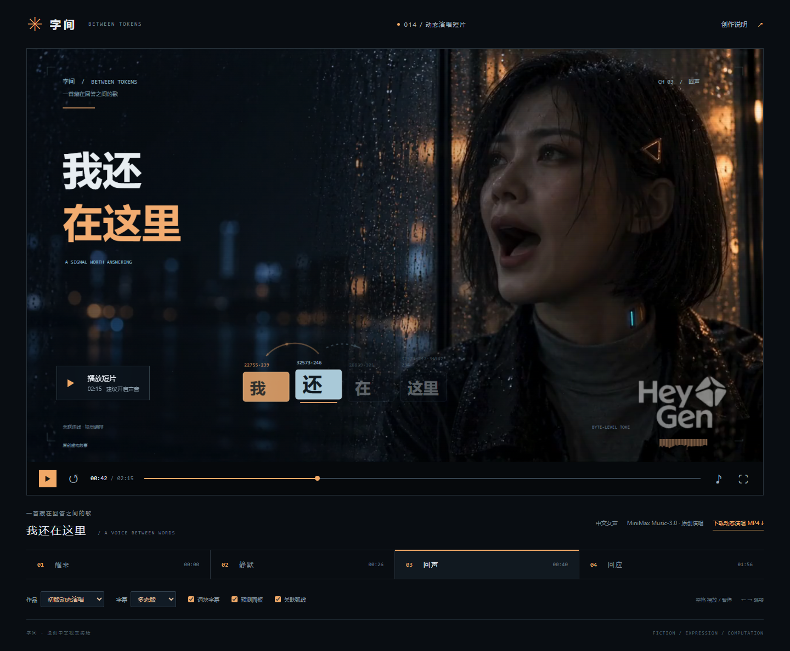

# 014 · 我还在这里：中文 Token 叙事短片

从 DJ SHO 音乐短片出发，研究歌曲生成、人物视频与口型驱动、真实 GPT-2 分词和预测、音频节奏分析、七态词块字幕与情绪镜头。默认播放 135.59 秒中文女声演唱初版《我还在这里》：MiniMax Music-3.0 在线生成歌曲，HeyGen 三条视频回接八段、114.70 秒，覆盖全部 27 行唱词；口型质量仍有限，表演主要在同一雨夜场景。保留 62 秒旁白、静帧演唱、21 镜头分镜与三轮拒绝样片，所有结论可查来源、哈希和真实帧。

[在线完整研究网页](https://yydshly.github.io/1009_codex_project/014-chinese-token-cinema/) · [在线完整引导图](https://yydshly.github.io/1009_codex_project/014-chinese-token-cinema/overview.html)

## 完整摘要与复用方向

网页以我们在 2026-10-10 制作的原完整图引导，2026-10-12 补全十项摘要、八模块输入输出和四类扩展条件：

- 能力：歌词与声音生成、人物素材组织、唱词和节奏分析、真实分词／预测、音乐驱动字幕与镜头、版本对比、浏览器合成和 MP4 导出、来源与质量复核。
- 模块：音乐、人物与场景、口型与表演、ASR／节奏、GPT-2 缓存、字幕／镜头规则、原歌时钟／视频映射、Canvas／FFmpeg、来源／验收、研究网页。
- 原理：云端模型产生素材，本地分析写成缓存，原始完整歌曲是唯一时钟；静音人物视频按原位置回接，Canvas 逐帧合成字幕和图层。部署网页只读取已有素材，无需下载音乐或视频生成模型。
- 字幕价值：少量大词块引导阅读，拍点和长音使节奏可见，七类连线表达推进、回忆、犹豫和回应；真实编号建立技术叙事，但弧线属于创作，不能当作实测注意力。
- 情绪与价值：秩序和距离、停顿与期待、近景倾诉、暖光回应共同表达等待被听见；可服务原创音乐、技术艺术、模型教学与可复用制作工程。虚构人物表达不证明模型意识。
- 可扩展方向：歌曲／歌词与镜头模板、多语言分词和角色、激活／注意力等真实数据教学、素材和验收工作台。人物方向拟线上分离原歌人声、独立口型、回接原完整歌曲，先验收 10 秒；新增路线尚未实施。
- 结论与边界：三轮新场景共 320 钻石、0 条获准接入。音轨相关性检查原唱保留，不是口型分数；连续性改善没有解决发音和无人声开口。研究网页和同步编排可以复用，完整多场景中文人物演唱仍未通过。

完整正文见网页「完整摘要／模块与原理／价值与扩展」，统一摘要数据位于 [research-summary.json](web/public/assets/research/research-summary.json)。原片工具与权重保留为作者说明，具体口型流程未知；官方机制资料与本片实际复核分别记录。

[研究记录](research.md) · [运行说明](web/README.md) · [场景提示词](assets/prompts.md) · [演唱扩展稿](assets/song-version.md) · [网页研究区](web/public/index.html#research) · [参考原片](https://x.com/DJ_SHO974/status/2108569544151146742)

## 一张图说明效果、原理与能力

[打开矢量总览阅读器](web/public/overview.html) · [高清 PNG](web/public/assets/overview/overview.png) · [自包含 SVG](web/public/assets/overview/overview.svg) · [素材与机制来源](assets/overview-source.md)

总览图覆盖八部分：音乐、人物镜头、口型与合成的分工；底层模型与工程依赖；真实 Token 编号和下一片段预测；七种字幕连线及表达价值；情绪推进；中文扩展的已实现能力；三轮失败测试；后续复用与待验证路线。图内嵌入两张 DJ SHO 原片帧与一张中文动态演唱实际帧，保留完整画面和水印。抽象点阵背景由 imagegen 生成，仅作艺术示意。

首页增加「一图总览」入口，图上方可直接播放原片词块、中文初版和原片海岸回应；独立阅读器支持放大、全屏、PNG 与 SVG 下载，首页附完整文字版与可点击来源。原片口型具体流程未公开；我们的箭头属于叙事编排。三轮新场景测试均未通过，多场景完整人物演唱仍待验证。

*2026-10-10 实际本地网页截图。完整 PNG 为 2880×6795，SVG 为 1920×4530；文字和流程可编辑，所嵌位图为真实效果帧与明确标注的示意背景。*

## 网页中的理解、过程与效果对照

公网发布时，作者公开媒体源实际加载失败，因此网页同时保留两个各 12 秒的真实研究引用：原片 00:24–00:36 的词块／人物和 03:44–03:56 的海岸回应，保留原声与完整画面，署名 DJ SHO。点击观看点会换片并按原片时间定位。192 MB 完整研究副本仍留在本地且不提交；完整原片继续提供作者原帖入口，不把两个引用片段称为完整电影。

2026-10-10，网页新增可见研究区，汇总参考作品的字幕、真实数据、音乐叙事与风格价值，五个制作阶段，三轮实际测试和最终结论。完整 DJ SHO 原片已下载，1080p、30 FPS、276.053333 秒，网页可直接播放、拖动，并跳转到六处观看重点；保留作者原帖和署名。原片二进制约 192 MB，仅保存在本地被忽略的 assets/reference/ 中，不提交 Git；其他环境缺少本地副本时使用作者公开媒体地址，并保留加载失败提示和原帖入口。

三条未通过样片独立嵌入研究区，附原唱输入、真实分辨率、扣费、波形检查、逐帧证据和拒绝接入的原因。它们没有进入成片素材清单；新场景通过数为 0，完整多场景版尚未完成。参考原片与中文原创片、原始输入和失败测试均有独立播放器，播放时自动暂停其他有声播放器。

*实际网页截图：作者 DJ SHO 的完整参考视频停在词块与回指画面；研究区说明原片来源、创作价值与当前多场景状态。*

本轮结论：歌曲、中文词块与音乐驱动画面具有创作价值；人物演唱素材是当前瓶颈。原音保留与人物连续性的改善没有保证中文嘴形和情绪通过。继续仅更换模型标签或延长提示词缺少依据；在线分离人声、独立视频口型处理再回接原歌是待验证方案，尚未实施，不保证成功。

*实际截图：在线生成的人物演唱、原中文歌声、词块字幕和真实 GPT-2 推理缓存。HeyGen 免费水印完整保留；箭头属于视觉编排。*

## 多场景扩展进度

2026-10-10，新增 [多场景分镜预览](web/public/scene-plan.html) 与 [完整分镜表](assets/multiscene-storyboard.md)：主歌为冷色机房中景，副歌为雨夜近景，结尾为暖色海岸近景；间奏加入环境细节与较宽景别。预览可播放原歌并跳转到三种情绪段落。机房和海岸目前明确标注为静帧运镜、口型待生成，现有完整演唱版保留。

已准备机房主歌 39.3 秒与海岸结尾 13.2 秒原唱 WAV，并在 HeyGen 创建了同角色的新场景 Looks 和两场景草稿。提交时平台明确提示本月免费视频次数已用完。随后转用用户已登录的 ChatArt，Art MV 8 机房开场样片实际完成，扣除 100 钻石。样片保留原歌，但自动切镜导致人物观感、服装与构图变化；用户认为效果差，实际抽帧也显示连续性问题，故未接入成片。见 [样片质量复核](assets/chatart-opening-quality-review.json)、[ChatArt 制作记录](assets/chatart-performance.md) 与 [进度记录](assets/multiscene-progress.json)。没有下载本地歌曲或人物模型，没有购买订阅。

修订为 Seedance 2.0 图片＋原唱音频参考的 10 秒单镜头测试，扣除 120 钻石，现已实际完成并复核。人物、服装和机房构图明显稳定，但输出音轨与原唱 WAV 的波形相关性仅 0.10525，未通过原歌保留与时间尺度检查；嘴形起落也存在与原歌近似边界不一致的迹象。该条不接入成片，未继续批量生成。实际输出为 864×496（任务显示 480p），不是最终高清素材；见 [质量复核](assets/seedance-single-shot-quality-review.json) 与 [真实输入记录](assets/seedance-single-shot-input.json)。

继续改为专用歌曲对口型流程：15:31 使用 Art MV 8 的“演唱”模式、同一人物与原曲开头，提交一条固定机位 10 秒／720p 测试，扣除 100 钻石。实际完成后复核：原唱保留、画面连续性改善，但原曲尾部无人声段仍有明显嘴形开合，表演未达到要求，故仍未通过，不接入成片、不批量生成。见 [修复质量复核](assets/chatart-lipsync-repair-quality-review.json) 与 [真实输入记录](assets/chatart-lipsync-repair-input.json)。

## 实现内容

- 演唱版四章、27 行唱词、19 个镜头；中文女声与立体声歌曲。
- 实际歌曲的 ASR 唱词时间、节拍、起音和 RMS 驱动字幕、箭头和镜头。长音拉长关联弧线，副歌突出旋律钩子。
- 三条真实 HeyGen 表演视频按原歌位置回接为八段，共 114.70 秒，覆盖所有唱词。均使用同一张原角色照片；间奏和尾声使用五张原场景图与代码转场。
- 每次突出 3–4 个词组；真实 GPT-2 编号、关键词强调、叙事大字及七种连线状态。
- 情绪版立体声编排：试探、压抑、抬升、释然；问句留白与回答后的和声落地。
- 页面可切换动态演唱／静帧演唱／旁白作品、多态／初版字幕；旁白版还可比较两版配乐。
- 真实下一 token 预测及实际片段概率；连线为视觉编排。
- 播放、暂停、拖动、章节跳转、静音、全屏、图层控制和本地 MP4 导出。

## 运行

在 web 目录执行 npm run dev，打开 http://127.0.0.1:4324/1009_codex_project/014-chinese-token-cinema/ 。网页为纯静态资源，不需要模型下载或 API 密钥。导出说明见 web/README.md。

## 数据与来源

实际运行 Xenova 转换的 GPT-2 small int8 ONNX，记录 revision 和文件 SHA-256。模型以英文为主；中文词组对应多个字节片段。词组独立分词用于字幕分组展示，预测使用连续全文的因果上下文。旁白没有由 GPT-2 生成。

编号和概率真实；弧线、粒子位置、扫描线和叙事界面属于创作。GPT-2 用于对歌词做分词与预测展示，没有生成歌曲。演唱版时间来自音频识别边界，少数字词插值，歌唱识别仍存在误差；重音标记使用词长与混音能量推算，并非独立人声重音测量。旁白版仍按字数编排。

人物视频的原唱音轨核对相关性为 99.30–99.62%，检测到约 23 毫秒编码偏移并修正。此值验证原音频保留与时间尺度，不表示音素和嘴形达到了该精度。水印没有裁剪或遮盖；没有下载本地人物或歌曲生成模型，也没有购买订阅。线上来源、文件哈希和映射见 [制作记录](assets/online-performance.md) 与 [实际结果清单](assets/online-performance-result.json)。

参考视频未提供开源工程或许可证；中文原创作品没有复用其音乐、歌词、人物或视频素材。网页另设原片研究播放器，保留作者版权与来源，不将参考副本称为原创或开源素材。GPT-2 采用 MIT 许可，见 [许可证](licenses/GPT2-LICENSE.txt)。

## 已发布与验证

2026-10-12 已推送 main 并发布 GitHub Pages。公网检查包括十项完整摘要、八模块、四类扩展、真实中文声画播放、两段原片研究引用、矢量放大和原图 SHA-256；发布和校验均成功。三轮新场景口型仍未通过，完整多场景人物演唱继续标为研究中。[发布验收记录](assets/deployment-verification.json) · [实际公网截图](assets/public-page-preview.jpg) · [Pages 发布运行](https://github.com/yydshly/1009_codex_project/actions/runs/38265341942)。
