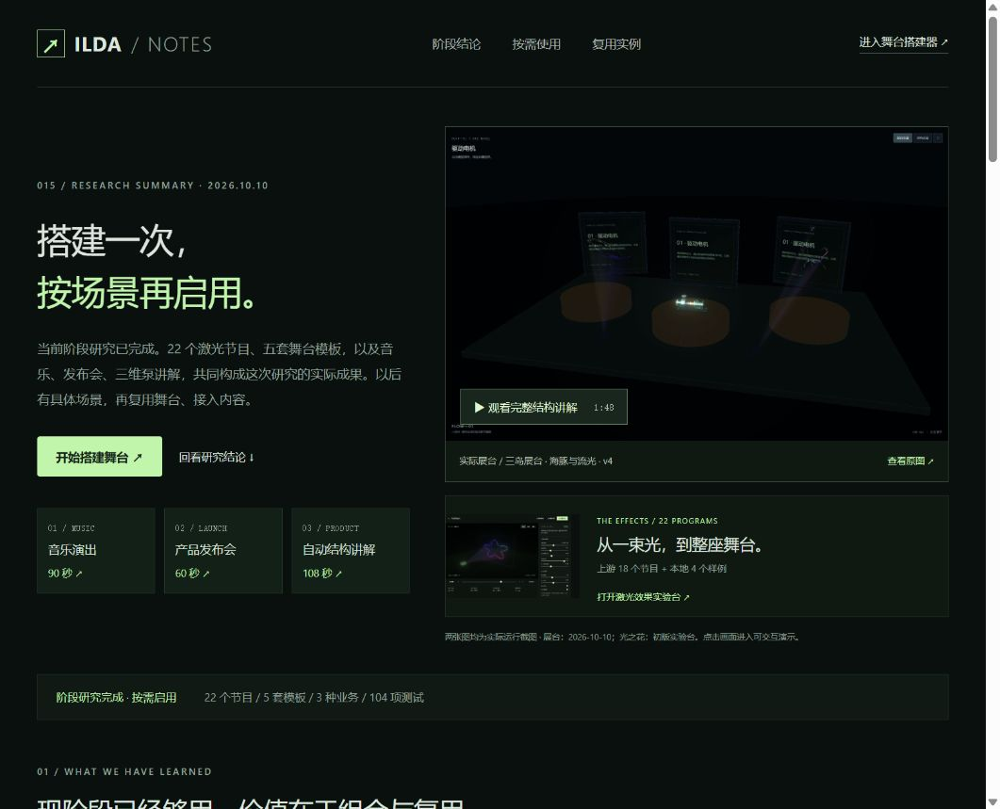
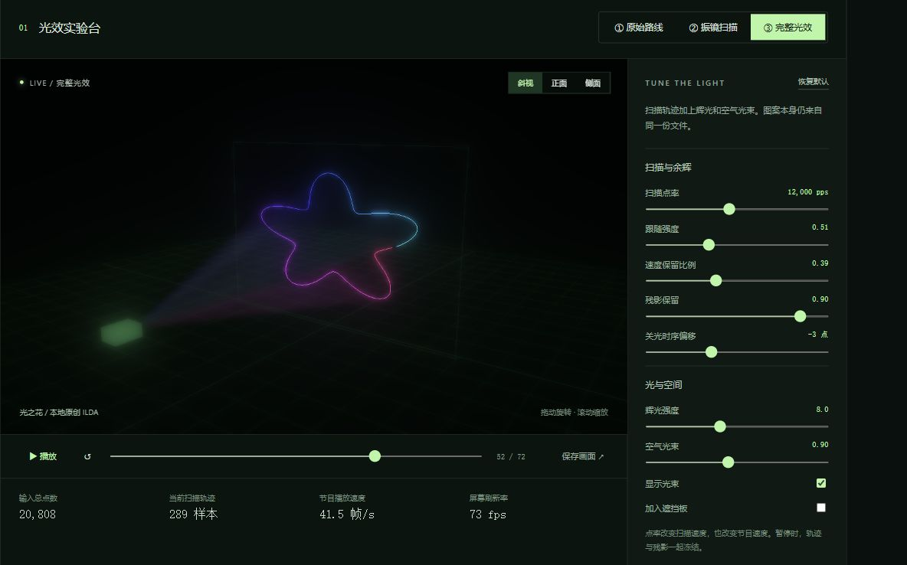
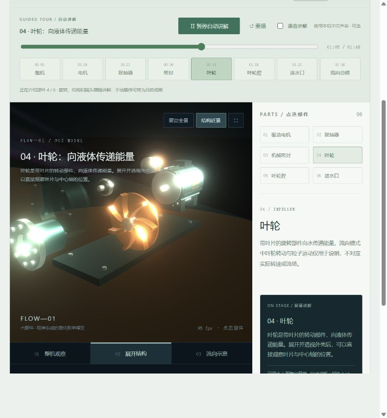
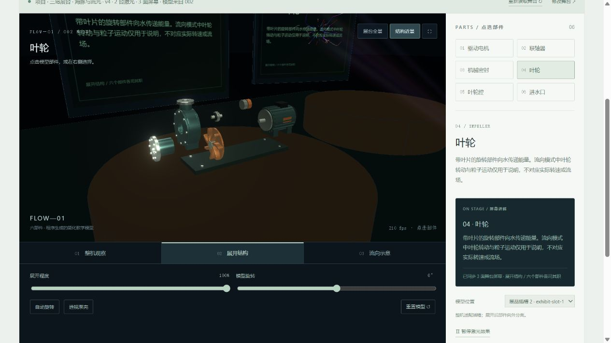

# 015 · Three ILDA：让坐标成为光

three-ilda 将 ILDA 节目的坐标、颜色与关光指令变为可嵌入 Three.js 场景的实时激光效果：解析分轨、固定点率扫描、历史轨迹、辉光与空气光束。我们以 22 节目实验台研究其原理，扩展五套模板、可编辑并另存的舞台项目、激光效果绑定与共享装配，让音乐、发布会和 002 三维泵讲解使用同一份舞台配置。网页全面记录能力、模块、工作链路、素材来源、价值、复用流程、16 类 / 64 项产品探索和验证边界；舞台由本项目新增，内容与演出仍由独立业务提供。

[返回总索引](../../README.md) · [完整研究网页](https://yydshly.github.io/1009_codex_project/015-three-ilda/product.html) · [研究记录](research.md) · [运行说明](web/README.md) · [原仓库](https://github.com/artcodev/three-ilda) · [GPU 自检结果](assets/webgl-validation.json)

**当前阶段研究已完成，后续按具体场景使用。** [网页阶段汇总](web/product.html) 整理了激光组件、舞台资产与内容业务的分工、三业务复用证据、按需搭建流程和验证边界。现有基础支持本地演示和后续接入研究；新需求出现后，再准备内容、调整舞台并进行实际项目验收。

### 一图回顾：激光能力、舞台复用与产品探索

库的核心价值是实现可控制、可嵌入的实时激光效果。我们的扩展思路是舞台搭建与配置复用，让音乐、产品发布、教学等内容业务接入同一空间。下图原样嵌入实际运行截图，汇总三层分工、三个已运行示例、16 类 / 64 个探索设想、使用流程与边界；金色方向尚未完成产品与商业验证。

[矢量原图](assets/research-overview.svg) · [高清 PNG](assets/research-overview.png) · [生成源脚本](web/scripts/generate-overview.mjs)


*2026-10-10 本地整理，1920 × 3780。图中的光之花与 v4 展台来自实际演示；总览以矢量图排版，嵌入原始截图，没有新增所列探索业务。网页入口为 product.html#overview。*

图和网页的实际交付检查见[总览验证记录](assets/research-overview-validation.json)，完整浏览器显示见[总览画面](assets/research-overview-browser.jpg)。

阶段汇总的[实际网页画面](assets/research-summary.jpg)与[交付检查](assets/research-summary-validation.json)已保留。网页的截图和证据链接随构建在编号子路径交付。

汇总入口的首屏现展示[实际三岛展台](assets/stage-entry-exhibit.jpg)与初版光之花，点击画面可重看结构讲解或激光实验；音乐、发布会、自动讲解均提供直接入口。实验台首页的汇总卡片也带展台图，便于以后回忆。展台封面为 2026-10-10 本地运行的完整视口截图，沿用 v4 配置、DOLPHIN / PLASMA2 和 002 模型。



*2026-10-10 本地浏览器实际入口截图。新入口的构建、图片交付和导航检查见[检查记录](assets/research-entry-validation.json)，早期汇总画面与记录继续保留。2026-10-12 整理后，总库与网页的引导图使用上方原始理解总览图。*



*初版四组原创样例的实际 WebGL 2 截图。当前版本扩展为 22 个节目，增加画布上方切换器和缩略图列表。*

## 已实现的能力展示

- **三个阶段**：直接连接文件目标点；真实振镜扫描与残影；加入辉光、空气光束的完整效果。
- **四组原创输入**：光之花、折角与停顿、轨道之间、光的签名，生成标准格式 5 的 `.ild` 文件。
- **18 个上游节目**：原样保留上游文件名，支持画布上方选择、上一个/下一个、缩略图点击、来源筛选和搜索。
- **自动轮播**：默认从第一个节目第 1 帧开始，每个节目完整播放一遍后切换；全部 22 个播完后从头循环。按实际扫描点数判断完成，暂停、后台及加载期间等待。
- **调参实验**：点率、跟随强度、速度保留比例、残影保留、关光时序、辉光和光束强度。
- **观察与操作**：斜视/正面/侧面、拖动旋转、滚轮缩放、遮挡板、暂停、拖动节目帧、重播、截图下载。
- **文件复用**：下载当前 `.ild`，导入本地文件，切换多投影设备轨道，明确显示损坏数据错误。
- **研究讲解**：同一个扫描器的二维对照图、输入来源、CPU/GPU 分工、价值和已确认边界。
- **完整研究网页**：[product.html](web/product.html) 以原始理解图引导，汇总上下游能力分工、两层模块、五步运行原理、输入来源、实际效果、价值、按需使用与交付流程，展开 16 类 / 64 项探索目录，并保留早期讨论、固定源码和验证依据。
- **舞台方案库**：[stage.html](web/stage.html) 配置台面、屏幕占位、立柱、内容插槽和激光设备；内置五套不同布局模板，支持修改后另存独立项目、项目版本更新、拖动位置、尺寸与朝向、设备参数、22 个测试光效和 JSON 导入导出。新增效果搜索 / 来源筛选、撤销重做、保存状态与多编辑页版本提示。音乐、发布会与泵讲解可选择同一项目，并同步读取更新。舞台搭建由本项目用 Three.js 扩展，three-ilda 负责激光组件。
- **展台效果复用**：22 个效果可直接点击接入全部或指定激光设备，绑定随项目保存。“沿用展台效果”保留节目、点率、亮度与设备布置，两种业务借用自己的时钟推进动画；“跟随业务编排”继续使用原业务脚本。当前示例为[三岛展台 · 海豚与流光](web/public/stages/exhibition-effects.json)，两台设备分别使用上游 DOLPHIN 与 PLASMA2。
- **002 泵结构讲解展台**：[pump.html](web/pump.html) 直接复用 002 的同一份程序模型和六部件数据；支持旋转、自动旋转、展开、透视、流向、真实模型点选、面板选择和已有屏幕同步讲解，沿用舞台设备绑定节目与参数，可切换内容插槽。
- **产品发布会接入示例**：[launch.html](web/launch.html) 复用同一保存配置，在内容插槽接入原创概念产品、在屏幕接入文案；60 秒揭幕 / 结构 / 场景流程，可切换视角、配色、结构与文案，并重新读取舞台。
- **独立演出业务示例**：[show.html](web/show.html) 读取已保存的舞台，独立驱动 90 秒原创配乐、五段编排、主题、镜头与本地应援；说明业务如何使用舞台资产。

## 研究基线

| 项目 | 信息 |
| --- | --- |
| 上游 | [artcodev/three-ilda](https://github.com/artcodev/three-ilda) |
| 固定 commit | `6044b91d120cc01f73bdaebed4f7e4d03feb0d2f` |
| 上游许可 | MIT © 2026 Artem Korenevych；源码和测试原样引入，保留 LICENSE |
| 本地环境 | Windows、Node.js 22.15.0、Vite 6.4.3、Three.js 0.185.0、WebGL 2 |
| GPU 实测 | Chromium 155 / NVIDIA RTX 4070 Laptop / ANGLE D3D11 |
| 研究日期 | 2026-10-10（Asia/Shanghai） |
| WebGPU | 已研究源码和 CPU 用例；未执行 WebGPU GPU 渲染或双后端比较 |
| Pages 输出 | `web/dist`；编号子路径 `/1009_codex_project/015-three-ilda/`；沿用总库 GitHub Pages 工作流，部署核验记录单独保存 |

## 运行

```powershell
cd projects/015-three-ilda/web
npm ci
npm run build
npm run dev
```

打开 http://127.0.0.1:5215/ 。构建会生成原创节目，再构建静态页面；运行没有模型、账户或 API 密钥依赖。

产品记录在 `/product.html`，舞台搭建器在 `/stage.html`。选择模板后修改布置，用「创建项目」或「另存为新项目」保留独立方案；选择已保存项目后「保存项目」更新版本。`/show.html`、`/launch.html` 和 `/pump.html` 共用舞台选择器，切换或保存项目会同步读取同一配置，后台音乐暂停。之前的单舞台自动保留为项目。音乐需点击「开始演出」才播放；切到后台自动暂停。导出 JSON 可在另一个浏览器中导入；配置记录素材 ID，素材本身由使用方提供。产品发布会在 `/launch.html`；点击「重新读取舞台」即可重新读取保存配置，发布内容编辑不会写回舞台资产。

五套模板均提供 JSON，原[极光环岛对比布置](web/public/stages/aurora-island.json)继续保留。演示浏览器此前新增“星轨秀场 · 定制方案”和其独立副本“星轨秀场 · 宽走台”；两份方案分别保留 3.6 / 4.8 宽的走台和 4 / 5 深的前岛，模板保持原尺寸。当前三个业务页面选择新增“三岛展台 · 海豚与流光”v4，在两侧展台屏幕前播放保存的效果。配置属于同一站点的本地存储，其他浏览器需自行导入。

推荐先选择「折角与停顿」，切到原始路线，再切到振镜扫描并降低跟随强度；最后回到完整光效，从侧面查看空气光束。下载文件后导回实验台，可以验证输入与画面的关系。

## 验证与结论

- 104 项 Node 测试通过：24 项未修改的上游测试、4 项原创数据测试、18 项上游节目校验、6 项轮播测试、6 项演出测试、7 项舞台资产与装配测试、6 项发布会接入测试、7 项方案库与项目测试、6 项效果接入测试、6 项编辑流程测试、6 项泵结构复用测试、8 项自动讲解测试。编辑检查覆盖效果与构件恢复、连续编辑合并、保存点状态、历史容量、搜索以及旧版本拒绝覆盖 / 另存。既有素材扫描、轮播、资产装配与业务接入检查继续保留。
- GPU 像素自检通过：前/后光束改变像素，关闭恢复原像素，辉光提高亮度，整面遮挡墙输出为黑，空节目背景保持一致。数值见 [webgl-validation.json](assets/webgl-validation.json)。
- 初版浏览器已验证三阶段、参数、四组原创节目、导入下载与窄屏。新增 18 节目完成 Node 校验与静态构建；此次浏览器自动检查受安全策略限制，未将新列表记为已逐个 GPU 实测。
- 根索引同步、仓库校验、Pages 汇总和编号路径检查见 [研究记录](research.md)。
- 环岛布置已通过浏览器导入、保存、刷新和导出；导出结果与源配置逐字段一致。音乐与发布会实际加载同一保存配置并渲染，音乐播放 / 跳段 / 暂停已检查。见 [复用记录](assets/stage-reuse-validation.json) 和[音乐画面](assets/reuse-music.jpg)、[发布会画面](assets/reuse-launch.jpg)。未检查拖动编辑、全屏或音频听感。此前默认舞台发布会检查见 [launch-validation.json](assets/launch-validation.json)；历史 Node 演出测试见 [stage-validation.json](assets/stage-validation.json)。
- 方案库已逐一载入五套模板并保存实际三维截图；通过 UI 修改、另存独立项目、更新版本、重开与导出，确认原项目和模板保留。音乐选择会同步到发布会，发布会选择也会同步到音乐；保存 v2 后两页自动加载同一版本。见 [方案库检查记录](assets/stage-library-validation.json)、[方案库画面](assets/stage-library.jpg)和实际导出的[定制方案](assets/library-project-a.json)、[宽走台副本](assets/library-project-b.json)。

库的价值是封装 ILDA 解析、固定频率运动模拟、轨迹缓冲、场景对象和光效管线。当前扫描轨迹的 Z 恒为 0；遮挡依据相机深度，不能把效果理解为从投影机计算的物理光路。适合网页视觉预览、虚拟舞台与图形教学，真实硬件输出需额外接入。

当前产品方向是**可复用的舞台搭建工具**：交付空间和设备配置；演出、展览、品牌活动与 AI 角色体验由独立业务接入。舞台 JSON 不包含音频、角色或时间线。协议与接入方式见 [运行说明](web/README.md)。

效果接入实测见[检查记录](assets/stage-effects-validation.json)、[展台效果画面](assets/stage-effects-builder.jpg)、[音乐复用](assets/stage-effects-music.jpg)和[发布会复用](assets/stage-effects-launch.jpg)。原来的方案与验证报告保留，当前浏览器使用新增效果展台 v4。

编辑流程进一步加入搜索、来源筛选与帧数显示；换效果、改参数、增删构件与恢复默认均可撤销重做。连续输入和一次拖动合并为一步，保存后仍保留本页历史。多个搭建器编辑同一项目时，旧页显示实际版本并提示读取最新或另存，保存检查基准版本。检查记录见[编辑流程实测](assets/stage-editor-validation.json)，实际画面见[改进后的搭建器](assets/stage-editor-builder.jpg)。

## 来源与本地新增

上游源码和测试位于 [web/vendor/three-ilda](web/vendor/three-ilda/ATTRIBUTION.md)。本地新增界面、原始轨迹对照、二维跟随示意、ILDA 编码/原创样例生成和像素自检。原创文件的生成不代表上游库已有节目创作工具。

上游 18 个 ILDA 文件已加入 [public/upstream/](web/public/upstream/ATTRIBUTION.md)，原样保留 LICENSE、CREDITS 和目录元数据。节目由上游项目所有者提供，最初作者与独立许可未逐项完整列明；不将其标为本地原创。四个原创输入仍保留。Sylvester 沿用上游的特殊回退调色板；缩略图为源文件指定帧的二维路线，点击后由真实库渲染完整光效。

### 002 内容复用的实际画面

结构讲解现支持自动模式：约 1 分 48 秒，从整机依次介绍六个部件，再收拢展示流向；旋转、展开、部件近景和三面屏幕同步。可以暂停继续、跳段、重播或接管手动探索，并可选择浏览器本机中文语音。仍读取同一舞台与设备效果，不修改已保存的舞台资产。当前 104 项 Node 测试通过，自动讲解验证见 [检查记录](assets/pump-tour-validation.json)。



*2026-10-10 本地浏览器实际截图：自动介绍叶轮，章节进度、模型近景与屏幕讲解同步。仍使用“三岛展台 · 海豚与流光”v4。*



*2026-10-10 本地浏览器实际截图：原 v4 舞台、展开泵模型、叶轮选择与三屏同步讲解。模型为既有本地简化教学示意。全景见 assets/pump-exhibit-wide.jpg，验证范围见 [运行记录](assets/pump-exhibit-validation.json)。*
