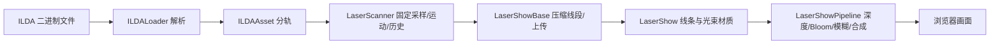

# 015 · Three ILDA：激光秀播放、扫描模拟与光束实验研究

## 2026-10-12 完整理解整理

本次整理沿用 [2026-10-10 原始引导图](assets/research-overview.png)，不改写历史截图与测试日期。完整网页为 [product.html](web/product.html)，线上入口为 https://yydshly.github.io/1009_codex_project/015-three-ilda/product.html 。下面的历史研究记录保留各轮的依据与当时范围；部署结果另记。

| 维度 | 最终理解 |
| --- | --- |
| 能力 | 库实现 ILDA 格式 0/1/2/4/5 解析、设备分轨、固定点率扫描、关光、轨迹历史、场景对象、辉光及空气光束；当前本地用 WebGL 2。 |
| 模块 | 上游：ILDALoader / ILDAAsset → LaserScanner → LaserShowBase → WebGL 或 WebGPU LaserShow 与 Pipeline。本地：节目实验、舞台协议与模板、项目及版本、编辑历史、效果缓存、共享 StageLayout、业务时间线与内容适配。 |
| 原理 | 文件指定目标点；CPU 按点率递推 X/Y 位置和速度、维护历史与衰减；几何连接为线段及出光口三角面；GPU 噪声、深度和后处理形成光效。舞台配置由共用装配器载入，业务注入素材与自己的时钟。 |
| 素材 | 18 份固定上游节目、4 份本地原创 ILDA、原创程序配乐、概念产品模型和 002 共享六部件泵。节目文件不是视频；角色、讲义、音频和模型需业务提供。 |
| 本地成果 | 22 节目完整播放轮播与三阶段实验；五舞台模板、独立项目、版本、编辑、效果绑定、导入导出；90 秒音乐、60 秒发布会和 108 秒泵自动讲解共享舞台与激光。 |
| 价值 | 库减少重复的激光显示实现；舞台资产减少布置重复搭建，业务接入表达各自内容；沟通、教学或商业收益需真实项目验证。 |
| 场景 | 虚拟演出、二人转与皮影戏、讲义与培训、品牌活动、产品和设备展示、文化展馆、互动游戏、直播、创意数据、AI、XR 与现场适配。 |
| 扩展 | 图与网页列出 16 类 / 64 项探索：舞台工具、节目创作、音乐、传统表演、品牌、产品电商、教学、工业、文化、游戏、直播、创意数据、AI、XR、硬件及资产服务；网页逐类说明基础与新增工作。 |
| 交付 | 现阶段足够用于研究；后续先确定场景与素材，选模板、保存 / 导出舞台，再接入业务并验收。云端、协作、打包、AI、XR 和硬件按需求追加。 |
| 边界 | JSON 与当前浏览器同站点存储不包含素材；扫描 Z=0、相机深度遮挡是视觉近似；泵与粒子非工程仿真；WebGPU GPU、全组合、移动性能、音频听感及商业效果未完整验证。 |

保留 104 项 Node 用例与原 GPU / 浏览器证据。本次发布继续验证测试、构建、相对子路径、原图字节、静态资源与线上实际页面，验证结论以对应记录为准。

## 它实现了什么，价值在哪里

`three-ilda` 把一份已经制作好的激光节目数据，变成能放进 Three.js 三维场景里的激光秀。输入 `.ild` 文件，得到可播放的图案、带惯性的扫描轨迹、逐渐变暗的残影，以及从出光口通向图案的雾中光束。

一个具体场景：开发者要制作网页里的虚拟演唱会，可以用它读取已有激光节目，把图案放在舞台平面上，调整出光位置，再从侧面观看光束。省下的是文件解析、扫描运动、轨迹管理、光束着色和辉光合成这些工作。舞台内容、交互、节目的制作和真实设备接口仍由应用提供。

| 能力 | 实际实现 | 对应用的价值 |
| --- | --- | --- |
| 节目读取 | 解析 ILDA 的坐标、颜色、开关光标记，并按投影机编号分组 | 复用已有节目数据，无须自己写二进制解析器 |
| 播放与跳帧 | 固定点频率循环扫描；暂停、选帧、切换轨道 | 建立浏览器预览和交互控制 |
| 扫描器模拟 | X/Y 两个轴各有位置和速度，追赶文件里的目标点 | 呈现转角变圆、跟随延迟和参数变化 |
| 图案显示 | 将扫描样本压缩成加法混合的线段 | 在三维场景里显示彩色发光图案 |
| 空气中的光 | 每段扫描线与出光口组成三角面，再加入噪声、柔化和深度衰减 | 呈现舞台雾光的视觉效果 |
| 两套渲染实现 | WebGPU / TSL 与 WebGL 2 / GLSL，共用读取和扫描代码 | 按浏览器与渲染器选择集成方式 |

它最值得研究的部分，是从“目标点列表”到“实际轨迹”，再到“可见的光”的分层设计。它可以用于节目视觉预览、虚拟舞台和互动展示；现有源码没有真实激光设备的发送接口，也没有完整的光学、雾介质或设备校准模型。

## 基线与环境

| 项目 | 记录 |
| --- | --- |
| 原仓库 | [artcodev/three-ilda](https://github.com/artcodev/three-ilda) |
| 固定研究版本 | [`6044b91d120cc01f73bdaebed4f7e4d03feb0d2f`](https://github.com/artcodev/three-ilda/tree/6044b91d120cc01f73bdaebed4f7e4d03feb0d2f)，提交说明为 Initial release，提交日期 2026-09-18 |
| 上游包版本 | `three-ilda` 0.1.0 |
| 研究日期 | 2026-10-10（Asia/Shanghai） |
| 本地运行环境 | Windows / PowerShell；读取到的 Node.js 版本为 `v22.15.0` |
| 浏览器实测环境 | Chromium 155 / Windows；NVIDIA GeForce RTX 4070 Laptop GPU，ANGLE Direct3D11 |
| 上游依赖 | Three.js `^0.185.0`；上游开发依赖固定 `three@0.185.0`、Vite 6.4.3 |
| 本项目演示方案 | Vite + Three.js 0.185.0，使用上游 WebGL 2 源码；启动、构建步骤见 [web/README.md](web/README.md) |
| 上游许可证 | MIT，Copyright (c) 2026 Artem Korenevych；实际引入的源码需保留 LICENSE 和版权声明 |
| 本文依据 | 已读取本地固定版本的 README、CREDITS、LICENSE、全部核心源码、两份测试文件和浏览器验证页；浏览器实测记录在下文单独列出 |

## 原始文件和视觉效果从哪里来

**节目文件负责描述画什么，库的算法负责把它显示成什么样。**

`.ild` 保存的是按顺序执行的点：位置、颜色、开关光状态和帧/投影机信息。它不是已经渲染好的视频，也不包含烟雾图片、辉光或出光口位置。图案轮廓与动作来自节目；镜子的延迟、残影和空中光束由库计算。

| 画面内容 | 来源 |
| --- | --- |
| 轮廓、扫描顺序、颜色、动画帧 | `.ild` 中的点记录 |
| 圆角、惯性、过冲 | `LaserScanner` 的位置/速度递推 |
| 残影 | 环形历史缓冲和按时间计算的颜色衰减 |
| 空气中可见的扇形光 | 出光口与线段组成的三角面 |
| 雾的不均匀与漂移 | 着色器中的三维噪声与时间偏移 |
| 辉光与柔和光束 | Bloom、模糊和最终合成 |

上游 `examples/public/ilda/` 有 **18 个**示例，例如 `DOLPHIN.ILD`、`dancer.ild`、`paperair.ild`。但 [CREDITS.md](https://github.com/artcodev/three-ilda/blob/6044b91d120cc01f73bdaebed4f7e4d03feb0d2f/CREDITS.md) 仅说明这些文件由项目所有者提供并保留原文件名，没有完整列出每个节目的最初作者及单独的授权条件。不能据此确认每个素材的原始创作者。

当前演示加入全部 18 个上游节目和四个原创样例，共 22 个；默认从第 1 项 0HNY 的第 1 帧开始自动轮播，每个节目完整播放一遍再切换，全部播完回到第 1 项。上游文件及 catalog 原样保存在 `web/public/upstream/`，保留 LICENSE、CREDITS 和[素材来源说明](web/public/upstream/ATTRIBUTION.md)。画布上方可选择或依次切换，缩略图列表提供来源筛选、搜索和点击播放。四个原创样例和文件导入下载继续保留。原创文件生成器属于本项目新增功能，不是 `three-ilda` 自带的节目编辑或导出能力。

轮播是本展台新增的播放控制，不属于上游库。独立控制器 `ProgramCarousel` 根据当前轨道的 scanner.samples、total、point 和 fraction 判断实际完成；暂停、后台和文件加载期间等待。加载后调用 show.reset()，消除上游 setData/seekFrame 预扫描整帧的影响，确保从第 1 帧第 1 个点播放，previewFrame 仅用于缩略图。最后一次 update 的步长限制为 `(剩余点数 - fraction) / pointRate`，先提交最后一帧画面再触发异步切换，避免跨过片尾后同一显示帧扫描到第 1 帧。点率或浏览器显示速度改变时，仍以实际样本数判断完成，不使用固定秒数。手动选节目后从新位置继续全部 22 项，筛选不改变顺序；跳帧暂停后继续播到片尾，重播或换轨从第 1 帧开始，重新开启轮播也从当前节目头部重播。导入本地文件或加载失败时关闭轮播。

缩略图以 catalog 的 previewFrame、track 读取真实源帧绘制，属于二维目标路线预览，不是 GPU 光效截图。选择卡片会读取对应原始二进制文件，创建扫描数据并在真实 WebGL 2 管线中播放。Sylvester 使用上游 examples/main.js 中的 observable-demo 回退调色板，前十个颜色的红色通道改为 55；嵌入调色板仍优先。合并目录记录每个文件的原名、字节数、帧数、点数和 SHA-256。

原创路径与格式 5 编码位于 [web/src/samples.js](web/src/samples.js)，由 [生成脚本](web/scripts/generate-samples.mjs) 输出到 `web/public/shows/`。四组样例为光之花、折角与停顿、轨道之间、光的签名；[样例授权说明](web/public/licenses/samples.txt) 明确这些扫描动画由本子项目原创、按 MIT 许可提供。上游源码的版权与引入范围另见 [vendor/three-ilda/ATTRIBUTION.md](web/vendor/three-ilda/ATTRIBUTION.md)。

## 数据与架构



| 模块 | 职责与关键边界 |
| --- | --- |
| `src/loaders/ILDALoader.js` | 继承 Three.js Loader；同步解析 ArrayBuffer；不创建场景或几何 |
| `src/core/LaserScanner.js` | 与渲染器无关的 CPU 扫描模拟；持有位置、颜色、blank、出生时间的固定数组 |
| `src/core/LaserShowBase.js` | 播放 API、场景对象、线段和三角面整理；两套渲染版本共用 |
| `src/objects/LaserShow.js` | WebGPU 的 TSL / NodeMaterial 材质 |
| `src/webgl/LaserShow.js` | WebGL 的 GLSL ShaderMaterial 材质 |
| `src/postprocessing/LaserShowPipeline.js` | WebGPU RenderPipeline 与 TSL 后处理 |
| `src/webgl/LaserShowPipeline.js` | WebGL 半浮点渲染目标、深度纹理、UnrealBloomPass、模糊和合成 |
| `src/index.js` / `src/webgl.js` | 两套入口；不能混用另一套材质与 pipeline |

解析结果用 `Float32Array` 保存交错的 XYZ/RGB，`Uint8Array` 保存关光状态。`asset.frames` 保留文件中的点帧顺序，`asset.tracks` 按投影机编号分组；调色板记录不作为动画帧。一个 `LaserShow` 播放一个轨道，多台虚拟投影机可以各建一个 show，共用同一份解析数据而独立播放。

数据和实例的生命周期也分开：`clone()` 共用 asset，但复制扫描历史并建立独立几何和材质；`show.dispose()` 释放本实例资源，不使共享 asset 失效；pipeline 的 `remove()` 恢复原图层和材质状态。这些设计在上游 Node 测试中有对应断言。

## 原理：为什么一串坐标会变成激光秀

### 1. 文件给的是目标位置，扫描器计算实际位置

可以想象用激光笔快速画一个方形：手指向四个角，但移动过程会有惯性和转弯。文件里的点像“下一步要指向哪里”的命令；库维护 X/Y 两个轴的位置和速度，每个样本执行：

```text
速度 = (旧速度 + (目标位置 - 当前位置) × gain) × dampening
位置 = 当前位置 + 速度
```

`gain` 控制追赶目标的力度。`dampening` 实际是保留速度的比例，数值越大，阻尼越弱；`0` 会冻结运动，`1` 会保留振荡。默认 `gain=0.51`、`dampening=0.39`。这是简单离散运动模型，两轴独立，未模拟扭矩极限、驱动器控制环、机械频率响应或设备误差。可视化中的“镜子目标跟随”示意用于解释这条递推，不表示库输出了某台实物的镜面角度。

### 2. 点采样频率也决定节目速度

`advance(dt)` 把经过的秒数乘以 `rate`，保留不足一个点的小数部分，按固定点间隔产生样本。显示器 30、60 或 120 FPS 只影响每次补算多少点，不应改变同一秒走过的点序列。

文件没有独立播放时间轴。一个 `N` 点帧的扫描时间是 `N / pointRate` 秒；800 点、8,000 点/秒对应每帧 0.1 秒。帧点数不同时，帧持续时间也不同。因此 `pointRate` 同时改变采样和动画速度，不能解释成显示器 FPS。由于运动递推按“每点”执行，固定 gain/dampening 时，改点频率也改变运动过程对应的实际时间尺度。

库没有对较大的 `dt` 自动截断。上游示例采用 Timer 并把间隔限制在 0.1 秒，应用集成时需要决定隐藏标签页恢复后的处理方式。

### 3. 关光跳转与残影

绘制完一个图形后移到下一图形时，镜子仍然运动，但激光必须关闭，避免出现连接线。解析器保留 blank 点的原始颜色；扫描器用 `blankingOffset` 选择前后若干点的开关标记，默认 `-3`，尝试补偿位置跟随的延迟。

这只是开关标记的点偏移，不是对激光器电路或设备延迟的自动校准。它可以跨帧正向/反向循环取标记；它不同时偏移坐标和颜色。

最近样本保存在固定容量的环形缓冲里，快照时按下式衰减颜色：

```text
衰减倍率 = lightDecay ^ (样本年龄秒数 × 60)
```

关光点的显示颜色为零。`lightDecay=0` 特殊处理为只保留最近 1/60 秒。默认缓冲 2,048 点，在 8,000 点/秒时最多保存 0.256 秒历史；较强残影可能还没有完全变暗就被覆盖，长余辉需要更大的 capacity。暂停会冻结 scanner.time，所以暂停画面中的残影也保持静止。

### 4. CPU 整理几何，GPU 画成光

| CPU 上进行 | GPU 上进行 |
| --- | --- |
| 解析二进制文件和调色板 | 按缩放与出光口 uniform 变换顶点 |
| 按 dt 逐点推进位置/速度 | 线条和三角面的加法混合 |
| 管理历史、计算衰减 | 三维噪声、光束两端的亮度包络 |
| 排除 blank 或足够暗的相邻样本 | 比较相机深度，淡出被遮住的光束片元 |
| 生成/压缩线段和光束三角面并更新属性 | Bloom、半分辨率光束、两遍模糊及合成 |

扫描模拟本身没有移到 GPU。每次 CPU 遍历历史样本，相邻两点都开光、亮度超过阈值时生成一段 `LineSegments`。有光束时，再生成一个“出光口 → A → B”的三角面。光束面的颜色取线段两端均值，设置双面、加法混合、不写入深度。

实际上传的出光口顶点为零，顶点着色器利用 `beamAlong` 在 uniform 出光口和缩放后的点之间选择位置。因此改变出光位置、图案大小、zoom、亮度可以通过 uniform 完成，不必重新计算坐标。关闭光束还会跳过三角面属性上传及其后处理。

### 5. 可见光束是薄面近似

大量扫描线对应的三角面叠加，表现快速扫描在空气中留下的扇面。着色器用沿三角面的渐变淡化出光口和落点，用随时间移动的三维噪声形成雾感。这里没有体积网格、体积积分、雾粒子散射或真实光能计算。

场景先渲染颜色与深度，光束单独以半分辨率渲染；随后模糊光束，给主场景加 Bloom，再将光束按 `1-exp(-x)` 压缩并叠加。明亮区域有保护权重，防止雾光淹没线条。Bloom 和保护权重读取整个主场景，所以库更适合暗场景；其他高亮物体或背景也会影响最终光效。

### 6. 深度遮挡的准确含义

光束片元取当前屏幕像素的场景深度，转换为相机空间 Z，再与自身相机空间 Z 比较：

```text
透明度 = 1 - smoothstep(0.002, 0.015, sceneViewZ - beamViewZ)
```

效果是从**当前相机视角**淡出躲在场景深度后面的光束。它没有从投影机沿光线发射射线，也没有计算挡板之后整条光路的中断、阴影、反射或图案如何投到其他表面上。挡板遮住了屏幕上的光束，不能作为“物理光路仿真正确”的证据。

遮挡取决于物体是否写入场景深度。上游 README 概括为不透明物体遮挡、透明物体不遮挡，但实际材质中的深度判断没有读取物体透明度；透明材质的 `depthWrite` 等设置也会影响结果，不能一概断言所有透明物体都不遮挡。

## 格式支持与明确边界

| ILDA 格式编号 | 解析支持 | 记录内容 |
| --- | --- | --- |
| 0 | 是 | 三维坐标 + 颜色索引 |
| 1 | 是 | 二维坐标 + 颜色索引 |
| 2 | 是 | RGB 调色板记录，按投影机生效 |
| 4 | 是 | 三维坐标 + 真彩色点 |
| 5 | 是 | 二维坐标 + 真彩色点 |
| 3 / 其他 | 否 | 解析时明确报错 |

解析器把 16 位坐标除以 32,768，范围为 `[-1, 1)`；真彩色点的数据按 BGR 存储，解析后成为 RGB。索引帧优先使用其投影机已出现的 format-2 调色板，否则用默认 64 色调色板；超出调色板的索引变为白色，并累计 `paletteFallbacks`。文件上限为 32 MiB，总点数上限为 2,000,000；无显式 EOF 的完整点帧也可以解析，并返回 `eof=false`。

**能解析三维文件不等于播放三维轨迹。**Loader 保留格式 0/4 的 Z，但 `LaserScanner.sample()` 和 `snapshot()` 都把输出 Z 写成 `0`，`LaserShowBase` 的图案缩放向量 Z 也为 `0`。默认播放始终位于 show 的局部 XY 平面。把整个 show 旋转或移动可以改变平面在场景中的位置，不能恢复文件中的三维曲线。

此外，库不提供节目创作工具、音频同步时间轴、真实硬件 DAC 输出、设备校准或实物效果保证。WebXR、多视角和多相机需要应用自行集成；pipeline 为一个相机视角管理渲染。

## 实验设计与复现记录

下方截图、浏览器操作和 GPU 数值记录的是初版四组原创展示。新增 18 节目的文件与 CPU 几何校验见 [upstream-program-validation.json](assets/upstream-program-validation.json)；开发服务和 Pages 编号路径已通过 22 文件、哈希、路线预览、来源文件的 HTTP 请求检查。新列表未记为已逐个 GPU 实测。

本项目实验台把同一输入分成三个观察模式：原始目标点轨迹、振镜后的轨迹、完整光效。前者是本项目提供的对照视图；后两者调用真实上游扫描/显示代码。目标跟随 Canvas 示意用于解释位置与速度，不代替 Three.js 实际渲染。

| 实验 | 输入与操作 | 要验证什么 | 本项目记录 |
| --- | --- | --- | --- |
| 目标与实际轨迹对照 | 原创几何样例；切换原始/振镜模式，将 gain 改为 0.12 | 对照目标点与运动递推输出 | 浏览器操作已确认模式切换与参数响应；原始模式禁用 gain，振镜模式禁用 Bloom。[原始路线](assets/raw-route.jpg)、[振镜轨迹](assets/scanner-trail.jpg) |
| 开关光偏移 | 原创多笔画输入；操作 blankingOffset 控件 | 关光标记偏移是否可调 | 已操作控件；offset=0 与 -3 的拖尾差异未单独定量验证，当前不作量化结论 |
| 残影与节目速度 | 原创样例；操作 lightDecay、pointRate、暂停、选帧 | 验证控制流程与播放状态 | 已操作点率和衰减控件，并确认暂停/选帧功能；衰减曲线和速度关系的理论依据仍为源码，未另做浏览器曲线测量 |
| 完整光效 | 光之花；Front/Back/Disabled、Bloom 开关 | 光束与 Bloom 是否实际改变 GPU 输出 | WebGL 2 render-target 读回自检通过，具体像素与亮度结果见下表；[完整效果](assets/preview.jpg) |
| 相机深度遮挡 | 演示开启挡板；自检加入整面不透明黑墙 | 场景深度是否能遮住输出 | 挡板截图已保存；自检遮挡后亮度均值为 0。[挡板效果](assets/occlusion.jpg)。此结果证明相机深度遮挡，不能推导真实光路截断 |
| 文件导入与下载 | 四个默认样例；多轨文件；下载再导入；损坏文件 | 生成、解析、播放、分轨和错误提示 | 四个默认样例成功解析；多轨文件显示 4 帧/1,142 点、设备 0/3，已选择设备 3；下载 `light-flower.ild` 再导入显示 72 帧/20,808 点；损坏输入显示 `Invalid ILDA signature at byte 0.` |
| 画面导出 | 完整光效下点击保存画面，再点击下载 PNG | 实际生成并下载画布图片 | 开发版 PNG 为 516,353 字节；编号路径构建版暂停第 52 帧导出为 374,556 字节；均实际下载成功 |
| 窄屏与日志 | 390 px 宽的浏览器视口 | 画布布局和页面日志 | `innerWidth=390`、文档可用宽度 375、canvas 宽度 345；未发现水平溢出；浏览器 warning/error 日志为空。[窄屏截图](assets/mobile-full.jpg)、[桌面截图](assets/desktop-full.jpg) |
| 项目构建与汇总 | 子项目 build、根 index:sync/check/pages:build | 演示与自检多入口、编号子路径可汇总 | Vite 多入口构建、索引同步、仓库校验和 Pages 汇总均通过；15 个项目、14 个本地演示。已在实际构建路径 `/015-three-ilda/` 确认三阶段、PNG 下载、窄屏布局和 GPU 自检 `pass: true` |

浏览器与 GPU 的实际环境为 Chromium 155 / Windows / NVIDIA RTX 4070 Laptop GPU（ANGLE Direct3D11）。证据位于项目的 `assets/`。截图记录交互外观；GPU 数值来自独立自检页 [web/validation.html](web/validation.html)，执行代码为 [web/src/validation.js](web/src/validation.js)，保存结果为 [assets/webgl-validation.json](assets/webgl-validation.json)。

自检固定使用原创光之花第 18 帧、capacity=4,096、480×320 渲染目标、pixelRatio=1、线性色彩输出、Bloom strength=8、MSAA samples=0。亮度指标取每像素 RGB 最大通道，再对整幅 8 位输出求平均，单位不是实物光功率；参数与上游报告不同，不能直接横比其均值。

| 本项目 WebGL 2 自检项 | 实测结果 |
| --- | --- |
| Front 相对关闭光束的变化像素 | 29,878 |
| Back 相对关闭光束的变化像素 | 16,597 |
| Disabled 恢复原像素 | `true` |
| Bloom / 无 Bloom 亮度均值 | 16.9606 / 0.9257 |
| 整面黑墙遮挡后的亮度均值 | 0 |
| 背景保持一致 | `true` |
| 着色器/自检错误 | `[]` |
| 总体结果 | `pass: true` |

从仓库根目录可按以下命令复现。`samples` 会重新生成原创文件、复制研究文档至静态目录；`build` 先执行该步骤，再输出 `web/dist/`。Vite 使用相对资源路径，并配置 `index.html` 与 `validation.html` 两个入口。

```powershell
npm --prefix projects/015-three-ilda/web ci
npm --prefix projects/015-three-ilda/web run samples
npm --prefix projects/015-three-ilda/web run check
npm --prefix projects/015-three-ilda/web run dev
```

开发地址为 `http://127.0.0.1:5215/`，GPU 自检页为 `/validation.html`。构建与总库汇总命令如下；此处列出复现步骤，最终检查结果在上方实验表单独记录。

```powershell
npm --prefix projects/015-three-ilda/web run build
npm run index:sync
npm run check
npm run pages:build
```

## 上游测试说明与证据等级

上游 `test/ILDALoader.test.js` 验证混合格式、分轨、坐标/颜色通道、调色板、损坏输入，以及 Three.js Loader 的异步请求与错误处理。`test/LaserShow.test.js` 验证 30/60/120 FPS 下 CPU 扫描的一致性、blank 旅行点不形成线段、关闭光束不再上传属性、uniform、跳帧、复制、释放和 pipeline 注册恢复。

这些 Node 测试可以在没有 GPU 的环境运行；构造 pipeline 图或用 fakeRenderer 不等于执行了着色器。两份 `examples/validation-*.html` 才在浏览器渲染，并读回最终 render target，检查 Front/Back 光束改变画面、关闭光束恢复像素、整面黑墙的遮挡、背景不被重复叠加，以及输出亮度。

上游 README 报告了两套实现的亮度接近，例如 Bloom 强度 15 时均值 30.43 / 30.52。这是**上游作者的验证结果**，不能写成本项目在当前机器上测得的值。这个有限场景的接近，也不能推导所有设备、全部相机与任意场景像素都完全一致。

| 项目 | 依据与当前状态 |
| --- | --- |
| 解析、运动、缓冲和渲染结构 | 本文已逐项核对固定 commit 源码 |
| 本项目 Node check | 71 项通过：4 项原创数据 + 18 项上游节目 + 24 项上游原测试 + 6 项轮播 + 6 项演出 + 7 项舞台资产与装配 + 6 项发布会；0 fail、0 skipped。舞台包含三台真实 LaserShow 同步与跳段、90 秒 PCM 与可控音频上下文的传输行为 |
| 本项目 WebGL 2 浏览器演示 | 初版已实际操作模式、参数、暂停/选帧、导入/下载、分轨与挡板；6 张截图及 GPU 自检 JSON 已保存。新增列表尚未自动核验浏览器交互 |
| 上游 WebGPU 浏览器验证 | 已阅读验证页；本项目没有据此宣称已实测 WebGPU |
| 两套渲染结果的等价性 | 仅引用上游有限场景报告；本项目没有自行完成双后端比较 |

WebGL pipeline 依赖半浮点颜色缓冲和深度纹理，WebGPU 版本需要相应浏览器后端。当前演示选择 WebGL 2 不会自动覆盖 WebGPU 兼容性或上游声明的渲染一致性。

`scripts/check.mjs` 将已引入的 sylvest.ild 复制到上游测试所要求的原始相对路径（生成夹具被 Git 忽略），不再排除素材用例。24 个原测试保持不变、全部执行；新增四个原创测试验证编码、解析与扫描；18 个新增上游节目测试检查文件哈希、帧/点/轨道、指定预览帧、有限扫描坐标以及实际线段和光束三角面，并检查 Sylvester 的特殊调色板。

本次新增节目列表完成文件/CPU 几何校验、Vite 构建与 Pages 汇总。先前自动浏览器操作被安全策略拦截（提示 URL 协议不被允许），因此未自动逐个切换新列表、读取 GPU 像素或保存新版界面截图。现有截图及 GPU 数值仍明确对应初版原创输入，不把 Node 几何结果记作 GPU 实测。

## 可以借鉴的设计与后续问题

- 把格式读取、时间模拟、场景对象和后处理拆开，让同一数据与运动模型支持两套渲染实现。
- 用固定时间点采样和出生时间把模拟从显示刷新率中分离；用固定数组与环形缓冲控制分配成本。
- 动态几何只更新有效前缀，出光口与缩放走 uniform；关闭光束会省去对应上传和渲染。
- 在程序中明确资源所有权与 remove/dispose 的恢复语义，降低嵌入其他场景的副作用。
- 若研究设备准确度，需要补充实物参数、位置/速度闭环及延迟测量；若研究物理光路，需要补充从出光口的可见性、表面相交与体积光计算。
- 若要播放 ILDA 三维 Z，不能只改相机或 show 变换，需要扩展扫描器与图案几何模型。

## 产品价值与虚拟演出的讨论记录（2026-10-10）

网页记录位于 [web/product.html](web/product.html)，舞台搭建器位于 [web/stage.html](web/stage.html)，独立演出业务示例位于 [web/show.html](web/show.html)。本段保存讨论结论，区分已验证能力、原型实现与商业假设。

### 能力与价值

库把激光节目变为可嵌入 Three.js、实时调节的显示组件。22 个节目是输入素材，列表、搜索、轮播、原创生成与界面由本项目新增。仅观看节目时额外价值有限；场景组合、实时控制、互动与工作流程可以产生更具体的产品价值。这里的场景首先是网页中的虚拟舞台，普通电脑即可体验；真实设备输出是另外一层接口工作。当前库不提供完整节目创作、音乐编排、人物、AI 或工程光学仿真。

### 产品方向与待验证价值

| 方向 | 潜在用户与价值 | 需要新增 |
| --- | --- | --- |
| 方案预览与评审 | 活动公司、设计师与客户；链接交付、比较方案、减少反复沟通 | 模板、布置、版本、分享、时间点评论 |
| 素材管理 | 创作者与制作团队；查找、预览、整理复用节目 | 批量导入、标签、项目与版本 |
| 轻量创作 | 制作文字、Logo 和动画的人；从自己的内容生成激光视觉 | SVG / 文字转扫描点、编辑、点序优化、导出 |
| 虚拟音乐体验 | 音乐人、品牌、内容团队与观众；进入音乐世界、参与和分享 | 音频、舞美、镜头、人物与互动，后续多人 |

工具订阅、项目交付、主题模板与定制体验是可探索的商业模式，尚无客户访谈、实际订单或付费意愿证据。QuickShow / BEYOND 已覆盖创作、时间线与现场控制，[Pangolin 官方功能介绍](https://pangolin.com/pages/laser-design-software) 是竞争背景；浏览器分享、协作与参与式体验仍需单独验证。

### 虚拟舞台与 AI / 音乐纪念方向

完整体验设想包括：开场从暗场进入光线空间；主歌用柔和轨迹配歌词或回忆；副歌展开多机光束、粒子与应援；间奏切换星空、海面或城市；结束收束光线，后续加入留言与分享。three-ilda 负责激光，应用负责舞台、音频时间、镜头、粒子与互动，人物与多人社区需要独立实现。

AI 可以辅助演出主题、配色、镜头与编排；原创虚拟歌手需要角色、声音、歌曲和动作；个性化体验可由用户选择不同主题。先准备音频、动作和脚本，再在播放时统一同步，是当前建议。现有原型未接入 AI，不把程序合成伴奏写成 AI 歌声。

已故歌手的辅助方向可包括沉浸式专辑、获准使用的历史录音与纪念演出、作品生涯展馆，以及有来源的资料讲解。人物重建和合成演唱需要独立内容合作。商业使用需核实词曲、录音和姓名、形象等权利来源与使用范围，并清楚区分历史资料和合成内容。在中国，已故人士姓名、肖像等仍受保护，音乐与录音涉及各自权利，依据[民法典](https://tjca.miit.gov.cn/zwgk/zcwj/flfg/art/2020/art_20cf1a2e1b854924b5caa744c8045d1f.html)与[著作权法](https://www.ncac.gov.cn/xxfb/flfg/flfg_532/202103/t20210309_50530.html)。这些讨论不代表已取得任何真实歌手或音乐素材授权。

2021 年 Roblox / Twenty One Pilots 的历史案例包括观众决定歌单、演出前任务与虚拟商品，见[官方介绍](https://about.roblox.com/newsroom/2021/09/roblox-warner-music-group-announce-twenty-one-pilots-concert-experience)。仅作为体验形态参考，没有据此推定本项目需求或收益。

### 已保留的下游示例：90 秒演出

最初的单人体验现保留为独立演出业务示例（show.html），其业务流程为「进入 → 观看 → 切换视角 → 应援 → 重播」。实现包括 90 秒 / 112 BPM 原创程序合成配乐、五段演出、真实 LaserShow、星海与霓虹城市主题、三种镜头与自动巡游。默认舞台使用三台激光，实际数量读取配置。本地应援短时增强亮度与粒子，尚未有多人状态。

配乐由 `src/stage-score.js` 合成正弦和弦、琶音、低音与鼓点，生成 `public/stage/aurora-90s.wav`（22,050 Hz、mono、16-bit PCM），没有第三方采样、歌词、歌手或声音克隆。使用四个原创 ILDA 输入，不改变 22 项实验台素材及轮播逻辑。

`StageAudio` 在用户点击后创建 / 恢复 AudioContext，以其 currentTime 为主时钟。`syncStageShows` 为三个 show 对齐段落局部时间；普通播放补算差值，跳段或回退重新扫描。暂停、静音、拖动、重播和结束具有明确状态，后台主动暂停。页面可通过 Vite 相对 base 发布到编号路径。

6 项新增 Node 测试覆盖五段完整覆盖、三台真实 LaserShow 同步与跳段、完整 PCM 文件与信号范围，以及可控音频上下文下的暂停 / 跳转 / 静音、过期解码请求取消、结束与重播。没有自动实测新舞台的浏览器画面、音频播放、全屏和交互；此前浏览器检查被安全策略拦截，不使用 Node 测试替代新的 GPU 或音频证据。

观看完成度、互动与分享是演出业务自己的验证指标，不作为舞台搭建器的核心价值判断。

### 用户明确后的产品边界：舞台搭建与业务分离

用户指出“这里的能力应该是搭建舞台，然后演出是其他业务”。当前产品重点据此调整为可复用的舞台搭建工具；演出示例用于证明配置接入，不再把音乐演出作为舞台搭建器的核心能力。

三层职责：上游 three-ilda 提供激光解析 / 扫描 / 渲染；本项目用 Three.js 新增舞台搭建、构件编辑、资产保存和装配；独立业务提供音乐、人物、时间线、AI 与互动。舞台搭建不是上游库原生自带的编辑器。

当前 V1 支持台面、屏幕占位、立柱、内容插槽和激光设备，最多 24 个构件；位置可用坐标轴拖动，也可输入坐标。尺寸、Y 轴朝向、颜色和设备参数可编辑，22 个素材可作为布置检查用的光效预览。点击保存写入同站点 localStorage，导出 / 导入 version-1 JSON 可迁移配置。JSON 不含音乐、角色、时间线或素材二进制，只记录空间和素材 ID。屏幕暂不播放视频；场景单位和光束近似不代表工程校准。

共用 StageLayout 将配置装配为真实 Three.js 对象与 LaserShow。编辑器显示插槽和辅助线；独立演出示例从同一保存键读取配置、隐藏辅助线，将抽象雕塑放到第一个内容插槽，并用自己的五段脚本替换预览节目。舞台的设备数量、位置、尺寸、出光口和点率沿用配置。业务的背景、节奏、镜头与应援由该业务控制；修改并保存后刷新演出页重新读取。

新增 7 项 Node 测试验证配置 JSON 往返、额外业务字段不成为装配指令、非法配置拒绝、存储失败 / 损坏回退、构件变换与世界坐标、真实管线注册的资源释放、22 个素材的扫描和独立业务复用五台不同点率的设备。全套 65 项通过，0 fail / skipped。HTTP 文件交付与编号路径静态构建另行检查，浏览器拖动、保存下载交互与新的 GPU 画面尚未自动实测。

当前价值假设是：减少重复搭建空间的工作，以舞台配置连接不同内容业务。下一步验证搭建效率、配置复用与业务接入，再考虑模板、版本、协作和商业模式；尚无实际付费需求证据。

### 产品发布会接入示例（第二种业务）

用户要求实际验证跨业务复用并打开页面。新增 [web/launch.html](web/launch.html)，使用与音乐演出完全相同的保存键和 StageLayout 装配器，读取同一份舞台配置。空间、屏幕和激光设备的数量、位置、尺寸、朝向、出光口与点率来自配置，业务负责自己的内容和流程，不改写舞台资产。

产品为原创程序建模的 AURA ONE 概念声场装置，不采用外部模型、品牌素材或真实商品规格。产品挂载到第一个内容插槽；已有屏幕挂载发布文案平面，继承构件变换。无插槽 / 无屏幕时给出说明，保留原舞台，不擅自补建。

60 秒流程包含预热（0–8）、揭幕（8–24）、结构（24–44）、场景（44–60），独立业务时钟控制暂停、跳段与重播；后台暂停，片尾停留。揭幕缩放、顶部结构展开、产品配色和文案属于发布会业务。页面可重新读取保存配置；重装配时先释放产品、文案材质与纹理。发布会没有复用音乐示例的音频或时间线，没有接入商品购买或视频业务。

6 项新增 Node 测试确认两种真实装配器读取同一保存配置，选择不同节目但设备的布局与点率保持一致；还确认时钟、内容挂载变换、模型分解 / 还原、业务资源释放，以及无插槽 / 屏幕的行为。全套 71 项通过，0 fail / skipped。

本次通过受支持的浏览器入口打开新发布会页面，取得默认舞台的真实 GPU 画面。已检查暂停、揭幕 / 结构阶段、产品近景、手动结构展开、配色与产品名称编辑；控制台无 warn / error。发现名称编辑在离开焦点前未及时同步，已改为输入时更新并重新验证。截图保存在 assets/launch-desktop.jpg，检查记录见 assets/launch-validation.json。此证据仅对应发布会页面默认配置，不追溯宣称此前搭建器、音乐音频或全部上游节目的 GPU 行为都已实测。

### 环岛布置的实际保存与跨业务复用

2026-10-10 按用户要求将演示布置改为“极光环岛 · 四机双屏”，配置保存于 web/public/stages/aurora-island.json。与默认矩形台面、居中单屏、三机布置相比，新方案采用 18×11 的椭圆主台、左侧抬高圆台和内容插槽、两面独立且朝向不同的屏幕、双立柱和四台高度 / 朝向 / 点率各异的激光设备，共 11 构件。没有修改协议或为两个业务另建一套舞台。

通过浏览器的文件选择器导入，在搭建器点击保存，再刷新并导出。导出的 JSON 与源文件逐字段相同；归档在 assets/stage-reuse-export.json。两种业务的页面均显示已加载“极光环岛 · 四机双屏”，实际画面保留同一空间布置：音乐把抽象雕塑放在左侧内容台，发布会在同一插槽放置概念产品，并为两面屏幕加入文案。音乐的播放 / 副歌跳段 / 暂停与发布会的配置重新读取已检查，得到真实浏览器截图。业务脚本和时钟保持各自独立。

检查记录见 assets/stage-reuse-validation.json，截图见 assets/reuse-builder.jpg、reuse-music.jpg、reuse-launch.jpg。此次证据对应这一套配置及本地 WebGL 浏览器；未新增拖动编辑、全屏、音频听感或全部 22 素材的完整检查，也不追溯改写此前报告。配置文件可下载迁移；本地保存按站点来源隔离，换浏览器或端口后需导入并保存。

### 舞台方案库 V2：五套模板与项目复用

2026-10-10 新增五套具体布局：极光环岛、镜幕发布厅、星轨 T 型秀场、三岛环绕展厅和双区直播间。分别使用椭圆台、宽幅背屏与台阶、长走台和座席、三展岛与三屏、主播桌和商品圆台。全部沿用已有五类构件与 version-1 舞台协议；模板卡片为配置生成的平面示意，真实三维画面在编辑画布中显示。

新增 stage-projects.js 管理稳定项目 ID、独立配置、模板来源、更新时间、版本和当前选择。另存创建新项目，保存更新当前项目版本；模板和原项目保持独立。原单舞台迁移成 project-legacy，旧保存键保留。项目库使用同站点的 three-ilda:stage-projects:v1，容量上限 64；单配置 JSON 仍可导出 / 导入。没有接入云端分享或多人协作。

两种业务使用共同的项目选择器和装配器。选择舞台或保存新版本后，通过跨页存储事件读取同一份配置；未保存的编辑草稿不影响业务。音乐在重新装配时暂停并保留时间，释放旧雕塑资源；发布会重新装配后暂停在开场。镜头按实际台面位置和朝向拟合，适配长走台与展厅布局。

新增 7 项 Node 测试覆盖五套配置的隔离与实际装配、旧保存迁移、另存与版本更新、共享选择、损坏 / 重复 ID / 存储失败、取景边界和不同业务脚本，合计 78 项。浏览器流程与实际截图记录在 assets/stage-library-validation.json，历史报告保持原来的验证范围。

浏览器逐一载入五套模板并保存 GPU 截图。将秀场后场台面改为宽 20，创建“星轨秀场 · 定制方案”并保存为 v2；另存“星轨秀场 · 宽走台”，把走台改宽 4.8、前岛改深 5，保存为 v2。重新打开原项目仍为走台宽 3.6、前岛深 4；模板仍保留后场宽 16。两份 UI 导出 JSON 已归档并逐字段校验。音乐页切换到原项目时发布会同步读取，发布会切换到副本时音乐同步读取；保存副本 v2 后两页自动更新，刷新仍保留共同选择。音乐实际播放位置从 30.1 推进至 49.9 秒，暂停在 50 秒；发布会暂停在揭幕 10 秒。三页警告 / 错误日志为空。此次未验证拖动、全屏、移动端或音频听感。

### 展台效果接入与跨业务复用

2026-10-10 将“设备预览节目”升级为可复用效果绑定：搭建器提供 22 个效果卡片，按全部 / 单个设备应用。新增可选 effectMode，旧配置保持业务编排；显式 stage 模式使音乐与发布会直接使用各设备保存的节目、点率与亮度。业务继续负责内容和时钟，但不按段落替换这些效果，也不改变设备的局部缩放与旋转。业务总时长、各自暂停 / 跳转机制保持独立。

三页共用 StageProgramLibrary，从既有可信目录获取文件、使用相同解析器和 Sylvester 调色板，去重缓存请求并支持加载失败重试。syncConfiguredEffects 按设备映射推进扫描，首次装配先 reset，避免 setData 的预扫第一帧混入业务时钟；暂停不重建扫描器，回退 / 大跨度跳转重扫到目标时间。异步业务装配具有请求序号，过期读取不能覆盖当前项目。

新增 6 项用例，合计 84 项通过。全部 22 个真实文件完成共同加载、缓存及实际扫描检查；两个真实业务装配器使用相同绑定时，参数与有效轨迹一致，时钟互不干扰。浏览器创建“三岛展台 · 海豚与流光”，分别绑定 DOLPHIN / PLASMA2，保存 v1；切为业务编排保存 v2，再切回沿用保存 v3，两业务无需手动刷新便同步显示相同来源。实际导出、画面与验证范围见 assets/stage-effects-validation.json。此前环岛与方案库报告保持历史范围。

实际画面检查后，将两台设备的投影面移到两侧屏幕前：Y 3.5、Z -2.4、投影面 3.8×3.6，调整局部出光口 Y -2.5 保持出光位置在台面上方。保存 v4 后两业务自动更新到相同位置、节目和参数。UI 导出与公开下载示例逐字段一致；音乐暂停于主歌 10.1 秒，发布会暂停于揭幕 10 秒，便于比较。

### 搭建编辑流程完善

2026-10-10 为实际搭建补充效果搜索、上游 / 原创筛选、匹配与空结果反馈、素材帧数以及接入方式说明。撤销重做记录舞台配置，覆盖绑定效果、构件增删与参数、背景和名称；连续输入与一次拖动合并为一步，保存后仍可撤销，是否未保存按配置内容比较。镜头与播放状态独立于历史。

多编辑页曾只更新项目下拉列表中的版本，画布却仍是旧配置。现在下拉显示画布版本，另有更新提示；用户可以读取最新或另存本页草稿。保存基于 expectedRevision 核对版本，拒绝旧页覆盖已保存的新版本；这属于浏览器本地编辑保护，未实现云端协作事务。

新增 6 项用例，合计 90 项。浏览器验证搜索 / 来源筛选、无结果提示、单设备换效果后的撤销与重做、删除设备恢复、连续调参合并撤销；另存独立“编辑工作流示例”，保存地台宽度更新后，另一个有草稿的编辑页收到版本提示、保存按钮不可覆盖，撤销草稿后读取到新宽度。两种业务同时显示该项目 v2。此前“三岛展台 · 海豚与流光”v4 保留，验证记录见 assets/stage-editor-validation.json。

## 固定版本参考

- [README：能力、API 和上游测试报告](https://github.com/artcodev/three-ilda/blob/6044b91d120cc01f73bdaebed4f7e4d03feb0d2f/README.md)
- [ILDALoader：格式、调色板、大小限制](https://github.com/artcodev/three-ilda/blob/6044b91d120cc01f73bdaebed4f7e4d03feb0d2f/src/loaders/ILDALoader.js)
- [LaserScanner：运动、时钟、Z=0、衰减](https://github.com/artcodev/three-ilda/blob/6044b91d120cc01f73bdaebed4f7e4d03feb0d2f/src/core/LaserScanner.js)
- [LaserShowBase：几何整理、uniform 和生命周期](https://github.com/artcodev/three-ilda/blob/6044b91d120cc01f73bdaebed4f7e4d03feb0d2f/src/core/LaserShowBase.js)
- [WebGL 光束材质：噪声与相机深度比较](https://github.com/artcodev/three-ilda/blob/6044b91d120cc01f73bdaebed4f7e4d03feb0d2f/src/webgl/LaserShow.js)
- [WebGL Pipeline：Bloom、模糊、合成](https://github.com/artcodev/three-ilda/blob/6044b91d120cc01f73bdaebed4f7e4d03feb0d2f/src/webgl/LaserShowPipeline.js)
- [WebGPU Pipeline：TSL 节点与深度衰减](https://github.com/artcodev/three-ilda/blob/6044b91d120cc01f73bdaebed4f7e4d03feb0d2f/src/postprocessing/LaserShowPipeline.js)
- [测试](https://github.com/artcodev/three-ilda/tree/6044b91d120cc01f73bdaebed4f7e4d03feb0d2f/test)、[浏览器示例](https://github.com/artcodev/three-ilda/blob/6044b91d120cc01f73bdaebed4f7e4d03feb0d2f/examples/README.md)、[MIT LICENSE](https://github.com/artcodev/three-ilda/blob/6044b91d120cc01f73bdaebed4f7e4d03feb0d2f/LICENSE)、[CREDITS](https://github.com/artcodev/three-ilda/blob/6044b91d120cc01f73bdaebed4f7e4d03feb0d2f/CREDITS.md)
- 上游列出的算法参考：[Tom Larkworthy 的 ILDA Laser Show Player](https://observablehq.com/@tomlarkworthy/ilda-laser-show-player)；格式参考：[ILDA IDTF revision 011](https://www.ilda.com/resources/StandardsDocs/ILDA_IDTF14_rev011.pdf)。本文结论以已读取的仓库实现为依据，未声称另行验证外部笔记本或标准全文。

### 002 三维泵接入已有展台（2026-10-10）

用户要求将以前研究的三维内容真正复用到现有展台。新增 [结构讲解业务](web/pump.html)：002 提供同一个程序生成的简化泵，015 提供当前项目的空间、屏幕、插槽和真实 LaserShow。几何与动画从 002 原 scene.js 原样提取为 pump-model.js，原页面随之引用共用工厂；六个部件的描述提取为 pump-parts.js。宿主注入各自 Three.js，不引用另一项目的 node_modules 或完整页面。002 上游仍固定 868539fb5b64a843071a2247d5d8bacb706a07b1；本次模型是已有本地独立实现，未引入 Dioramas 上游模型或引擎。

模型有驱动电机、联轴器、机械密封、叶轮、叶轮腔、进水口；支持整机 / 展开 / 流向、手动和自动旋转、透视、实际模型点选和面板选择。选中部件同步更新已有屏幕上的名称、说明和流向，网页保留完整解释。模型挂在已有内容插槽，继承位置和朝向并按整机尺寸适配。可切换插槽；展开时部件暂时分离。缺构件时提示而不增改舞台。

讲解直接使用设备绑定的节目与参数，不另写一套激光编排。音乐、发布会和讲解复用同一个项目选择器、保存配置与 StageLayout；交互不写回舞台。新增六项有意义的模型、变换、射线、资源释放、缺项和光效复用测试；合计 96 项。002 与 015 均需构建验证，共用源模块记录与截图验证见 assets/pump-exhibit-validation.json。

### 自动讲解将模型交互串成产品介绍（2026-10-10）

新增独立教学脚本，总长 108 秒：0–6 秒整机，6–21 秒电机，21–36 秒联轴器，36–51 秒机械密封，51–66 秒叶轮，66–81 秒叶轮腔，81–96 秒进水口，96–108 秒收拢与流向总结。六部件按动力链到液体路径排列，旋转和展开在章节边界连续变化。模型、舞台与既有设备效果仍来自原组件和保存配置，教学脚本不进入舞台资产。

主时钟依据实际时间，而非渲染帧数。暂停保存进度并冻结模型和镜头，继续接着播放；拖动进度与章节跳转保留原播放状态。模型点选、参数修改、相机拖动可接管手动探索，后台自动暂停，结束可重播。部件镜头取实际世界包围盒，跟随泵轴朝向并缓慢变化，避免薄片和环形部件长期侧对镜头。屏幕与页面同步显示章节解释，结尾再用既有流向粒子演示工作链。

可选语音只使用浏览器提供的本机中文声音，默认关闭，无外部合成服务。没有声音或声音失败时保留视觉和完整文字；暂停、跳段与退出取消当前语音，过期回调不能打断新章节。新增 8 项测试后合计 104 项，覆盖脚本与时钟边界、五套舞台的世界坐标镜头边界和资产隔离、语音可用性与清理。实际浏览器流程、截图与限制记录于 assets/pump-tour-validation.json。

### 阶段研究完成：保留成果，后续按需搭建（2026-10-10）

用户确认现阶段研究已经够用，后期按需搭建舞台并使用。阶段结论已汇总到 `web/product.html#summary`：three-ilda 提供激光解析、扫描与显示组件；本项目提供模板、空间设备、效果绑定与独立舞台项目；音乐、发布会、教学及后续戏剧 / 讲义等业务负责素材、故事、角色、时间线和交互。三业务复用同一配置已通过实际示例验证，各自内容和播放进度独立，不属于跨页面同步演出。

可复用的价值是保留空间、设备和效果配置，换内容时继续使用，并接入以前研究过的三维组件。上游 18 节目和本地 4 样例是已准备的输入，新的演出或内容素材仍需另外提供。当前网页示例不需要真实硬件；硬件输出和工程光学是独立接入工作。AI 演唱会、虚拟角色与音乐纪念空间保留为未实现的产品假设。

后续流程为“明确内容与场景 → 选择模板、布置空间并绑定效果 → 另存项目与导出 JSON → 业务读取同一配置并挂载内容 → 实际预览与按需求验收”。现有成果足以支持本地演示和接入研究，商业需求、正式交付、全部素材在各舞台的 GPU 表现、手机性能与语音听感仍有各自未验证范围。云端分享、协作、角色、AI 或硬件能力待具体场景需要时再扩展。

网页集中提供搭建器、22 节目、三业务、两份舞台 JSON、研究笔记和五份验证记录的入口；三张既有实际截图原样保留并标注日期。证据文件随构建复制到 `public/records/`，开发地址和编号子路径均需验证可读，避免网页只有源目录中存在的图片链接。根项目状态继续为 done，摘要标明阶段研究完成。

### 入口保留视觉记忆（2026-10-10）

汇总入口 `product.html#summary` 改为首屏实际效果展示：三岛展台全景截图包含 v4 配置中的两台激光、三面讲解屏幕与 002 三维泵，保留完整运行视口；旁边展示初版光之花截图，标明来源与日期，分别链接到自动结构讲解和 22 节目实验台。音乐、发布会和自动讲解也提供直接入口，阶段文字结论移到 `#understanding`，原汇总入口地址仍可使用。实验台首页的汇总卡片展示同一展台图。

新增展台封面与既有光之花截图均原样复制到 `public/records/`，和已有证据共十个文件随构建交付。这次仅调整展示与导航，没有新增播放业务或修改舞台配置。

### 用一张图保留完整理解与探索方向（2026-10-10）

新增 `assets/research-overview.svg` 与配套 1920 × 3780 PNG，接入 `product.html#overview`，保留矢量原图和下载入口。库的价值表述为“可控制、可嵌入的实时激光效果”：ILDA 文件提供坐标、颜色与关光信息，库复用解析、扫描、轨迹及光效链路。我们的方向是可复用舞台资产，内容业务提供模型、角色、音频、讲义、动作、镜头、屏幕文案与时间线。图中实际光之花与三岛展台照片原样嵌入；音乐 90 秒、发布会 60 秒、002 泵讲解 108 秒是已运行示例。

探索地图覆盖 16 类、64 个场景或功能设想：舞台工具、节目创作管理、音乐演出、戏剧与传统表演、品牌活动、产品电商、教育培训、工业设备、文化博物馆、互动游戏、直播线上活动、创意视觉与数据、AI 内容助手、XR 空间媒介、硬件工程、资产与服务生态。唱歌、二人转、皮影戏、讲义、模型展示与授权音乐纪念方向均保留。它们是可继续研究的方向，不代表库已经实现，也不代表需求或收益已验证。

图中同时保留具体场景触发的五步使用流程、工具订阅 / 模板素材 / 定制 / 内容合作 / 接入服务等商业路径，以及素材准备、授权与合成标识、二维扫描与视觉近似、真实硬件接入、目标设备体验等边界。当前没有新增 AI、演员、多人、云端、XR 或硬件业务。总览 SVG 由原生 Node 源脚本排版，PNG 使用本机中文字体和可选本地 sharp 渲染；两个文件随构建复制到 `public/records/`，当前记录文件共十二个。
