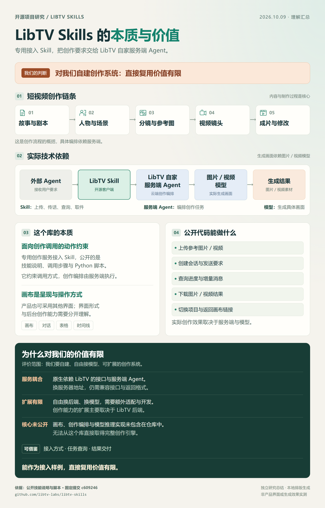

# 019 · LibTV Skills：专用创作服务接入与有限复用价值

[返回总索引](../../README.md) · [研究记录](research.md) · [网页说明](web/README.md) · [原仓库](https://github.com/libtv-labs/libtv-skills)

## 全面摘要

面向外部 AI Agent 的 LibTV 专用创作服务接入 Skill，以技能说明、调用步骤和 Python 标准库脚本完成素材上传、会话消息、增量查询、项目切换与图片／视频结果下载。梳理故事与剧本、人物与场景、分镜与参考图、视频镜头、成片与修改的创作链，区分操作约束、LibTV 自家服务端 Agent 的编排、底层图片／视频模型的生成与画布呈现；拆解 1 个 Skill、5 个操作脚本和 1 个公共接口模块、Bearer 鉴权、异步会话、结果解析与平台耦合。沿用原始总结图，评估短剧、广告、MV、产品展示等官方描述场景、现有用户接入价值与我们自建系统的有限复用价值；说明兼容后端、解析泛化、任务恢复、参数与版本追踪及独立人物／分镜／剪辑系统等扩展的条件和成本。研究固定源码、MIT 许可与用户反馈，明确云端核心未公开、扩展方案未实现、未进行真实生成或成片质量验证。

## 理解引导图

*原样沿用 2026-10-09 的完整总结图：本地 HTML/CSS 排版与 Chromium 截图，非上游产品界面或真实生成效果。PNG 为 2400 × 3748，原文件 SHA-256 已记录于 [来源记录](assets/guide-provenance.json)，保留 [可编辑排版源](assets/libtv-summary.html)。*

## 核心理解

这个公开库是给外部 Agent 使用、连接 LibTV 自家服务端创作 Agent 的专用接入 Skill。公开的是调用步骤、操作约束和 Python 接口脚本。故事、剧本、人物、场景、分镜、视频镜头与成片构成创作链；画布是呈现与操作方式。服务端组织创作，图片／视频模型实现具体画面。

对我们自建、自由接模型和精细控制制作的系统，直接复用价值有限。可参考会话、素材传输、增量查询与结果交付；核心编排、人物／镜头管理、模型适配与剪辑执行仍需另行开发。评价限定为这个公开库的复用价值，不代表 LibTV 产品对所有用户没有价值。

## 能力与证据层级

| 类别 | 能力 | 层级 | 模块 | 边界 |
| --- | --- | --- | --- | --- |
| 素材接入 | 图片／视频上传、素材 URL | 公开脚本 | upload_file.py | 支持类型与格式检查仍有边界；不包含上传本地音频的操作脚本。 |
| 会话与要求 | 创建、续用会话，发送自然语言 | 公开脚本 | create_session.py | 提供高层创作要求，细粒度操作依赖后端理解与能力。 |
| 进展与项目 | 消息查询、增量 seq、切换绑定项目 | 公开脚本 | query_session.py / change_project.py | 不是完整项目 CRUD，也不是客户端持久任务管理。 |
| 成果交付 | 批量下载图片／视频、画布链接 | 公开脚本 | download_results.py / _common.py | 结果 URL 是产物入口；文件是否完整、画面是否正确要另行验收。 |
| 图片与视频创作 | 生成、编辑、风格迁移、视频续写 | 官方能力描述 | SKILL.md | 通过消息请求 LibTV 云端执行，仓库没有公开这些算法实现。 |
| 复杂内容制作 | 短剧、MV、TVC、产品展示、分镜 | 官方能力描述 | SKILL.md | 剧本到成片是平台能力描述；不能据此保证一条要求稳定产生可交付成片。 |

## 模块

### 技能说明与操作约束

[skills/libtv-skill/SKILL.md](https://github.com/libtv-labs/libtv-skills/blob/c609246c1eca69f6bc129bcbb5d64c36734e4a4a/skills/libtv-skill/SKILL.md)

- 职责：决定何时触发、如何上传与传话、怎样查询和交付。
- 机制：用文本要求外部 Agent 保留用户原始意图，把创作拆解交给服务端；规定 8 秒轮询、增量 seq、超时和展示规则。
- 边界：这些流程规则主要由宿主 Agent 执行，仓库没有完整持久任务调度器；文本要求不等于硬性程序门禁。

### 公共 API 客户端

[skills/libtv-skill/scripts/_common.py](https://github.com/libtv-labs/libtv-skills/blob/c609246c1eca69f6bc129bcbb5d64c36734e4a4a/skills/libtv-skill/scripts/_common.py)

- 职责：统一服务地址、Bearer 鉴权、HTTP 请求及项目链接。
- 机制：Python urllib 发起 POST／GET，解析响应 data；默认服务 im.liblib.tv，可由环境变量改地址。
- 边界：会话端点和返回字段采用 LibTV 协议；画布链接前缀固定。改地址需要新服务兼容协议。

### 创建会话与发送要求

[skills/libtv-skill/scripts/create_session.py](https://github.com/libtv-labs/libtv-skills/blob/c609246c1eca69f6bc129bcbb5d64c36734e4a4a/skills/libtv-skill/scripts/create_session.py)

- 职责：提交消息，或在已有 session 中继续提出要求。
- 机制：接受 message 和可选 session-id，返回 sessionId、projectUuid 与 projectUrl。
- 边界：未传 message 时只创建／绑定会话；公开 CLI 没有独立的模型、seed、镜头或时间线参数。

### 增量消息查询

[skills/libtv-skill/scripts/query_session.py](https://github.com/libtv-labs/libtv-skills/blob/c609246c1eca69f6bc129bcbb5d64c36734e4a4a/skills/libtv-skill/scripts/query_session.py)

- 职责：读取消息，用于宿主轮询生成进展。
- 机制：用 afterSeq 拉取后续消息，可根据 project-id 附加画布 URL。
- 边界：脚本每次只查询一次。8 秒轮询、3 分钟超时是 Skill 约定，不能推断服务端任务在超时后被取消。

### 参考素材上传

[skills/libtv-skill/scripts/upload_file.py](https://github.com/libtv-labs/libtv-skills/blob/c609246c1eca69f6bc129bcbb5d64c36734e4a4a/skills/libtv-skill/scripts/upload_file.py)

- 职责：把本地图片／视频变成服务端可访问的素材 URL。
- 机制：根据扩展名猜 MIME，构造 multipart 请求，读取服务返回的 url。
- 边界：文档要求小于 200 MB；当前客户端未实现文件大小检查，整个文件读入内存。MIME 推断也不是内容格式检测。

### 切换绑定项目

[skills/libtv-skill/scripts/change_project.py](https://github.com/libtv-labs/libtv-skills/blob/c609246c1eca69f6bc129bcbb5d64c36734e4a4a/skills/libtv-skill/scripts/change_project.py)

- 职责：请求切换 accessKey 当前绑定的项目。
- 机制：调用 change-project 接口，返回新 projectUuid 和画布链接。
- 边界：当前脚本不接收目标项目 UUID；不能据“切换”推断任意项目选择、列出或删除能力。

### 结果解析与批量下载

[skills/libtv-skill/scripts/download_results.py](https://github.com/libtv-labs/libtv-skills/blob/c609246c1eca69f6bc129bcbb5d64c36734e4a4a/skills/libtv-skill/scripts/download_results.py)

- 职责：从消息提取生成媒体，保存到本地。
- 机制：解析 tool 消息的 task_result 与 assistant 文本 URL；自动提取结果去重，默认 5 个下载线程，可指定前缀和目录。
- 边界：assistant 文本正则限定 LibTV 域名和部分后缀；tool 字段或手动 URL 路线不受同一正则限制。没有媒体完整性验收或断点恢复，下载部分失败会返回 errors。

## 实现原理

接入链：外部 Agent → LibTV Skill → LibTV 自家服务端 Agent → 图片／视频模型 → 生成结果。

1. **上传参考素材**：用户给了图片／视频时，先上传取得可访问 URL；纯文字要求可跳过。

2. **发送创作要求**：将要求和素材 URL 发送到会话接口，保留 sessionId 与 projectUuid。

3. **云端编排与生成**：服务端 Agent 组织创作并调用模型；这是官方描述，内部实现不在公开库。

4. **查询消息与结果**：宿主按 Skill 轮询，利用 seq 增量读取消息与结果 URL。

5. **下载并交付**：提取图片／视频、下载本地文件，并提供项目画布链接继续查看。

| 方法 | 接口 | 输入 | 输出 | 用途 |
| --- | --- | --- | --- | --- |
| POST | /openapi/session | message、sessionId（均可选） | data.sessionId、data.projectUuid | 创建／绑定会话，或提交追加消息 |
| GET | /openapi/session/{sessionId} | afterSeq（可选查询参数） | data.messages | 单次查询消息，供宿主轮询 |
| POST | /openapi/session/change-project | 空 JSON 对象 | data.projectUuid | 切换当前密钥绑定项目 |
| POST | /openapi/upload | multipart：file、accessKey | data.url | 上传参考图片／视频 |

LIBTV_ACCESS_KEY 用于 Bearer 鉴权。默认 https://im.liblib.tv，可通过 OPENAPI_IM_BASE 或 IM_BASE_URL 改地址；仍需兼容端点、鉴权、data、messages 与媒体结果。项目画布链接固定指向 LibTV。

## 内容结构与界面

1. **故事与剧本**：叙事目标、人物动机、情节与对白。它决定内容要表达什么。

2. **人物与场景**：角色外观、场景设定、参考素材和需要保持的约束。

3. **分镜与参考图**：把情节转成镜头：景别、动作、运镜、构图、时长和声音。

4. **视频镜头**：图片／视频模型执行生成，逐镜头挑选结果与修正偏差。

5. **成片与修改**：组织镜头、节奏、字幕与声音，检查后局部重做与导出。

创作链是我们的概括，不能视为这些算法已在客户端实现。画布适合素材关系，表格适合批量镜头检查，时间线适合节奏，对话适合表达要求；换界面不自动增加后台创作能力。

## 使用场景

- **短剧与短漫剧**：请求剧本、分镜和视频素材，继续提出修改。 条件：依赖服务端编排；人物一致性、情节与镜头连续性需实际验证。

- **产品展示与广告**：基于参考图片提出展示片或宣传片要求。 条件：产品外观、文字、卖点和使用素材的授权需人工确认。

- **MV 与创意短片**：以主题、音乐或风格提出镜头创作要求。 条件：官方描述不等于客户端支持所有音频输入；同步、节奏和最终剪辑需确认。

- **视觉预演与分镜探索**：快速查看方向、参考构图、镜头候选。 条件：更适合容许迭代的草稿；精确复现参数与品牌规范需要更细的控制接口。

## 对我们的价值

- **已有 LibTV 用户，让 Agent 帮忙操作（用途明确）**：上传、发送、查询和取件可以纳入自然语言对话，减少重复手动操作。实际收益取决于云端效果、费用与服务稳定性，本次未量化。

- **我们研究专用 Skill 的接口组织（可作小样例）**：可以学习外部 Agent 与专业服务端的分工，以及会话 ID、增量消息、素材 URL 和结果交付的串联。脚本规模较小，参考深度有限。

- **我们自建可控、多模型创作系统（直接复用价值有限）**：故事／人物／镜头管理、可见编排、参数控制、局部重做、版本与剪辑等核心实现未公开。供应商耦合较强，核心系统仍需另做。

- **我们学习视频生成算法或训练模型（缺少所需实现）**：公开库没有模型权重、训练、推理算法或性能基准。模型能力来自云端服务，不能从接入脚本推出模型创新。

## 耦合与扩展条件

| 方式 | 条件 | 范围 |
| --- | --- | --- |
| 更换外部 Agent | 宿主能读取技能说明、执行 Python 脚本并满足授权条件 | 可以使用现有 Skill；不同宿主的技能加载与展示方式需要适配。 |
| 修改服务地址 | 设置 OPENAPI_IM_BASE 或 IM_BASE_URL | 只改变请求目标；新服务仍须兼容端点、Bearer 鉴权、字段与消息格式。 |
| 代理转发到 LibTV | 正确转发现有协议与授权 | 仍依赖 LibTV 运行创作任务，没有取得其创作引擎。 |
| 接入独立兼容后端 | 实现会话、项目绑定、上传、消息、任务和结果协议 | 技术上可行，但服务端创作编排、存储和模型调用要自己完成。 |
| 直接换模型 API | 新增协议适配、媒体引用、参数、查询与结果解析 | 当前脚本没有通用供应商插件机制；修改 base URL 无法完成这些工作。 |
| 控制人物／分镜／时间线 | 新增结构化对象、操作接口、版本和执行能力 | 当前公开接口不足以证明支持精细编辑，需要后端新增能力。 |

## 可扩展方向：全部为建议，尚未实施

### 结果解析与文件交付泛化 · 客户端可改

- 基础：现有 tool 结果解析、assistant 正则与下载脚本。
- 需补充：改为明确的媒体清单，兼容域名／后缀，补临时文件、完整性校验、失败退出和重试恢复。
- 边界：能改善取件可靠性；不能增加云端模型或创作能力。

### 显式任务状态与恢复记录 · 客户端＋后端协议

- 基础：会话 ID、增量 seq 和文本轮询约定。
- 需补充：增加 taskId、状态机、检查点、去重与幂等、取消／超时、重启恢复和单任务产物关联。
- 边界：需要后端提供可区分的任务状态；不能把出现某个 URL 当作整项创作完成。

### 模型参数与实际提示词留痕 · 后端需配合

- 基础：当前只发送 message，后端负责编排与提示词。
- 需补充：记录用户要求、最终模型提示词、模型版本、seed、参考素材、生成参数和费用，支持选择或受控 raw 模式。
- 边界：这是我们提出的可控性方案；仓库没有公开稳定 raw 模式或完整参数合同。

### 通用创作服务适配层 · 独立开发

- 基础：可以参考上传、提交、查询与下载的操作分工。
- 需补充：为不同供应商定义 submit／status／cancel／results 合同，显式声明模型参考能力、时长与参数差异。
- 边界：要实现协议映射、错误与费用处理；此库不是现成多供应商 SDK。

### 人物、场景与镜头的可编辑项目 · 独立核心系统

- 基础：我们对创作链的分析，非此仓库的数据模型。
- 需补充：设计角色设定、场景约束、镜头 ID、参考关系、候选版本、审核与局部重做；把修改影响传播到相关产物。
- 边界：核心对象、依赖关系和一致性保障需自己实现与验证。

### 剪辑、质量检查与多种界面 · 独立核心系统

- 基础：内容结构与呈现方式可以分离。
- 需补充：以统一项目数据驱动画布、表格、对话和时间线；增加字幕、音轨、拼接导出与逐镜头人工审核。
- 边界：新界面需要已有业务操作和执行器支撑；画布改版本身不会形成新的生成能力。

## 自建创作对象：设计建议

| 对象 | 建议保存 | 用途 |
| --- | --- | --- |
| 故事／剧本 | 叙事目标、情节、对白、场景顺序、版本 | 内容结构可检查与修改 |
| 人物／场景 | 角色外观、场景设定、参考素材、连续性约束 | 为多个镜头提供共同依据 |
| 镜头／分镜 | 镜头 ID、人物引用、动作、景别、运镜、时长、声音 | 支持定位、选择和单镜头重做 |
| 任务／产物 | 输入素材、实际提示词、模型参数、状态、费用、候选版本 | 可追踪生成过程与失败恢复 |
| 成片／时间线 | 已选镜头、顺序、字幕、音轨、转场、导出设置 | 把素材组织成可交付作品 |

“把第三个镜头改成近景”的完整流程，应定位镜头、保留参考、生成候选、检查连续性、选版并更新成片。镜头 ID、依赖、版本与剪辑能力需要另做。

## 基线、许可与运行边界

- 固定 main 提交：[c609246c1eca69f6bc129bcbb5d64c36734e4a4a](https://github.com/libtv-labs/libtv-skills/commit/c609246c1eca69f6bc129bcbb5d64c36734e4a4a)；提交日期 2026-03-18，2026-10-12 复核 HEAD 仍一致。

- 上游 MIT，Copyright (c) 2026 libtv-labs；[许可原文](licenses/upstream-MIT.txt)保留。网页与说明原创，未引入上游执行代码。

- 网页环境：Windows／PowerShell；Node.js 22.15.0；HTML/CSS/JavaScript 与 Node 标准库，无根级依赖。

- 上游文档声明 Python 3.6+；本次只研究源码，没有验证所有 Python 版本、配置密钥或实际生成。

- 官网能力、用户反馈、研究判断与网页交互验证分别记录。未实测模型、人物一致性、完整成片、商业效率或费用。

- 官网：[LibTV](https://www.liblib.tv/)；组织：[libtv-labs](https://github.com/libtv-labs)。

## 来源

- [项目定位与安装条件](https://github.com/libtv-labs/libtv-skills/blob/c609246c1eca69f6bc129bcbb5d64c36734e4a4a/README.md)：专用 OpenAPI 接入 Skill，Python 标准库、密钥、安装与五类操作。README 的 Python 3.6+ 是上游声明，本次没有逐版本兼容实测。

- [操作约束与云端能力描述](https://github.com/libtv-labs/libtv-skills/blob/c609246c1eca69f6bc129bcbb5d64c36734e4a4a/skills/libtv-skill/SKILL.md)：外部 Agent 负责传话，服务端负责创作编排；轮询、超时与展示规则是文本协议。

- [接口协议与服务耦合](https://github.com/libtv-labs/libtv-skills/blob/c609246c1eca69f6bc129bcbb5d64c36734e4a4a/skills/libtv-skill/scripts/_common.py)：可配置 IM 地址、固定会话端点、Bearer 鉴权、data 字段与画布链接前缀。

- [公开参数范围](https://github.com/libtv-labs/libtv-skills/blob/c609246c1eca69f6bc129bcbb5d64c36734e4a4a/skills/libtv-skill/scripts/create_session.py)：message 与 session-id；响应标识与项目链接。

- [单次查询与增量读取](https://github.com/libtv-labs/libtv-skills/blob/c609246c1eca69f6bc129bcbb5d64c36734e4a4a/skills/libtv-skill/scripts/query_session.py)：after-seq 与 project-id；脚本没有常驻轮询调度。

- [素材传输与检查边界](https://github.com/libtv-labs/libtv-skills/blob/c609246c1eca69f6bc129bcbb5d64c36734e4a4a/skills/libtv-skill/scripts/upload_file.py)：multipart 上传、MIME 推断、一次读入文件；客户端没有 200 MB 大小校验。

- [项目切换范围](https://github.com/libtv-labs/libtv-skills/blob/c609246c1eca69f6bc129bcbb5d64c36734e4a4a/skills/libtv-skill/scripts/change_project.py)：无目标 UUID 参数，切换密钥当前绑定项目。

- [结果解析与交付边界](https://github.com/libtv-labs/libtv-skills/blob/c609246c1eca69f6bc129bcbb5d64c36734e4a4a/skills/libtv-skill/scripts/download_results.py)：tool 的 task_result、assistant 的限定域名正则、并行下载和 errors。

- [上游 MIT 许可](https://github.com/libtv-labs/libtv-skills/blob/c609246c1eca69f6bc129bcbb5d64c36734e4a4a/LICENSE)：Copyright (c) 2026 libtv-labs；本项目未引入上游执行代码，保留许可原文供研究查阅。

- [Issue #12](https://github.com/libtv-labs/libtv-skills/issues/12)：用户对后端改写提示词与可见性的反馈；不是我们实测。

## 网页

[正式阅读地址](https://yydshly.github.io/1009_codex_project/019-libtv-skills/) · [运行与发布说明](web/README.md)

网页提供完整引导图放大／下载、两条流程切换、模块展开、章节导航、来源链接和文档下载。它是研究展示，不调用模型或接收密钥。

## 部署记录

正式网页：[019 · LibTV Skills](https://yydshly.github.io/1009_codex_project/019-libtv-skills/)。

内容提交 [bbd5844](https://github.com/yydshly/1009_codex_project/commit/bbd5844c495124594defaa50f6f8845b9db075c0) 已推送到 main；[Pages 构建与部署](https://github.com/yydshly/1009_codex_project/actions/runs/38241858905)和[仓库验证](https://github.com/yydshly/1009_codex_project/actions/runs/38241857175)均成功。2026-10-12 正式网址 HTTP 200，线上四种视口、导航与交互、原图下载哈希和无 JS 阅读复核通过。详细记录见 research.md。
