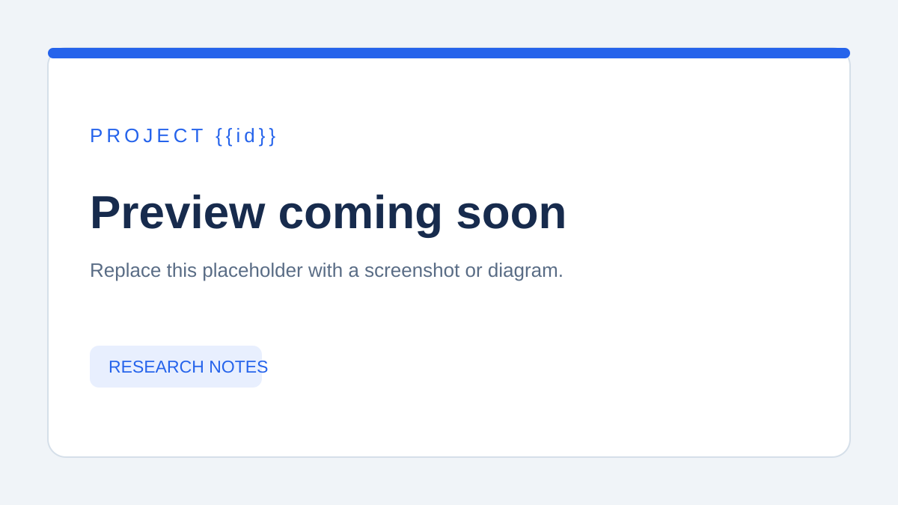

# {{id}} · {{title}}

> {{summary}}

[返回总索引](../../README.md#有序索引) · [研究记录](research.md) · [Web 演示说明](web/README.md)

| 项目 | 信息 |
| --- | --- |
| 原仓库 | [{{source}}]({{source}}) |
| 研究版本 | 待填写 tag / commit |
| 上游许可证 | 待核实并记录 |
| 收录日期 | {{addedAt}} |
| 当前状态 | 待研究；同步更新根目录 `projects.json` |
| 在线演示 | 尚未部署 |

## 为什么研究

{{summary}}

<!-- 补充适用场景、独特之处和希望回答的问题。 -->

## 项目预览

*当前为占位图。请替换为实际截图，并在此说明界面内容；同时更新总索引中的图片路径与说明。*

## 运行与复现

待研究后填写：环境版本、安装命令、启动命令、最小验证步骤及必要配置。敏感配置使用 `.env.example` 描述，不提交真实凭据。

## 关键发现

待实验与源码阅读后补充；完整过程见[研究记录](research.md)。

## 来源与修改

研究来源：[原 GitHub 仓库]({{source}})。引入代码时补充上游 LICENSE、版权声明和本地修改范围。
